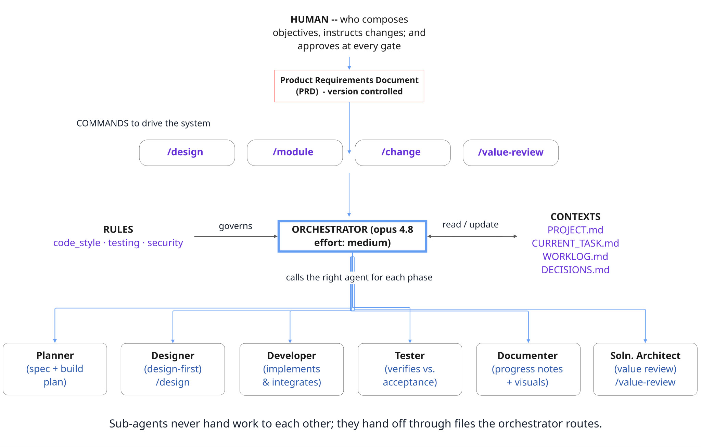
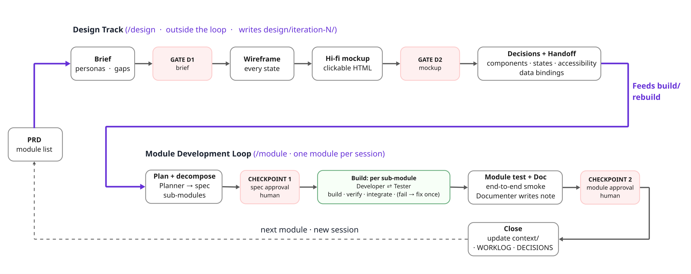
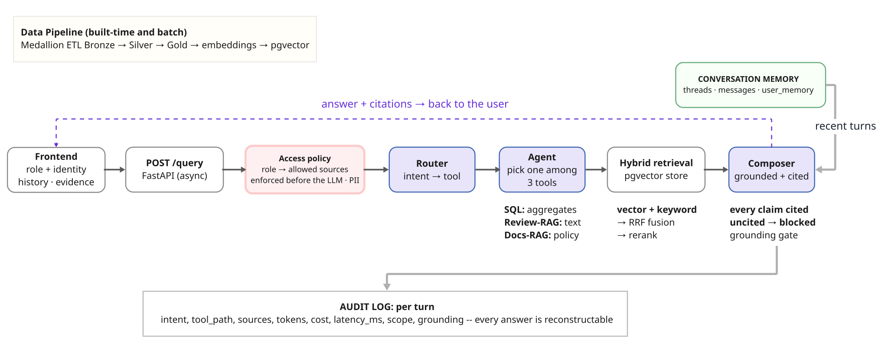
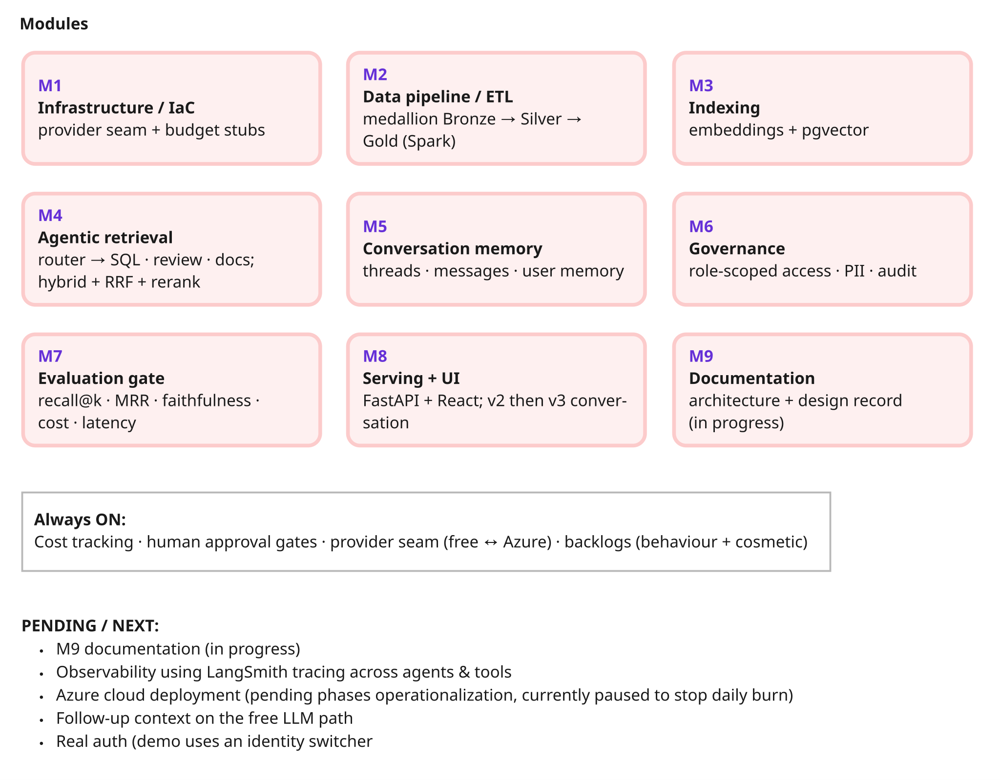
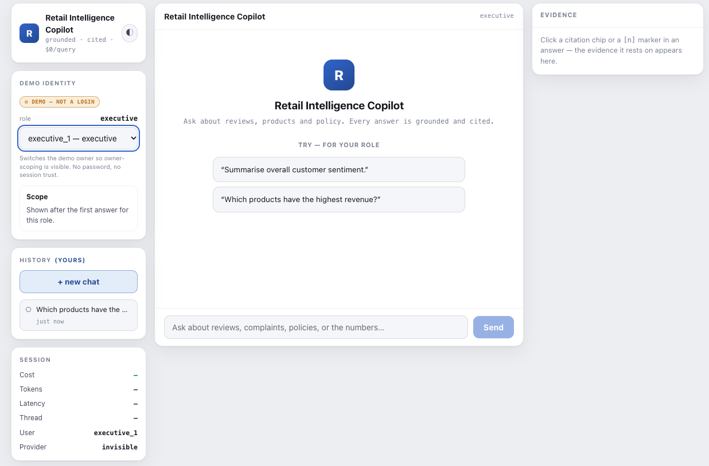

# Retail Customer Intelligence Copilot

**The problem.** Retail teams sit on millions of customer reviews and sales records
they can't actually query; the insight is trapped, and getting an answer today means
waiting on a data analyst.

**The idea.** Let anyone, be it support or marketing or an executive — just ask in plain English and get an answer in seconds. Under the hood it's **agentic RAG**: a **router** reads each question and picks the right tool: text-to-SQL for numbers, semantic review search for themes, policy docs for how-to — so you never get a hallucinated statistic. Retrieval is **hybrid** (vector + keyword, fused and reranked), and a **composer** returns one answer where **every claim is cited**.

**What we aim to get.** Enterprise-grade from day one: **access-controlled** (you only see your scope), fully **auditable**, with **groundedness enforced before the model ever speaks**. It currently runs **fully local at $0**, and the same code can switch to Azure behind one flag — reliable, governable, and scalable from the start.

`Python · FastAPI · React · pgvector · Spark/Delta · Ollama ↔ Azure OpenAI`
 · full spec in **[`PRD.md`](./PRD.md)**

---

## 1 · How I run the build

One **orchestrator** directs six specialist AI sub-agents through a checkpointed
loop — the way a small engineering team ships. Commands trigger the work, rules
govern it, and context files carry memory between sessions.

## 2 · The process

Every module follows the same loop — **spec → build → test → document → close** —
with two **human approval gates**. A design track runs beside it on demand and feeds
rebuilds. Nothing passes a gate on its own.

## 3 · The running system

The agentic-RAG pipeline for one question. Access policy is enforced **before the
LLM**; retrieval fuses vector + keyword results (RRF, optional rerank); the composer
**blocks any uncited claim**; and the whole turn is written to an audit log.

## 4 · Modules & status

Nine modules, built one per session — eight **done**, documentation in progress.
Four concerns run across all of them; the roadmap (observability, cloud deployment)
is marked honestly.

---

## The data

Built on the **real [Amazon Reviews 2023](https://huggingface.co/datasets/McAuley-Lab/Amazon-Reviews-2023)**
corpus (McAuley-Lab) across **15 product categories**, plus a small authored
knowledge base. Reviewer identities are hashed at ingestion (PII redaction). Each
source feeds one of the three retrieval tools:

| Source | Served by | Scale |
|---|---|---|
| Reviews → **structured** table | SQL agent — aggregates & trends | 15 categories × up to **100K** = ~**1.5M rows** |
| Reviews → **review text** | Review-RAG — semantic search | 15 categories × up to **15K** = ~**225K passages** |
| **Policy & manuals** (authored) | Docs-RAG — policy Q&A | **22 docs** (18 markdown + 4 PDF) |

Built by a **medallion ETL** (Bronze → Silver → Gold, Delta) in Spark, then embedded
into pgvector.

---

## The interface

A three-pane chat: a demo **identity switcher** and owner-scoped **history** on the
left, the grounded, cited conversation in the middle, and a **click-to-inspect
evidence** panel on the right. Per-turn **cost, tokens and latency** stay in view.
*(UI is a work in progress — actively being refined.)*

---

## Run it from the beginning (Claude Code)

The whole system runs locally at **$0** — no cloud account required.

1. Clone the repo and install **[Claude Code](https://docs.claude.com/en/docs/claude-code)**.
2. Start local services: `docker compose -f infra/docker-compose.yml up -d` (Postgres + pgvector),
   and an [Ollama](https://ollama.com) model for the free LLM.
3. Open a session and skim **[`PRD.md`](./PRD.md)** (what) + **[`context/PROJECT.md`](./context/PROJECT.md)** (where we are).
4. Say **"build M1"** (or **"next"**). The orchestrator runs the loop and **stops for
   your approval** at each checkpoint — you can watch every phase.

Going to the cloud is optional and **cost-gated** (see [`COST.md`](./COST.md)); one
env flag swaps the free stack for Azure. New here? Start with **[`docs/GUIDE.md`](./docs/GUIDE.md)**.
