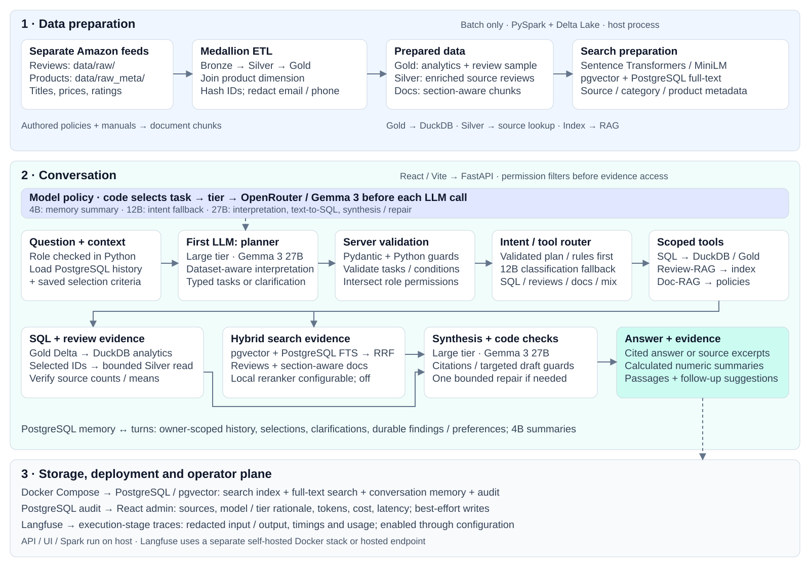
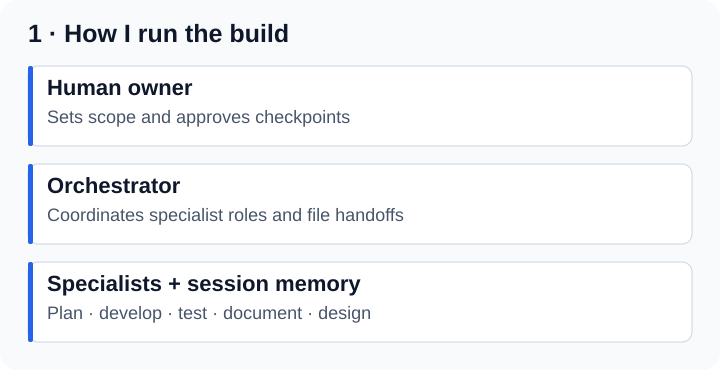
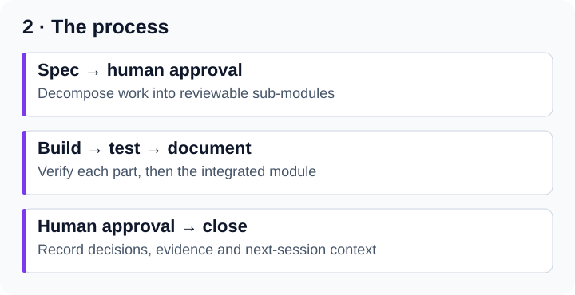
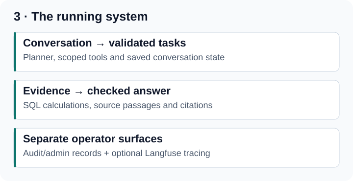
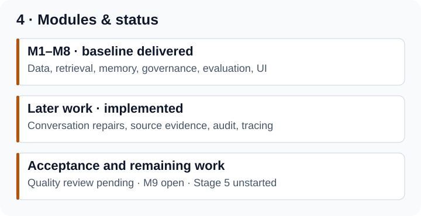

# Retail Customer Intelligence Copilot

**Conversational analytics and retrieval-augmented generation over retail reviews,
product metadata and policy documents.**

**Why I built it.** Retail teams need answers across customer feedback, product
records and policies without waiting for an analyst. This copilot turns plain-language
questions into scoped SQL, review search and document retrieval, then returns
calculated results and cited evidence.

**What I engineered.** A Spark/Delta medallion pipeline, task-aware LLM routing,
text-to-SQL with DuckDB, hybrid RAG with pgvector, PostgreSQL conversation memory,
and Langfuse tracing — connected through a FastAPI API and React interface.

**Watch the demo:** role-scoped queries, supporting evidence, admin audit and Langfuse traces.

<table align="center" width="800">
<tr><td>

https://github.com/user-attachments/assets/019bc1bd-f163-44f9-9db4-29539c38f7e0

</td></tr>
</table>

**Explore:** [How it works](#how-an-answer-is-produced) ·
[RAG engineering](#rag-engineering-decisions) · [Model routing](#model-routing) ·
[Data](#the-data) · [Verification](#whats-verified-and-what-isnt) ·
[How I built it](#how-i-built-it) · [Run locally](#run-locally)

**Stack:** Python 3.12 · FastAPI · React / TypeScript / Vite · PySpark / Delta Lake ·
DuckDB · PostgreSQL / pgvector · Sentence Transformers · OpenRouter / Gemma 3 ·
Langfuse · Docker Compose

## What you can ask

| Question | Evidence path |
|---|---|
| “Which five Electronics products have the lowest average rating, with at least 50 reviews?” | SQL over all rated rows for each product; calculated ranking. |
| “What do reviewers dislike about those products?” | Selected product IDs carried forward; bounded Silver review lookup with count/mean verification. |
| “What is the average recorded price in Electronics?” | Product-level SQL, with missing prices disclosed and excluded. |
| “What is the policy for returning a damaged item?” | Retrieval over authored policy documents with inspectable passages. |
| “Show the lowest-rated products and explain the return policy.” | Independent scoped tasks, clarification when needed, then combined evidence and citations. |

Follow-ups retain selection criteria; missing definitions trigger clarification.
Owner-scoped history and an evidence panel expose redacted source passages.
The identity selector is a **demo control**, not production authentication.

## How an answer is produced

Three connected layers keep batch processing, interactive answers and operator
inspection distinct:

*Click for the full-size diagram. [Mermaid source](docs/diagrams/answer-flow.mmd).*

1. **Batch ETL — PySpark + Delta Lake.** `data/raw/` reviews and `data/raw_meta/`
   product attributes feed Bronze → Silver → Gold, with product enrichment and PII
   handling. Policies/manuals are chunked separately.
2. **Context + models — FastAPI, PostgreSQL, OpenRouter.** Load role-scoped memory;
   code selects a model tier per task. The first LLM task is normally large-tier
   planning from the question, capabilities and saved criteria.
3. **Validation + routing — Pydantic and Python.** Validate typed tasks and intersect
   filters with server-owned permissions. Route to SQL/review/docs agents using the
   plan or rules, with medium-tier classification as a fallback.
4. **Evidence + answer — DuckDB and hybrid RAG.** Query Gold, search reviews/docs,
   or verify selected-product Silver reviews. Large-tier synthesis adds citations;
   code checks drafts, permits one repair, then falls back to excerpts. Numeric-only
   summaries come from calculations.
5. **Persistence + inspection — PostgreSQL and Langfuse.** Save history, criteria,
   clarifications and durable memory. Audit/admin views and stage traces expose
   models, routing, sources, tokens, cost and latency outside customer chat.

**Where it runs:** repo **Docker Compose → PostgreSQL/pgvector** for search,
memory and audit; **host → FastAPI, React/Vite and batch Spark**. Langfuse uses a
**separate Docker stack or hosted endpoint**. Tracing is shown in the demo and
config-enabled (off in a fresh clone); audit writes are best-effort.

## RAG engineering decisions

| Concern | Implementation · tools and tradeoffs | Inspect |
|---|---|---|
| **Data preparation and enrichment** | **PySpark + Delta Lake** medallion ETL joins product metadata and produces separate analytics/search outputs. Batch processing stays outside the query path. | [ETL](data/etl/pipeline.py) · [Product dimension](data/etl/product_meta.py) |
| **Planning and tool use** | **Pydantic** typed plans dispatch SQL/review/docs agents; **OpenRouter + Gemma 3** tiers match model capacity to each task. Python validates plans before execution. | [Planner](backend/agents/conversation.py) · [Router](backend/agents/router.py) · [Model policy](backend/agents/model_policy.py) |
| **Hybrid retrieval and reranking** | **Sentence Transformers MiniLM + pgvector + PostgreSQL full-text search**, fused with **reciprocal-rank fusion (RRF)**. Local cross-encoder reranking is configurable, off by default. | [Hybrid search](backend/retrieval/hybrid.py) · [Reranking](backend/retrieval/rerank.py) |
| **Chunking and source metadata** | One chunk per sampled review; section-aware policy/manual chunks retain source, category and product metadata. Token-overlap chunks and versioned provenance remain an opt-in, fixture-tested path. | [Chunking](backend/retrieval/chunking.py) · [Evidence foundations](docs/modules/M3_answer_quality_stage3.md) |
| **Structured analytics + source evidence** | **DuckDB over Delta** uses scoped templates and checked generated SQL. Product-level prices avoid review weighting; bounded Silver reviews reconcile evidence with SQL-selected products. | [SQL agent](backend/agents/sql_agent.py) · [Source lookup](backend/retrieval/source_reviews.py) |
| **Grounding and citations** | **Python checks** combine calculated summaries, inspectable citations and targeted draft guards. One bounded repair precedes source-excerpt fallback; citation validity alone does not prove factual support. | [Grounding](backend/governance/grounding.py) · [Composer](backend/agents/composer.py) |
| **Conversation state and memory** | **PostgreSQL** stores owner-scoped history, findings/preferences, selections and clarifications for follow-ups. Memory provides context, never cited evidence. | [Memory manager](backend/memory/manager.py) · [Persistence](backend/memory/store.py) |
| **Access control and privacy** | **Server-owned Python policies** constrain SQL/retrieval before synthesis; unknown roles are denied. Ingestion hashes reviewer IDs and redacts email/phone patterns. Demo identity selection is not authentication. | [Access policy](backend/governance/policy.py) · [PII handling](backend/governance/pii.py) |
| **Auditability and observability** | **Langfuse** stage traces and **PostgreSQL audit / React admin** expose redacted evidence, model/tool choices, routing rationale and usage. Audit writes are best-effort. | [Tracing](backend/observability/tracing.py) · [Audit](backend/governance/audit.py) · [Admin UI](frontend/src/admin) |
| **Evaluation and cost control** | Recall@k/MRR, grounding, cost/query and p50/p95 latency harness; **pytest + GitHub Actions** checks. Per-turn token/cost caps bound execution; CI quality evaluation currently covers docs. | [Evaluation](backend/eval) · [Cost ledger](backend/app/cost.py) · [CI](.github/workflows/ci.yml) |

## Model routing

**The demonstrated hosted path uses open-weight Gemma 3 models through OpenRouter.**
A code-owned **task → tier → configured model** policy selects each call's model;
simple controls and supported follow-ups can bypass LLM calls.

| Task | Tier / default model | Selection reason |
|---|---|---|
| Summarize a turn for memory | Small · **Gemma 3 4B** | Lightweight background task; lowest measured latency/cost. |
| Classify intent when needed | Medium · **Gemma 3 12B** | Structured classification; measured improvement over the small tier. |
| Interpret and plan the request | Large · **Gemma 3 27B** | Compound requests, context and clarification; output validated by the server. |
| Generate SQL when needed | Large · **Gemma 3 27B** | Runnable SQL and exact structured output. |
| Synthesize or repair an answer | Large · **Gemma 3 27B** | Combine evidence; calculations and draft checks remain code-owned. |

The [six-model study](docs/model-comparison.md) informed the policy; later planning/
synthesis choices are engineering decisions, not new benchmark wins. Tier models
are configurable through `OPENROUTER_MODEL_{SMALL,MEDIUM,LARGE}`. Local
OpenAI-compatible and Azure OpenAI adapters are also available; per-task switching
applies to OpenRouter. The demo uses open-weight models.
[Routing policy](backend/agents/model_policy.py) · [Adapters](backend/agents/llm.py).

## The data

Built on the real **[Amazon Reviews 2023](https://huggingface.co/datasets/McAuley-Lab/Amazon-Reviews-2023)**
corpus from McAuley Lab across **15 product categories**, plus authored policies
and manuals. Recorded local snapshot, documented November 3, 2026:

| Source / serving layer | Recorded scale | Used for |
|---|---:|---|
| Gold structured reviews + joined product metadata | **911,308 reviews / 645,448 category-product pairs** | Ratings, counts, product discovery and recorded prices. |
| Sampled review index | **225,000 chunks / 191,007 products** | Semantic and keyword review search. |
| Authored knowledge base | **22 source documents / 79 indexed chunks** | Policy and manual questions. |
| Silver source reviews | Bounded reads for selected products | Evidence where SQL-selected products lack sampled index coverage. |

**Coverage matters:** the sampled index covers **29.59%** of SQL category-product
pairs. Verified Silver lookup supports selected-product explanations; review examples
do not establish complaint prevalence. There are **no sales/revenue transactions**;
prices are recorded metadata with explicit missing values. This corpus is not
bundled with a fresh clone.

## What's verified, and what isn't

- **Tested.** Backend test suite (last local run: 339 passed, 45 skipped where a
  live DB/LLM key wasn't available), plus lint/format and a frontend build, all in CI.
- **Real-data demo.** Supported paths have end-to-end checks; rejected drafts can
  fall back visibly to source excerpts. Overall answer-quality review remains open.
- **Limits.** Full-corpus recall, arbitrary generated SQL quality, production auth
  and cloud deployment are not claimed.

Citation checks do not prove factual support; CI's quality evaluation covers docs,
not complete conversational quality. [Quality report](docs/answer-quality-status.md) ·
[Acceptance evidence](docs/testing/acceptance/README.md) ·
[Test methodology](docs/testing/unit-testing.md).

## How I built it

Development uses a human-led orchestrator, specialist AI roles, file-based handoffs
and explicit approval gates. Specs, tests and documented decisions keep
AI-assisted implementation reviewable.

<table>
  <tr>
    <td width="50%" valign="top">
      
      
<a href="CLAUDE.md">Orchestration rules</a> · <a href="docs/img/agentic_architecture.svg">Detailed operating model</a>

    </td>
    <td width="50%" valign="top">
      
      
<a href="docs/GUIDE.md">Developer guide</a> · <a href="design/README.md">Design iterations</a>

    </td>
  </tr>
  <tr>
    <td width="50%" valign="top">
      
      
<a href="docs/answer-quality-status.md#what-executes-now">Runtime details</a> · <a href="PRD.md">Product and architecture spec</a>

    </td>
    <td width="50%" valign="top">
      
      
<a href="docs/modules/README.md">Implementation notes</a> · <a href="context/PROJECT.md">Milestones and acceptance status</a>

    </td>
  </tr>
</table>

## Run locally

The current local route uses Python, Node, Java/Spark for batch preparation,
PostgreSQL/pgvector and a configured model endpoint. A fresh clone includes code,
a **40-row sample and authored documents**; the operationalized review corpus,
Delta lake, vector store, model cache and secrets are excluded.

1. Follow the **[local setup guide](data-pipeline-setup/local/LOCAL_SETUP.md)** to
   install dependencies and configure your own ignored `backend/.env` from
   [the template](backend/.env.example).
2. Download reviews **and product metadata** (`data/raw/`, `data/raw_meta/`),
   build the lake and indexes, then start the API and UI as described in the guide.
   Spark/ETL and embedding are preparation steps; reuse the prepared stores for
   subsequent application launches.
3. Open the frontend at `http://localhost:5173` and try the questions above using
   an appropriate demo role.

Choose **OpenRouter/Gemma 3** for the demonstrated hosted path, a **local
OpenAI-compatible endpoint** for local inference, or the configured **Azure** path.
Hosted generation requires an explicit opt-in; local models require downloads and
suitable hardware. Enable [Langfuse tracing](data-pipeline-setup/local/LOCAL_SETUP.md#b8--observability-with-langfuse-optional)
to inspect execution. The application is not yet packaged as a one-command Docker launch.

For development without the corpus: [isolated tests](docs/testing/unit-testing.md).
For cloud setup: [runbook](data-pipeline-setup/cloud/CLOUD_SETUP.md) · [spend ledger](COST.md).

## Further reading

| You want to… | Read |
|---|---|
| Understand the full product intent | [PRD](PRD.md) |
| Inspect evidence coverage, repairs and known failures | [Quality report](docs/answer-quality-status.md) |
| Trace implementation decisions | [Module notes](docs/modules/README.md) · [Decisions](context/DECISIONS.md) |
| Explore the interface design | [Design history](design/README.md) |
| Understand evaluation and model selection | [Acceptance artifacts](docs/testing/acceptance/README.md) · [Model study](docs/model-comparison.md) |
| Extend or resume development | [Developer guide](docs/GUIDE.md) · [Current task](context/CURRENT_TASK.md) · [Resume handoff](context/RESUME_NEXT_SESSION.md) |
