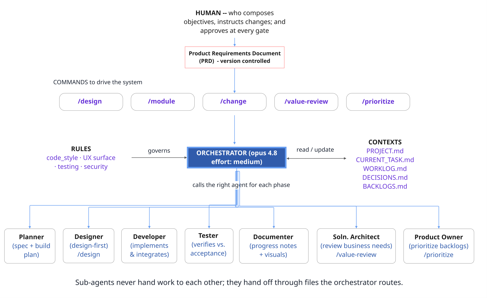
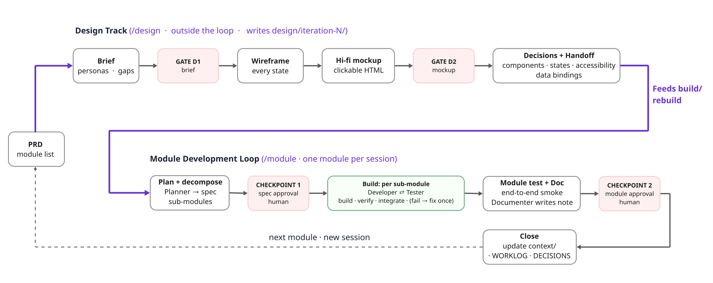
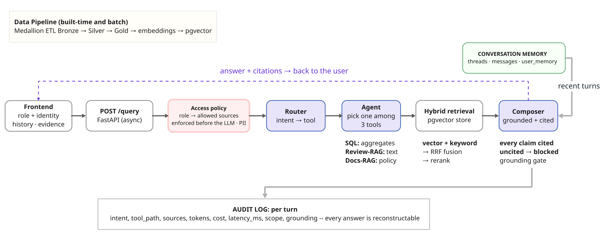
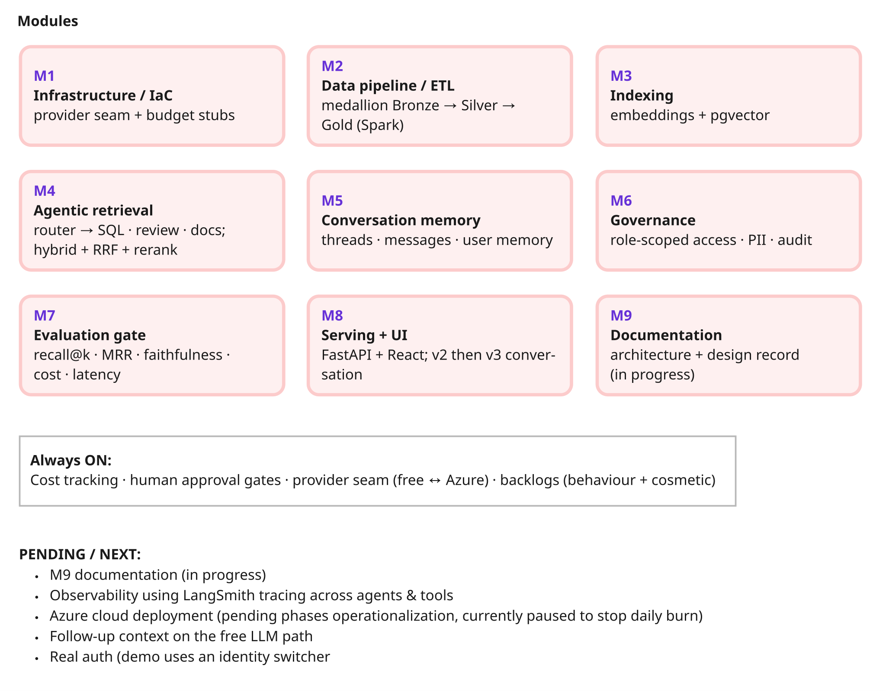
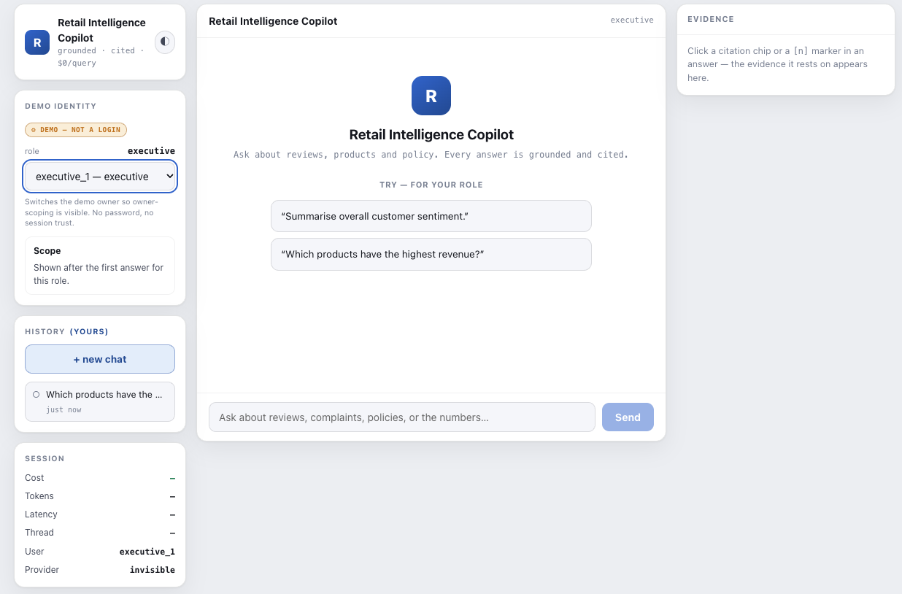

# Retail Customer Intelligence Copilot

**The problem.** Retail teams sit on millions of customer reviews and sales records
they can't actually query; the insight is trapped, and getting an answer today means
waiting on a data analyst.

**The idea.** Let support, marketing and executives ask about customer reviews,
product ratings, recorded prices and policy documents in plain language. A
capability-aware conversation planner resolves the request, then scoped SQL/review/
document tools supply evidence for the answer. Access filters, calculated summaries,
citations and draft checks reduce known failures; they do not guarantee that every
model claim is correct.

**Current status (2026-11-03).** M1–M8 are the historical baseline. Answer-quality
remediation is implemented on `plan/answer-quality-remediation`, with review and
full-quality acceptance still pending. Read the
[consolidated status](docs/answer-quality-status.md),
[current task](context/CURRENT_TASK.md) and
[next-session handoff](context/RESUME_NEXT_SESSION.md) before making changes.
Local free-mode execution is supported; hosted OpenRouter/Azure generation is
optional and cost-gated. This dataset does not contain sales/revenue transactions.

`Python · FastAPI · React · pgvector · Spark/Delta · Ollama ↔ Azure OpenAI`
 · full spec in **[`PRD.md`](./PRD.md)**

---

## 1 · How I run the build

One **orchestrator** directs six specialist AI sub-agents through a checkpointed
loop — the way a small engineering team ships. Commands trigger the work, rules
govern it, and context files carry memory between sessions.

## 2 · The process

Every module follows the same loop — **spec → build → test → document → close** —
with two **human approval gates**. A design track runs beside it on demand and feeds
rebuilds. Nothing passes a gate on its own.

## 3 · The running system

The current flow is **conversation planner → validated scoped tasks → router/tools
→ calculated summaries + guarded synthesis → contextual follow-up questions**.
Role permissions are enforced at data access before evidence reaches synthesis;
retrieval uses vector + keyword fusion and optional reranking. Citation and draft
checks can reject output and show source excerpts. They are not entailment proofs.
Per-turn audit/observability records stay on the operator plane.

The diagram below depicts the original pipeline; the
[current flow](docs/answer-quality-status.md#what-executes-now) includes the planner,
source-first selected reviews and additive conversation state.

## 4 · Modules & status

Nine original modules: eight baseline milestones **done**, M9 documentation still TODO.
Later remediation has separate implementation/acceptance status in the handoff.
Four concerns run across all of them; the roadmap (observability, cloud deployment)
is marked honestly.

---

## The data

Built on the **real [Amazon Reviews 2023](https://huggingface.co/datasets/McAuley-Lab/Amazon-Reviews-2023)**
corpus (McAuley-Lab) across **15 product categories**, plus a small authored
knowledge base. Reviewer identities are hashed at ingestion (PII redaction). Each
source feeds one of the three retrieval tools:

| Source | Served by | Scale |
|---|---|---|
| Reviews → **structured** table | SQL — aggregates, prices & discovery | 15-category cap up to1.5M; recorded local snapshot **911,308 reviews /645,448 products** |
| Reviews → **review text** | Sampled review search; selected products can use verified Silver reviews | **225,000 indexed chunks /191,007 products** in recorded snapshot |
| **Policy & manuals** (authored) | Docs-RAG — policy Q&A | **22 source docs**, **79 indexed chunks** in recorded snapshot |

Built by a **medallion ETL** (Bronze → Silver → Gold, Delta) in Spark, then embedded
into pgvector. These dated local counts are not included with a fresh clone. The
sampled index does not cover every SQL product. The remediation changed code, not
the serving corpus; no rebuild/backfill is needed to inspect it.

---

## The interface

A three-pane chat: a demo **identity switcher** and owner-scoped **history** on the
left, the grounded, cited conversation in the middle, and a **click-to-inspect
evidence** panel on the right. Conversation replies include relevant next-question
buttons; source passages can be inspected. **Cost, tokens and latency belong to the
audit/admin view**, not the customer-facing chat. The screenshot is historical.

---

## Run it from the beginning (Claude Code)

The whole system runs locally at **$0** — no cloud account required. A fresh clone ships the
**code, a 40-row sample, and the authored docs**; the real corpus, the medallion lake, `.env`, and
the vector store are gitignored, so you populate them once on your own machine. There are **two
independent tracks**:

**A · Build & inspect the code (module loop).**
1. Clone the repo and install **[Claude Code](https://docs.claude.com/en/docs/claude-code)**.
2. Open a session and skim **[`PRD.md`](./PRD.md)** (what) + **[`context/PROJECT.md`](./context/PROJECT.md)** (where we are).
3. Say **"build M1"** (or **"next"**). The orchestrator runs the loop and **stops for your
   approval** at each checkpoint. Modules build and verify code against the committed **40-row
   sample** — instant and $0; they deliberately do **not** touch the real dataset.

**B · Load the real data (one-off local operationalization).**
To actually query ~225K reviews, run the data pipeline once on your machine: download the Hugging
Face slice → build the medallion lake (Bronze→Silver→Gold) → embed into pgvector, then start the
API + UI. This is the local mirror of the cloud operationalization phase, fully **$0**.
→ Step-by-step: **[`data-pipeline-setup/local/LOCAL_SETUP.md`](./data-pipeline-setup/local/LOCAL_SETUP.md)**.

Going to the cloud is optional and **cost-gated**: see **[`COST.md`](./COST.md)** for the budget and
**[`data-pipeline-setup/cloud/CLOUD_SETUP.md`](./data-pipeline-setup/cloud/CLOUD_SETUP.md)** for the one-off live run.

---

## Where to go next

This README is the front door; each doc below has one job, so you never read the same thing twice.

| You want to… | Read |
|---|---|
| Know what this is (you're here) | `README.md` |
| **Resume the latest work safely** | **[Current task](context/CURRENT_TASK.md)** · [Resume](context/RESUME_NEXT_SESSION.md) |
| Understand every change since ec0ef26 | **[Status](docs/answer-quality-status.md)** · [File inventory](context/CHANGE_INVENTORY.md) |
| The full product & architecture spec | **[`PRD.md`](./PRD.md)** |
| **Run it locally** ($0) | **[`data-pipeline-setup/local/LOCAL_SETUP.md`](./data-pipeline-setup/local/LOCAL_SETUP.md)** |
| **Run the one-off cloud demo** (cost-gated) | **[`data-pipeline-setup/cloud/CLOUD_SETUP.md`](./data-pipeline-setup/cloud/CLOUD_SETUP.md)** |
| **Work on / extend** the repo (developer manual) | **[`docs/GUIDE.md`](./docs/GUIDE.md)** |
| See what it has cost | **[`COST.md`](./COST.md)** |
| Drive the AI build loop (Claude Code's own rules) | **[`CLAUDE.md`](./CLAUDE.md)** |
