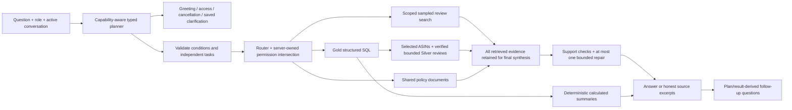

# Answer-quality remediation — current status

Updated 2026-11-03. This is the consolidated handoff for changes since GitHub
`ec0ef266ca2d1bfa4094e19a9dbfaa1dd4006738`. Read with
[CURRENT_TASK](../context/CURRENT_TASK.md), [resume](../context/RESUME_NEXT_SESSION.md)
and the [file inventory](../context/CHANGE_INVENTORY.md). Detailed historical
results remain in module notes and WORKLOG; they are not all current acceptance claims.

## Status and publication boundary

| Work | Current status | Detail |
|---|---|---|
| Stage 1 baseline | Accepted, preserved before-baseline | [M7 baseline](modules/M7_answer_quality_baseline.md) |
| Stage 2 operation/routing/access | Bounded implementation accepted | [M4 Stage 2](modules/M4_answer_quality_stage2.md) |
| Stage 3 provenance/index foundations | Implemented in isolated fixtures; acceptance pending | [M3 Stage 3](modules/M3_answer_quality_stage3.md) |
| Practical Stage 4 workaround | Implemented; user quality review pending | [M4 workaround](modules/M4_answer_quality_workaround.md) |
| Conversation/price/compound-query repairs | Implemented; user quality review pending | [M4 conversation](modules/M4_conversational_planning.md) |
| Stage 5 / fresh model bake-off | Not started | Larger configured tier is a user-requested policy choice, not a new benchmark win |
| Documentation + Git publication | Explicitly authorized by the user | Commit/push does not approve quality, merge main, deploy or migrate the corpus |

The branch is `plan/answer-quality-remediation`, based on `ec0ef26`. The prior local
`65665dd` had the same tree as that remote merge commit; fast-forwarding changed no
working-tree source. Publication references: formatting `6befa4b`, implementation `770bcd0`; the
documentation commit contains CURRENT_TASK/WORKLOG and this handoff. Verify the
current remote/tracking ref in Git; main is not merged or deployed.
Original module M1–M8 DONE rows remain historical baseline milestones; M9 is still TODO.

## What executes now

- `agents/catalogue.py` describes dataset grain, available fields and supported
  operations to the entry model. Raw Gold/Silver corpora are not inserted wholesale
  into prompts. Normalized typed plans preserve category/numeric/exclusion conditions;
  harmless conversational words are not rejected by a selection vocabulary whitelist.
- `understand`, `sql` and `compose` use the existing configured large tier; `route`
  remains medium and `summary` small. Free/Azure retain configured deployments.
  No provider/model switch, model download or new benchmark claim is implied.
- Lowest-product requests clarify rank vs strict average threshold and minimum
  dataset review count. Default after definition: five products, maximum25;
  minimum reviews2–20000; below-threshold value greater than1 and at most5.
  The average uses all rated review rows per ASIN/category, not just negative reviews.
- Category averages are review-row `AVG(rating)`; unqualified category review counts
  use `COUNT(*)`. Price/discovery/count operations first deduplicate ASIN/category,
  with `MAX(non-null price)` as the recorded product price and `MIN(product_title)`
  as label. Missing prices are disclosed and excluded from price calculations.
  Prices are recorded metadata, not live quotes; literal smartphone-title matches
  include accessories and do not certify a handset taxonomy.
- SQL-selected explanations verify source review count/mean against selection before
  using existing Silver. Caps:5000source rows,3reviews/product,12000characters/review
  by default, at most25selected products; global retrieval limits still apply.
  Missing/oversized/unverifiable evidence remains explicit; no substitute ASINs.
- Ordinary legacy indexed reviews receive metadata only from a unique exact legacy
  chunk-ID match, not an ambiguous ASIN join. General review search stays sampled.
- Independent questions run scoped tools under one turn/budget and retain companion
  tasks through clarification. Explicit current count/order/mode replaces stale
  history conditions. Additive JSON message fields retain active plan/clarification
  state; no memory DDL. An unavailable-revenue clarification followed by a concrete
  replacement metric no longer repeats the unavailable measure in fallback routing.
- SQL narration uses calculated rows. Composition retains the full retrieved source
  pool until final synthesis, then keeps used citations. Known prevalence, numeric,
  correction/update and refund-support guards can reject drafts. A shipping-fee
  refund does not establish full purchase-price reimbursement.
- Frontend shares safe Markdown and grouped citation handling across live/replay,
  displays expandable full redacted passages, and shows charts only for supported
  dimensions/completeness. Specific empty-result explanations stay visible.
  Suggestions derive from the current plan/result and role; buttons fill/focus the
  composer without sending automatically. They are supported next questions, not
  promises that each proposed query has matches.

## Role boundaries

Source of truth: [policy.py](../backend/governance/policy.py). Authorization remains
code-owned at data access; the entry LLM only proposes tasks.

| Role | Product/review categories |
|---|---|
| executive, admin, analyst | All categories |
| support | Electronics; Home and Kitchen; Automotive; Pet Supplies |
| marketing | Electronics; Beauty and Personal Care; Toys and Games |
| unknown role | Denied |

Shared policy documents are not narrowed by product-category/ASIN filters. A denied
review request plus a permitted policy request is answered as two separate parts.
The UI identity selector is demo-only, not production authentication.

## Data, migration and configuration

Recorded read-only local findings, not data shipped in a fresh clone:

| Measure | Recorded result |
|---|---:|
| Gold structured reviews / category-ASIN products | 911,308 /645,448 |
| Review-Gold/index distinct products | 191,007 |
| SQL products absent from sampled index | 454,441 |
| Product presence / rows whose product has indexed evidence | 29.59% /35.61% |
| Serving review / document chunks | 225,000 /79 |
| Gold structured / Gold reviews / Silver Delta version | 1 /1 /1 |

Presence is not relevance, review-level overlap or full-text entailment. The two
initial lowest-product failures had source rows but no review-Gold/index rows.
Reading verified selected-product Silver reviews addresses those gaps without
re-embedding; it does not make the whole sampled index complete.

Stage 3 adds forward Gold identity/projection metadata and an immutable bounded
SQLite/FTS/vector+Delta bundle prototype. It was fixture-tested, not activated as a
serving replacement. Existing serving vectors retain unverified lineage; dimensions
alone do not certify compatibility. No real Gold rerun, schema migration, backfill
or corpus reindex occurred. Existing reviewer privacy is preserved.

| Setting | Meaning / current boundary |
|---|---|
| `EVIDENCE_BUNDLE_PATH` | Optional immutable fixture-bundle pointer; unset in recorded serving checks; no cutover authorization |
| `EMBEDDING_MODEL_REVISION`, `AZURE_EMBEDDING_REVISION` | Explicit lineage when available; no retroactive certification |
| `EMBEDDING_LOCAL_FILES_ONLY` | Optional offline/cached-model loading, false default; fixture smoke forces offline |
| `EVIDENCE_MIN_SIMILARITY=0.35` | Tiny-fixture raw-cosine floor, not full-corpus confidence calibration |
| `SOURCE_REVIEW_FALLBACK=true` | Bounded existing-Silver lookup for supported selected-product evidence |
| `SOURCE_REVIEW_MAX_ROWS=5000`, `SOURCE_REVIEWS_PER_PRODUCT=3`, `SOURCE_REVIEW_MAX_CHARS=12000` | Source read/text limits; fail honestly at limits |
| `SQL_MIN_PRODUCT_REVIEWS=2` | Legacy supported SQL fallback default; conversational selection asks for the user's definition |

See [backend/.env.example](../backend/.env.example) for non-secret defaults and
[Stage 3 migration boundary](modules/M3_answer_quality_stage3.md#limits-and-operational-handoff)
before any real migration: pinned sources/identities, measured sampling/caps, model
lineage, exact resource estimate, target schema/index, reconciliation, backup,
rollback and explicit authorization are required. Committing code grants none of these.

## Verification: measured results and limits

Historical artifacts remain frozen: [Stage1](testing/acceptance/quality-baseline.md),
[Stage2](testing/acceptance/quality-stage2.md), [Stage3](testing/acceptance/evidence-stage3.md).
[Snapshot checksums](testing/acceptance/snapshot-checksums.json) protect their bytes.
Stage2's108passing/0failing/66unmeasured assertions are not a complete quality pass.
The unchanged CI eval is docs-only and does not certify full conversational RAG.

The prior repair session recorded138focused tests and frontend harness/build,
71real browser turns across27distinct queries (including failed iterations and
rechecks), and25named latest-outcome checks. Sources were read for specific final
Beauty, drawback, selected-product and policy examples; valid citation syntax alone
was never counted as entailment. UI checks included history, source links, suggestion
fill/focus, and390px no-overflow—not physical-device certification.

Independent Gold examples: Electronics product-price67.341765… from26,504known prices
with13,244missing; smartphone-title718products/mean68.688518… from432known/286missing;
no Electronics product below2/5 with50+reviews; relative lowest at50+reviews average
4.08–4.47. Generated SQL2023Electronics count2733/mean4.290523234540798 matched separately
written SQL. The final review-ID SHA256 matched the original audit using sorted IDs,
each followed by newline. All three Delta versions and225000/79chunks stayed unchanged.

### Documentation-audit verification

The broader pre-publication hermetic run included baseline/hosted-budget/coverage/
Stage3 tests, and found two integration gaps missed by the earlier138-test scope:
A12's concrete replacement measure loop in no-model fallback (fixed without disabling
the missing-measure guard), and the Stage3 partial-state test using the old ambiguous
selection prompt (updated to explicit criteria, with partial-state assertions intact).
The combined run passed **177 tests**; see [publication verification](testing/publication-verification.md).
The explicit prompt also exposed an imperative decomposition bug: “and show1”
must stay a modifier on the original task, not become an unscoped independent query.
This is corrected with regression coverage. Commit identifiers are recorded in CURRENT_TASK/WORKLOG.
Six baseline files also required formatting-only normalization; no logical changes
were made to those files. No new hosted/model/DB-backed run is part of this audit.

Some Pet/policy answers still degrade to source excerpts after support rejection;
source excerpts are an honest fallback, not consistent polished synthesis. General
review frequency, exhaustive recall, adversarial entailment, arbitrary generated SQL
and all natural-language variations remain unproven. Durable ownership/auth and
cloud deployment were not revalidated here. Stage3 acceptance and full answer-quality
acceptance remain separate user decisions.

Live diagnostics stay local under `/private/tmp/ric-*` and may disappear. They are
not required to interpret this handoff and are not committed: raw model transcripts,
retrieved live text, credentials, browser profiles, corpus/model files stay out of Git.
No new paid work is needed for this publication. Additional repair-run provider-reported
cost$0.010445375; cumulative remediation reported$0.013769129;118attempts/114cost reports,
4HTTPfailures with retained reservations$0.42382848 under the original$2 authorization.
See [COST.md](../COST.md); do not mistake reservations or missing reports for actual spend.
