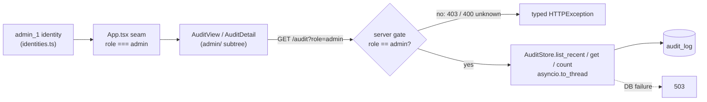

# B-14 — Audit admin view

Date: 2026-11-02. Ran as a `/change` (not a module loop), two sub-modules. Spec: `.claude/specs/B14_audit_admin.md`.
ADR: `context/DECISIONS.md` (B-14, 2026-11-02, Option A). Cloud spend: $0 (reads existing `audit_log`; no cloud calls).

## What was built

An **operator-only** audit view: the first read path over `audit_log`, which was write-only until now.
It is the sanctioned home for the fields the chat must hide (ids, cost, routing, tokens, latency; see
`.claude/rules/ux-surface.md`). It does **not** widen retrieval scope: the endpoint only reads
`audit_log` (no corpus, no DDL, no writes, no schema change).

| Sub-module | Delivered | Key files |
|---|---|---|
| B14.1 Backend read path | `AuditStore` gains its first reads: `list_recent` (newest-first, `limit`/`offset` clamped), `get(id)`, `count()`. `GET /audit?role=&limit=&offset=` returns `{items,total,limit,offset}`; `GET /audit/{id}?role=` returns one row. Gated **server-side** to `role=="admin"`: 403 other roles, 400 unknown role, 404 missing id, 503 on DB failure. DB calls run via `asyncio.to_thread`. | `backend/governance/audit.py`, `backend/app/main.py`, `backend/tests/test_audit_read.py` (new) |
| B14.2 Admin view | New `frontend/src/admin/` subtree: paginated audit list (When / Role / Intent / Tokens / Cost / Latency / Tool path) and a row detail showing sources, grounding, memory, `sql_error`. New `admin_1` demo identity. `App.tsx` gets a two-line `role === "admin"` routing seam. The admin subtree imports **nothing** from chat `components/`, so the ux-surface boundary is enforced in code. | `frontend/src/admin/{AuditView,AuditDetail}.tsx`, `admin/admin.css`, `identities.ts`, `api/client.ts`, `api/types.ts`, `App.tsx` |

## Key decisions

| Decision | Why | Rejected alternative |
|---|---|---|
| In-app React subtree over a role-gated read endpoint (Option A) | Shares the API client, theming and identity switcher; the ux-surface boundary is honored by code separation (`admin/` never imports chat components), not by a separate deploy | **B**: standalone operator page, a second frontend artifact to maintain with no gain over an isolated subtree |
| Ship the UI in this change | Backend-only leaves the "admin surface" half-built | **C**: backend-only, defer UI to the iteration-4 design pass, which is about the chat persona, not the operator plane |
| Gate on the server (`role=="admin"` → else 403), not by hiding the UI | Same posture as retrieval: access policy is enforced in code, never trusted to the client | Client-side-only route hiding |
| Read-only, no schema change; `App.tsx` change limited to a routing seam | Smallest blast radius; chat shapes untouched | Extending the chat `audit` payload to the UI (violates ux-surface) |

## Read path

## Problems faced & fixes

| What happened | Resolution |
|---|---|
| Tester reported a missing per-row `role` column in the list | On verification the column was already present (`AuditView.tsx` header and cell, lines ~72/88). Tester misread; **no code change** |
| `audit_log` had no read API; tests must not touch the real DB | Read methods tested against the `<db>_test` scratch DB via `conftest.py` (fails closed) |

## Discussion / corrections

No reviewer course-corrections. The only correction was the tester finding above, which was a false positive.

## Tests

- **B14.1:** `tests/test_audit_read.py` → **2 passed** against the `<db>_test` scratch DB: store read methods, and a real `TestClient` end-to-end smoke (admin 200 with operator fields; support 403; missing id 404). `ruff`/`black` clean.
- **B14.2:** `npm run build` clean; import-boundary check PASS (admin subtree imports nothing from chat `components/`); `App.tsx` seam static check PASS.

### Honest gaps

- Browser smoke of the admin UI against live `/audit` is **deferred to human UAT**.
- No committed frontend render/component test.
- The 503-on-DB-failure path is not exercised by a test.

## Visuals

The read-path diagram above. TODO (human): capture a screenshot of the admin list and a row detail during UAT; none has been captured yet.

## Result

Verified at sub-module level (B14.1, B14.2) as above, pending human UAT of the browser view. Operators now have a governed, role-gated place to see per-answer cost, tokens, routing, latency and sources. The observability plane (B-13, Langfuse) and this audit plane are the two operator homes the chat boundary points to.

## Build metadata

- Build time: n/a (ran as `/change`; not tracked against a CHECKPOINT 1)
- Sub-module cycles: 2 (B14.1, B14.2)
- Cloud spend this module: $0
- Claude session usage: n/a
