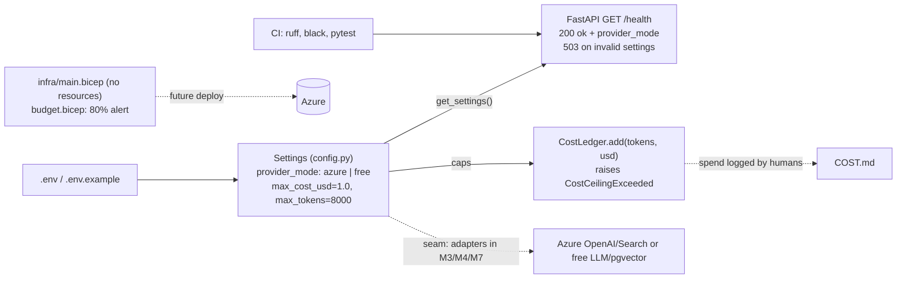

# M1 — Foundations

Date: 2026-10-27. Spec: `.claude/specs/M1_foundations.md`. Cloud spend: $0.

## What was built

| Sub-module | Delivered | Key files |
|---|---|---|
| M1.1 Repo scaffold & dev tooling | Backend package tree (`app/ agents/ retrieval/ governance/ eval/`), ruff + black (line length 100, py312), pytest `testpaths=["tests"]`, Vite React-TS frontend skeleton, `data/.gitkeep`, CI (install, ruff, black, pytest) | `backend/pyproject.toml`, `frontend/`, `.github/workflows/ci.yml` |
| M1.2 Config & app skeleton | `Settings(BaseSettings)` with `provider_mode: Literal["azure","free"]` (default `free`), Azure OpenAI/Search/Blob, Databricks, free-LLM and `database_url` fields, cost caps, `SecretStr` for secrets, cached `get_settings()`. Async FastAPI `GET /health` returns `{"status":"ok","provider_mode":...}`; settings-validation failure returns 503 `HTTPException`, not 500. `.env.example` documents every key (placeholders only) | `backend/app/config.py`, `backend/app/main.py`, `backend/.env.example`, `backend/tests/test_health.py` |
| M1.3 Cost tracking & ceiling | `CostLedger.add(tokens, usd)` enforces both USD and token ceilings from `Settings`, raises `CostCeilingExceeded`. `COST.md` seeded at $0 | `backend/app/cost.py`, `backend/tests/test_cost.py`, `COST.md` |
| M1.4 IaC skeleton & budget alerts | Subscription-scope `main.bicep` with params and outputs only (no live resources, module refs commented). `budget.bicep` is a monthly `Microsoft.Consumption/budgets@2023-05-01` with an actual-spend alert (default 80%). Placeholder param file (`budgetAmountUsd=10`). `teardown.sh` (destructive, type-the-name confirm, `set -euo pipefail`, never executed) | `infra/main.bicep`, `infra/budget.bicep`, `infra/main.bicepparam`, `infra/teardown.sh`, `infra/README.md` |

## Key decisions

| Decision | Why | Rejected alternative |
|---|---|---|
| Provider seam is only a config switch (`PROVIDER_MODE`) in M1 | Lays the seam without building adapters; implementations arrive in M3/M4/M7 | Building stub adapters now (speculative code) |
| Caps default to $1.0 and 8000 tokens/query | Spec left values open; developer's choice, env-overridable | Hard-coded constants |
| Ledger rejects the breaching entry before recording it | Totals never exceed caps; caller can still report real spend | Record then raise (totals could exceed the cap) |
| `SecretStr` for all secret settings | Prevents accidental logging or printing | Plain `str` |
| `/health` returns 503 on bad settings | Matches the "loud but clean" error rule | Unhandled 500 |
| Bicep has no live resources, plus a budget alert | Cost gate: nothing can spend money until a human approves | Provisioning early |
| `httpx` added to backend deps | Required by FastAPI `TestClient` | None |

## Problems faced & fixes

| Problem | Resolution |
|---|---|
| Bicep CLI was not installed during M1.4, so the templates were unverified. The developer declined to download a binary unasked. | The Tester ran `az bicep install` (local, $0). Both `.bicep` files then compiled (`az bicep build` exit 0). |
| The spec said IaC param names should mirror config env keys for naming prefix and region. `Settings` has no such keys yet. | Used `namePrefix` and `location` params. Deviation logged. Add `AZURE_NAME_PREFIX` and `AZURE_LOCATION` to `Settings` in the first module that deploys. |
| `TestClient` failed without `httpx`. | Added `httpx` to backend dependencies. |

## Discussion / corrections

No reviewer course-corrections during the build. Each sub-module passed its scoped tester without a developer re-route. The only deviation is the IaC param naming above.

## Visuals

Solid lines are built and tested. Dotted lines are seams or placeholders for later modules.

Screenshots: none captured. TODO (human, optional): a terminal capture of `curl /health` returning 200.

## Result

- **Verdict: PASS.** All four sub-modules passed their scoped tests.
- Module end-to-end smoke: a live `uvicorn app.main:app` plus `curl /health` returned HTTP 200 `{"status":"ok","provider_mode":"free"}`.
- Full pytest suite: 4 tests green. ruff and black clean. Both Bicep files compile.
- Expected and actual cloud spend: $0.
- **Next:** later modules read `get_settings()` for the provider switch and route every model call through `CostLedger`. Any deploying module fills in `main.bicep` and adds the naming and region settings.
