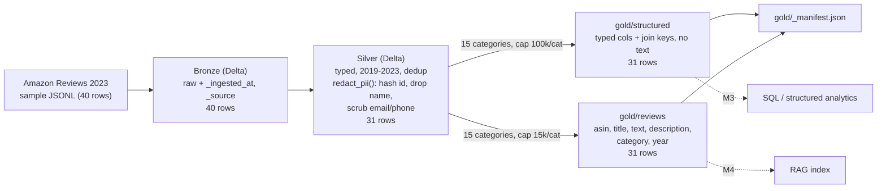
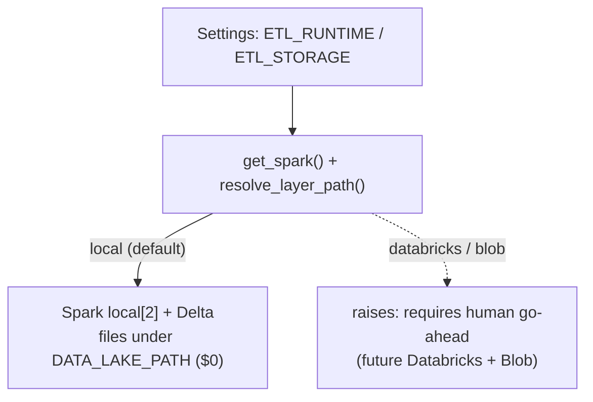

# M2 — Data ingestion & ETL

Date: 2026-10-27 (amended 2026-10-27, see Change log). Spec: `.claude/specs/M2_data_ingestion_etl.md`. Cloud spend: $0.

## What was built

A Bronze → Silver → Gold medallion pipeline over Amazon Reviews 2023 (2019–2023 window), running on PySpark local mode with Delta Lake. The Databricks/Blob path sits behind a config seam and is inert.

| Sub-module | Delivered | Key files |
|---|---|---|
| M2.1 Scaffold & seam | ETL keys in `Settings` (all documented in `.env.example`). `get_spark()` builds a `local[2]` session with Delta. `resolve_layer_path()` maps a layer name to a path and raises a clear "requires human go-ahead" error for `databricks`/`blob`. A 40-row synthetic sample spans 2018–2024 and 8 categories, with injected fake email, phone and name for PII tests | `backend/app/config.py`, `backend/.env.example`, `data/etl/spark_session.py`, `data/etl/storage.py`, `data/sample/amazon_reviews_sample.jsonl`, `data/tests/test_storage.py` |
| M2.2 Bronze | Raw land into Delta with provenance (`_ingested_at`, `_source`). No typing, no filtering. 40 rows in, 40 out | `data/etl/bronze.py`, `data/tests/test_bronze.py` |
| M2.3 Silver + PII | Typed columns (rating/price float, category string, verified_purchase bool, epoch-ms timestamp → timestamp + `year`). Null-key and malformed rows dropped, 2019–2023 window applied, dedup on (`asin`, `user_id_hash`, `timestamp`). `redact_pii()` is the single PII enforcement point. 40 → 31 rows | `data/etl/silver.py`, `data/tests/test_silver.py` |
| M2.4 Gold + manifest + pipeline | Two Gold tables plus `gold/_manifest.json`, both over the same 15 categories with a deterministic per-category row cap. `run_pipeline()` chains Bronze → Silver → Gold. On the sample the caps do not bite: structured 31 rows, reviews 31 rows | `data/etl/gold.py`, `data/etl/pipeline.py`, `data/tests/test_gold.py` |

### Settings keys added

| Key | Default | Purpose |
|---|---|---|
| `ETL_RUNTIME` | `local` | `local` or `databricks` (inert) |
| `ETL_STORAGE` | `local` | `local` or `blob` (inert) |
| `DATA_LAKE_PATH` | `data` | Root of the bronze/silver/gold layers |
| `ETL_YEAR_MIN` / `ETL_YEAR_MAX` | 2019 / 2023 | Review-year window |
| `ETL_SAMPLE_SIZE` | 50 | Sample cap for runs |
| `AMAZON_DATASET_ID` | `McAuley-Lab/Amazon-Reviews-2023` | Source dataset |
| `SQL_CATEGORIES` | 15 categories (see below) | Feed the structured (SQL) Gold table |
| `RAG_CATEGORIES` | same 15 categories | Feed the reviews (RAG) Gold table. Independent of `SQL_CATEGORIES`; env can diverge them |
| `SQL_ROWS_PER_CATEGORY` | 100000 | Per-category cap on `gold/structured` (added 2026-10-27) |
| `RAG_ROWS_PER_CATEGORY` | 15000 | Per-category cap on `gold/reviews`, the embedding-cost lever (added 2026-10-27) |
| `PII_HASH_SALT` | unset (`SecretStr`) | Salt for `user_id` hashing; Silver refuses to run without it |

The 15 default categories: Electronics, Home_and_Kitchen, Books, Beauty_and_Personal_Care, Sports_and_Outdoors, Toys_and_Games, Automotive, Pet_Supplies, Cell_Phones_and_Accessories, Clothing_Shoes_and_Jewelry, Health_and_Household, Office_Products, Tools_and_Home_Improvement, Grocery_and_Gourmet_Food, Patio_Lawn_and_Garden.

### Gold tables

| Table | Rows | Categories | Columns |
|---|---|---|---|
| `gold/structured` | 31 on sample (≤ `SQL_ROWS_PER_CATEGORY` per category) | `SQL_CATEGORIES` (15 default) | `asin, user_id_hash, year, rating, price, category, verified_purchase, timestamp, helpful_vote`. No free text |
| `gold/reviews` | 31 on sample (≤ `RAG_ROWS_PER_CATEGORY` per category) | `RAG_CATEGORIES` (15 default) | `asin, title, text, description, category, year`. No PII columns |

## Key decisions

| Decision | Why | Rejected alternative |
|---|---|---|
| Local Spark + Delta by default; Databricks/Blob behind `ETL_RUNTIME`/`ETL_STORAGE` | Runs at $0 and matches the cost gate. Mirrors M1's `PROVIDER_MODE` seam | Provisioning Databricks now |
| Seam raises "requires human go-ahead" instead of silently falling back | A cloud request must never quietly run locally or spend money | Silent fallback to local |
| `redact_pii()` is the single enforcement point, called inside Silver before any write | PII never exists in Silver or Gold, so downstream layers need no redaction logic | Redacting per layer or at query time |
| SHA-256(salt + `user_id`) → `user_id_hash`; raw `user_id` and `name` dropped | Keeps joins and dedup possible without identity | Dropping the user id entirely (loses per-user analytics) |
| Missing `PII_HASH_SALT` raises | Fail loud rather than write an unsalted hash | Default salt |
| Malformed or null-key rows dropped, not defaulted | Casts yield null on bad values, so bad data never becomes fake data | Filling defaults |
| Gold split: `structured` (SQL) vs `reviews` (RAG) by column set, both broad on categories | SQL tools get typed aggregates. RAG gets only redacted text and metadata, with no reviewer identifiers | One wide table for both |
| Broad on both layers, capped embed (15 categories each, caps 100k SQL / 15k RAG per category) | Embedding with text-embedding-3-small costs a few dollars one-time; the ~225k-review vector bulk is ~1.4 GB (~0.5 GB at 512-dim). Per-category caps are the cost lever. Reliability comes from M4 hybrid search/rerank and M7 eval, not row count | Prior "broad SQL / narrow embed (~2 categories)", now superseded (ADR in DECISIONS.md) |
| Deterministic cap: `row_number()` over `category`, ordered by `timestamp` desc, `asin`, `user_id_hash`; keep ≤ cap | Re-runs produce identical output, so evals and manifests are reproducible | Random sampling or unordered `limit` |
| `_manifest.json` with row counts, window, categories, caps, per-category counts, run timestamp | Lets later modules and evals check what the lake contains | Inferring counts at read time |
| Synthetic 40-row sample committed, with injected fake PII | Deterministic, tiny, and a real PII-leak test input. Raw data is not committed | Committing real review data |

## Problems faced & fixes

| Problem | Resolution |
|---|---|
| No Java runtime on the machine, so Spark could not start | Installed `openjdk@17` via brew. It is keg-only, so `JAVA_HOME` must be set. ETL run docs must say so |
| System Python is 3.9, but the project needs 3.12 | Built a 3.12 venv with `uv` |
| `pydantic-settings` tried to JSON-parse the comma-separated category lists and failed | Typed the fields `Annotated[list[str], NoDecode]` and added a `field_validator` that splits on commas |
| Spark workers defaulted to system Python 3.9 while the driver ran 3.12, which failed when building DataFrames from Python rows | Set `PYSPARK_PYTHON`. Any test that builds frames from Python data must set it. Note for CI |
| Phone numbers like `555-0142` (7-digit local form) slipped past a full-number regex | `PHONE_RE` has a second alternative for the bare 7-digit form |

## Discussion / corrections

No reviewer course-corrections. Each sub-module passed its scoped test before the next began. The 2026-10-27 Gold amendment is covered in the Change log below. The problems above were environment and config issues fixed during the build.

### Open items (non-blocking, flagged forward)

- The PII scrub covers only `title` and `text`, as specced. Real PII in `description` or other free text would pass through. Hand to M6 governance.
- `run_pipeline()` has no `source_path` argument, so a temporary lake must stage the sample under `<lake>/sample/`. Minor ergonomics.

## Change log / revisions

**2026-10-27 — Gold data strategy: broad on both layers, capped embed (M2.4, approved post-build).**

| Area | Before | After |
|---|---|---|
| Default categories | SQL 6 / RAG 2 | Both 15 (same list; settings stay independent) |
| Row limits | none | `sql_rows_per_category=100000`, `rag_rows_per_category=15000` (in `.env.example`) |
| `gold.py` | category filter only | plus deterministic per-category cap (`row_number()` window, tiebreak `timestamp` desc, `asin`, `user_id_hash`) |
| `_manifest.json` | totals and categories | adds `sql_rows_per_category`, `rag_rows_per_category`, `gold_structured_by_category`, `gold_reviews_by_category` |

- Why: the strategy moved from "broad SQL / narrow embed" to "broad on both layers, capped embed". See the Key decisions table. PRD §5/§9 updated (v1.3): the bulk lives in pgvector, and the AI Search free tier holds only a tiny demo slice.
- Downstream, noted and not built: text-embedding-3-small (optionally 512-dim Matryoshka), pgvector bulk, AI Search tiny slice. All M3, gated, no spend yet.
- Verified live on the sample at $0: caps do not bite on the tiny sample (bronze 40 → silver 31 → gold_structured 31 / gold_reviews 31). With `rag_rows_per_category=2`, every category was capped to exactly 2 rows, identical across two runs. Manifest per-category counts match the Delta tables. PII scan: 0 hits. 16 data tests green, ruff/black clean.

## Visuals

Solid lines are built and tested. Dotted lines are the downstream consumers (later modules) and the inert cloud path.

Screenshots: none captured. TODO (human, optional): a terminal capture of `python -m data.etl.pipeline` and the resulting `gold/_manifest.json`.

## Result

- **Verdict: PASS.** All four sub-modules passed their scoped tests, run live on Spark local mode.
- Tests: 16 green (12 data + 4 backend M1 regression) at original build; after the 2026-10-27 amendment, 16 data tests green. ruff and black clean.
- Module end-to-end smoke: `python -m data.etl.pipeline` exits 0 and produces all layers plus the manifest. A PII scan of Silver and both Gold tables found 0 hits.
- Expected and actual cloud spend: $0.
- **Next:** the SQL module reads `gold/structured`. The retrieval and indexing module reads `gold/reviews`. The manifest documents the lake contents. M6 governance should extend PII scrubbing to `description` and other free text.

## Build metadata

- Build time (wall-clock, checkpoint-1 approval → module done): ~18 min (approximate; derived from summed sub-agent run durations, no precise clock).
- Sub-module cycles: 4 | sub-agent calls: 11 total — planner ×1, developer ×4, tester ×5 (4 sub-module + 1 module gate), documenter ×1.
- Cloud spend this module: $0.00 (from COST.md).
- Claude session usage: run `/cost` for this session's token usage.
