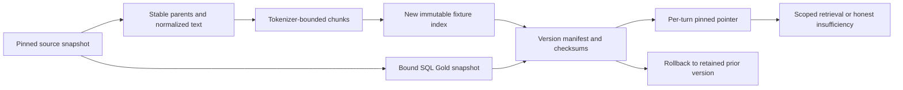

# M2/M3/M4 — Answer quality Stage 3 evidence foundations

> This note includes dated intermediate results. The latest consolidated status
> and publication/verification boundaries are in [answer-quality-status.md](../answer-quality-status.md).

2026-11-03. User accepted bounded Stage 2 and approved Stage 3 code plus isolated
fixture verification with “go ahead”. **Stage 3 ready for human review; real
backfill and serving cutover remain unauthorized.** No overall quality pass.

## Built and verified

| Submodule | Implementation | Evidence |
|---|---|---|
| S3.1 Coverage | Streaming SQL/review-Gold/index product anti-joins, explicit denominators, metadata completeness, year/rating strata, snapshot labels and selected-product upstream traces | Fixture counts reconcile; real Postgres audit enforced repeatable-read/read-only; no source bodies read |
| S3.2 Provenance | Parent IDs before Gold projection; rating, exact timestamp, product title, source version/hash; embedding provider/model/revision/dimensions/tokenizer/preprocessing | Two-review Spark test confirms both upstream/fallback IDs, privacy, metadata, source version and text-edit stability; same-dimension mismatch blocked before query embedding |
| S3.3 Normalization/index | Parse HTML to redacted plain text once, versioned normalized result; embedding-tokenizer chunks/offsets; full redacted parents; immutable manifests, reconciliation and rollback | HTML/entities/PII/adversarial markup, tail complaint, edited/deleted/shortened sources, checksum tampering, vector reuse and rollback tests |
| S3.4 Retrieval | Deterministic product/year/rating core plus labelled diagnostic supplement; candidate-only focused lexical terms, raw-cosine floor, rating-intent constraints and parent deduplication; partial-state audit/user message | Scoped filter intersections, unique-parent counts and offline real pipeline; 2 calibration/4 held-out relevance probes with explicit source/index recall and separate lexical contribution |

The fixture adapter uses SQLite/FTS5 with real vectors and a bound Delta SQL
snapshot. It is capped at 100 reviews/3 documents/500 chunks and refuses real
source snapshots. This exercises versioned migration contracts without creating
or changing a Postgres database. It is **not a scalable production replacement**.
Existing pgvector columns/indexers remain compatible; Azure remains explicitly gated.
`EVIDENCE_BUNDLE_PATH` is opt-in and was not set in serving configuration.

Forward Gold code pins Silver before projecting new metadata. It was run only
against two synthetic reviews in temporary directories. No serving ETL was run.
The product-aware selector is a bounded fixture policy; production sampling/caps
still require a measured candidate plan. Legacy vectors remain unverified rather
than being certified from their dimensions.

## Real coverage findings

Read-only local report: `/private/tmp/ric-stage3-coverage.json`. SQL/review Gold
Delta versions are both 1. Index snapshot and review-ID checksum are recorded;
these are independently labelled cross-store snapshots, not an atomic source run.

| Measure | Observed |
|---|---:|
| SQL review rows / distinct category-ASIN products | 911,308 / 645,448 |
| Review-Gold/index distinct products | 191,007 |
| SQL products without indexed reviews | 454,441 |
| SQL product coverage | 191,007 / 645,448 = 29.59% |
| SQL rows whose product has at least one indexed chunk | 324,526 / 911,308 = 35.61% |
| Serving review / document chunks | 225,000 / 79 |

Both selected lowest-rated products have Silver rows (2 and 3) and zero rows in
review Gold/index. Their missing evidence starts before indexing. This establishes
row availability, not usable text quality or a universal cause for every gap.
Gold/index product sets match; review-level exact overlap remains unknown without
stable legacy parent IDs. Rating/exact time/title are absent from legacy review
Gold/index, as reported explicitly. Newest-first cap bias remains relevant.

A 225,000-review budget cannot cover 645,448 products even with one review each.
Sampling alone cannot eliminate this gap. Product-aware coverage must have a
stated population and index budget; SQL rankings must not silently exclude products
without indexed reviews. Covered-product row counts do not prove relevant passages.

## Verification and corrections

- **135 scoped backend tests passed**, including Stage 1/2 regression and hosted
  safety guards. Shared DB fixtures were bypassed with `--noconftest`; inspected
  SQL tests only read Gold into an in-memory DuckDB table.
- **One real two-review Spark integration test passed**, using existing Java and
  cached Delta jars, temporary Silver/Gold paths, no downloads. Initial worker
  Python 3.15/driver 3.12 mismatch was fixed by pinning the fixture worker interpreter.
- **18 real offline end-to-end checks passed**: cached embeddings, SQLite vector/
  FTS retrieval, Delta SQL and actual pipeline, no hosted generation. Two versions
  were built in a temporary workspace and removed afterward.
- New hermetic tests deny Postgres/network I/O. One legacy real-model unit test
  was explicitly deselected; the offline smoke exercises actual cached embeddings.
- Model identity now pins the exact cached path loaded. Tokenizer fingerprints
  exclude runtime padding/truncation state after the first smoke exposed that
  mutable serialization detail. Same-model encoding retains stable identity.
- A pipeline turn pins its complete bundle so a pointer change between SQL and
  retrieval cannot mix versions. Tests switch/rollback pointers inside a pinned turn.
- Scoped ruff/black and diff whitespace checks passed. No frontend changes in Stage 3.
- Final read-only preservation check confirms 225,000 review / 79 document chunks
  and the exact preimplementation review-ID checksum. Local evidence:
  `/private/tmp/ric-stage3-corpus-preservation.json`.

Synthetic evidence: [evidence-stage3.md](../testing/acceptance/evidence-stage3.md)
and companion JSON. Stage 1 `quality-baseline.*` and Stage 2 `quality-stage2.*`
were preserved. Live aggregate audit remains outside Git; no raw live text copied.

## Limits and operational handoff

The 0.35 raw-cosine floor separates the tiny fixture probes; it is not calibrated
for the real corpus. The generic lowest-rated Electronics question falls below it,
so the fixture pipeline gives a truthful selection-only result. Targeted battery
questions retrieve relevant evidence, including a long-review tail. Indexed-parent
recall is 1.0 on answerable probes; source-parent recall for headphone praise is
0.5 because sampling kept one of two reviews. Lexical retrieval adds no relevant
parent beyond vector top-k in this fixture. No gain is invented from those results.

Full redacted parent context is retained and scope-controlled, including updates;
the composer still uses selected chunk text. Automatic resolution-aware synthesis,
SQL-prose contradictions, Markdown/grouped citations, chart semantics and factual
support remain Stage 4. Citation syntax and a relevance score do not prove support.
Durable ownership/persistence, full-corpus recall and adversarial semantic grounding
remain unvalidated. At this Stage3 snapshot, Stages4–5 had not started; later
workaround/conversation work is recorded in the current status, with Stage5 still unstarted.

Before real backfill: inspect stable identities/source text quality; measure a
product-aware candidate over pinned Silver; select caps/population; estimate exact
review/chunk counts, storage/CPU/time and embedding tokens; verify model provenance;
specify the real pgvector/Azure migration adapter, target paths/schema, reconciliation
diff, backup, spend/transfer cap and rollback commands. Existing unverified vectors
cannot be mixed/reused merely because they have 384 dimensions. Real backfill,
cutover and cleanup each need explicit authorization. No in-place serving migration
or activation has occurred; the prototype's fixture bounds cannot be used for a
bulk backfill.

Build metadata: four ordered submodule scopes; developer/tester/documenter roles
adopted in-session, 0 sub-agent calls. Approval-to-completion wall time was not
independently timed. Additional cloud spend **$0**; prior hosted actual remains
**$0.003323754** in COST.md. No deployments, commits or pushes. Session usage: n/a.
