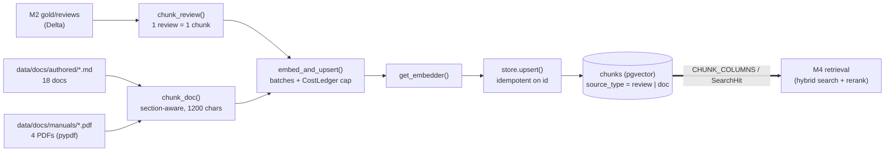
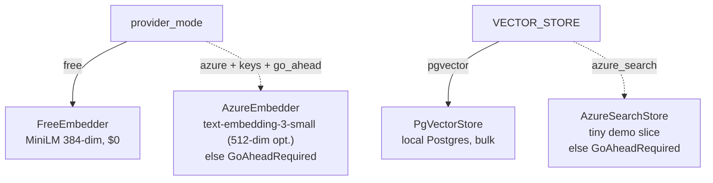

# M3 — Indexing

Date: 2026-10-27. Spec: `.claude/specs/M3_indexing.md`. Cloud spend: $0.

## What was built

An embedding + vector-store layer that turns M2's `gold/reviews` and an authored doc/PDF corpus into one unified `chunks` table in local pgvector. Both cloud paths (Azure OpenAI embeddings, Azure AI Search) sit behind gated seams and were not run.

| Sub-module | Delivered | Key files |
|---|---|---|
| M3.1 Embedding adapter | `Embedder` protocol (`embed(texts)`, `dim`). `FreeEmbedder` runs local `all-MiniLM-L6-v2` (384-dim, real vectors at $0). `AzureEmbedder` (`text-embedding-3-small`, optional 512-dim Matryoshka via `azure_embedding_dim`) raises `GoAheadRequired` unless Azure keys and `azure_embedding_go_ahead` are set. `get_embedder()` keys off M1's `provider_mode` | `backend/retrieval/embeddings.py`, `backend/app/config.py`, `backend/.env.example`, `backend/tests/test_embeddings.py` |
| M3.2 Vector store + `chunks` schema | `Chunk`, `SearchHit`, `CHUNK_COLUMNS`, `chunks_ddl(dim)`, `make_chunk_id()`. `PgVectorStore` (`ensure_schema`/`upsert`/`query`), upsert is `ON CONFLICT (id) DO UPDATE`. `AzureSearchStore` is gated. `get_vector_store()` keys off `VECTOR_STORE`. Local pgvector via docker-compose | `backend/retrieval/schema.py`, `backend/retrieval/vector_store.py`, `infra/docker-compose.yml`, `backend/tests/test_vector_store.py` |
| M3.3 Review indexing | `chunk_review()` makes one chunk per review (title + text), id = hash of (`review`, `asin`, sha1 of text). `index_reviews(limit)` reads the Delta `gold/reviews`, embeds in batches under `CostLedger`, upserts. CLI `python -m retrieval.index_reviews` | `backend/retrieval/chunking.py`, `backend/retrieval/index_reviews.py`, `backend/tests/test_index_reviews.py` |
| M3.4 Doc parsing + indexing | 18 authored markdown docs and 4 manual PDFs (generated by a script, synthetic, no PII). `split_sections` / `chunk_doc` are section-aware with a bounded chunk size (1200 chars). PDFs parsed via `pypdf`. `index_docs()` reuses the shared embed/upsert path, tagging `source_type="doc"` | `data/docs/authored/*.md`, `data/docs/manuals/*.pdf`, `data/docs/make_manual_pdfs.py`, `backend/retrieval/index_docs.py`, `backend/tests/test_index_docs.py` |

### Settings keys added

| Key | Default | Purpose |
|---|---|---|
| `VECTOR_STORE` | `pgvector` | `pgvector` or `azure_search` (gated) |
| `EMBEDDING_MODEL_FREE` | `sentence-transformers/all-MiniLM-L6-v2` | Local $0 embedder |
| `AZURE_EMBEDDING_DIM` | 512 | Matryoshka dimension on the Azure path |
| `EMBEDDING_BATCH_SIZE` | 64 | Batch size per embed call |
| `MAX_EMBEDDING_USD` | 5.0 | Hard cap enforced via `CostLedger` |
| `INDEX_SLICE_SIZE` | 1000 | Tiny AI-Search demo slice |
| `AZURE_EMBEDDING_GO_AHEAD` | `false` | Extra flag added by the Developer. Real Azure embed calls refuse unless true |

### The `chunks` schema (M3 to M4 boundary)

`id, source_type (review|doc), text, embedding vector(dim), category, asin, year, doc_id, doc_title, section, chunk_index, source`

## Key decisions

| Decision | Why | Rejected alternative |
|---|---|---|
| Azure path uses `text-embedding-3-small`, optional 512-dim Matryoshka | Cheap (~$0.02/1M tokens); 512-dim cuts the ~225k-review bulk from ~1.4 GB to ~0.5 GB | Larger embedding model; fixed full-dim vectors |
| Free path is local `all-MiniLM-L6-v2` (384-dim), real vectors | CI and the e2e smoke exercise a real embedder at $0, not a mock | Mocked or random embeddings in CI |
| Two independent seams: `provider_mode` (embeddings) and `VECTOR_STORE` (store) | Each can be flipped without touching the other. Mirrors M1/M2 seams | One combined "mode" flag |
| pgvector holds the bulk; Azure AI Search is a tiny demo slice only | Free-tier Search cannot hold the bulk; pgvector is $0 locally | Putting everything in AI Search |
| Both cloud paths raise `GoAheadRequired`, never silently fall back | A cloud request must not quietly run locally or spend money. Extra `azure_embedding_go_ahead` flag means having keys is not enough to spend | Keys alone enable the paid path |
| One unified `chunks` table, `source_type` discriminator | M4 reads one index; docs-RAG vs review-RAG is a filter, not a second store | Separate tables per corpus |
| `source` and `category` columns reserved in the schema | Hooks for M6 access policy at retrieval, before the LLM | Adding columns later and re-indexing |
| Deterministic ids (`make_chunk_id` over source keys) + upsert on `id` | Re-runs are idempotent: same rows, no duplicates | Auto-increment ids; delete-and-reload |
| Indexing wrapped in `CostLedger`, capped by `max_embedding_usd`, recorded before the embed call | A cap breach never makes the paid call. Ledger's per-query defaults are overridden for indexing | Cost check after the call |
| `deltalake[pyarrow]` to read Gold | Gold is Delta; see Problems | Plain pyarrow |
| Section-aware doc chunking, bounded size; `pypdf` and markdown only | Keeps section metadata for citations. Docling deferred as out of scope | Layout-aware Docling parsing |

## Problems faced & fixes

| Problem | Resolution |
|---|---|
| No project Python env existed | Used a Python 3.12 scratch venv. CI note: provision 3.12 plus the new deps (`sentence-transformers`, `psycopg`, `pgvector`, `pypdf`, `deltalake[pyarrow]`) |
| Gold is a **Delta** table; pyarrow alone would read the data files and ignore the Delta log | Added `deltalake[pyarrow]`; `read_gold_reviews` uses `DeltaTable(...).to_pyarrow_table()` |
| **Vector-dim test-isolation bug.** The `chunks` vector dimension is fixed at table creation. M3.2's test used dim 3, real runs use 384, so a leftover table failed with `expected 3 dimensions, not 384` | M3.2's fixture now drops the table on setup and teardown |
| **Black line-length drift.** Two index files were wrapped at black's default 88, not the project's `line-length=100` | The orchestrator normalized all of `backend/retrieval/` and its tests to the project config (whitespace only) |
| `index_reviews` and `index_docs` needed the same batching, ledger and upsert logic | Refactored during M3.4 into a shared `embed_and_upsert` helper; M3.3 behaviour unchanged (its tests still pass) |

## Discussion / corrections

No reviewer course-corrections to scope. The Developer added the `azure_embedding_go_ahead` flag beyond the spec's wording ("Azure keys + go-ahead flag") as the concrete go-ahead mechanism. The refactor and the black normalization above were internal.

## Visuals

Solid lines are built and run. Dotted lines are the gated cloud paths, not run. The thick edge is the M3 to M4 boundary.

Screenshots: none captured. TODO (human, optional): a terminal capture of `python -m retrieval.index_reviews`, `python -m retrieval.index_docs` and a `psql` count by `source_type`.

## Result

- **Verdict: PASS.** Module-level end-to-end smoke on the real path: free embedder to live pgvector. `index_reviews` = 6 chunks, `index_docs` = 79 chunks, at $0. Similarity queries return both reviews and docs with the correct `source_type`. Reruns are idempotent.
- Full backend suite: 18 passed, 0 failed. DB tests skip cleanly with a clear reason when Postgres is down (not a silent pass). ruff and black clean under the project config.
- **Cost:** actual $0 (local embedder, local pgvector, no cloud call). Not run, still gated: a full ~225k-review Azure embed, estimated ~$0.20 to $1.00 one-time (~11M tokens at ~$0.02/1M), capped at `max_embedding_usd` $5. Azure AI Search provisioning also not done.
- **Next (M4):** reads the `chunks` store through `CHUNK_COLUMNS` / `SearchHit`. It adds hybrid search (vector + BM25), fusion and rerank, and query-time embedding via `get_embedder()`. `source_type` separates docs-RAG from review-RAG. `source` and `category` are the access-policy hooks M6 filters on at retrieval. Known gap: the tiny committed Gold slice means retrieval quality is only meaningfully testable after a larger (free-embedder) run; M7 owns evaluation.

## Build metadata

- Build time (wall-clock, checkpoint-1 approval → module done): ~20 min (approx; ~16 min of that is sub-agent compute summed across calls).
- Sub-module cycles: 4 | sub-agent calls: **10** post-checkpoint-1 — 4 developer + 5 tester (one per sub-module + one module-level) + 1 documenter (plus 1 planner before checkpoint-1 = 11 total for M3). No sub-module needed a re-build routed back to the developer; all passed first-pass.
- Cloud spend: **$0.00** (local sentence-transformers embedder + local pgvector in Docker; no Azure/cloud call). See `COST.md`.
- Cloud spend this module: $0.00 (from COST.md).
- Claude session usage: run `/cost` for this session's token usage.
