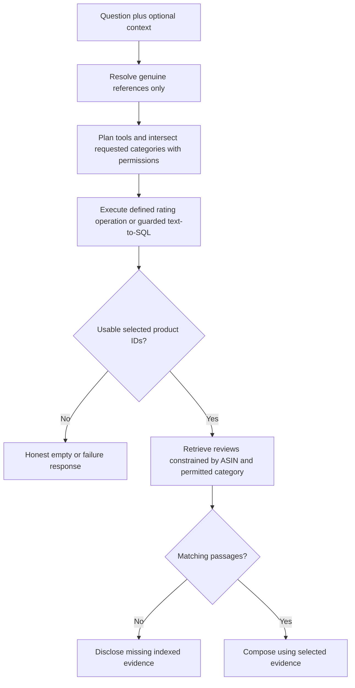

# M4/M5 — Answer quality Stage 2

> This note includes dated intermediate results. The latest consolidated status
> and publication/verification boundaries are in [answer-quality-status.md](../answer-quality-status.md).

Stage 1 accepted; Stage 2 implementation authorized by the user's “proceed”.
The user accepted this bounded implementation on 2026-11-03 with “go ahead”.
Stage 3 isolated implementation was then authorized; overall answer quality still fails.

## What changed

- Complete questions, including initial “why” and topic switches during pending
  clarification, stay standalone. Genuine “why is that?”/clarification replies
  retain subject context; explicit category switches replace the prior category.
- Router plans SQL plus review retrieval for explanations of lowest-rated products.
  Requested canonical categories intersect role permissions before SQL/reviews;
  an empty intersection stays empty. Permission scope remains separate in audit.
- Two bounded SQL operations use explicit semantic contracts: category averages
  mean `AVG(rating)` at review grain; lowest products aggregate all review ratings
  by ASIN/category, minimum 2 reviews (configurable upward), default 1 product,
  explicit top/bottom limits capped at 25. Titles/counts accompany selection.
  Unknown modifiers, time/subpopulation filters and explicit product-metadata
  measures stay on generated SQL rather than being silently discarded.
- Other text-to-SQL receives grain, types, canonical categories and metric meaning.
  Its single retry receives the redacted failed statement and bounded error.
  This improves the contract; it does not validate arbitrary generated SQL semantics.
- Selected ASINs become parameterized retrieval filters alongside role/request
  filters. Empty/failed/unidentified selections never retrieve unrelated products.
  No matching indexed passages yields a selection-only explanation of the limit.
- Empty SQL cannot become a citation/table or be filled by old memory. Failure,
  empty and selection-only outcomes remain distinct. Overflow fetches one extra
  row and reports `has_more`; the small frontend integration uses “at least”
  counts, avoids charting incomplete results, and labels partial/failure states honestly.

No schema/index/data changes, provider/model changes or hosted calls. Markdown,
grouped citation parsing, categorical chart semantics, prevalence/support checking
and review-update interpretation remain later-stage work.

## Data flow

The selection branch applies to lowest-product explanations. Ordinary review,
doc and metric-change paths remain available; this is not a universal why router.

## Verification

| Check | Result |
|---|---|
| Scoped tests | **118 passed**, including semantic SQL, guards, retrieval joins, memory interpretation, empty outcomes, repair feedback and baseline/hosted guards |
| Synthetic comparison | 24 core case/role executions; **108 assertion PASS, 0 FAIL, 66 NOT RUN** including unmeasured qualitative/browser checks and pending boundaries; 0 complete case PASS |
| Before baseline | Preserved `quality-baseline.*`: 12 failing rows / 29 failing assertions; no threshold relaxation |
| Real read-only smoke | **6 passed**: category averages, toy sequence, Electronics explanation, Beauty evidence, out-of-role Books, policy retrieval |
| Numeric reference | Live category review averages equal independently computed Stage 1 reference |
| Existing corpus | Read-only sessions; counts unchanged: 225000 review chunks, 79 doc chunks |
| Additional generation cost | **$0**; model generation explicitly disabled for smoke |
| Frontend | `npm run build` passes; React server rendering checks overflow/legacy/partial/failure integration |
| Lint/format | Scoped ruff/black and whitespace checks pass |

DB-free/scoped tests deliberately use `--noconftest`; they never run the shared
DB-creating fixture. The older SQL tests read existing Gold only. No destructive
DB-backed pytest suite was run against the serving corpus.

Committed candidate synthetic comparison:
[`quality-stage2.md`](../testing/acceptance/quality-stage2.md) / companion JSON.
Live evidence stays outside Git at `/private/tmp/ric-stage2-readonly-smoke.json`;
React checks at `/private/tmp/ric-stage2-render-check.json`. Temporary files may be
cleaned by the OS.

## Remaining limitations and Stage 3 handoff

Both live selected lowest-rated products lack any review chunks in the index,
confirmed by independent ASIN counts, not only zero search hits. SQL selection now
works, but the current vector corpus cannot explain these specific products.
The response says so. Stage 3 must measure SQL/vector product overlap, define
coverage/sampling and plan a bounded migration/backfill before any reindex.

Category interpretation is a bounded configured-vocabulary/unique-alias matcher,
not general entity resolution; unsupported phrasing and complex qualifiers still
need evaluation. Generic generated SQL receives better guidance/repair but lacks
a general semantic correctness guarantee. No new hosted synthesis/repair,
calibrated faithfulness, browser layout/clicks, persistent memory/ownership or
adversarial boundary validation is claimed. Synthetic adapters do not establish
live model answer quality. Existing Stage 1 defects outside Stage 2 remain open.

## Decisions and build metadata

Prefer deterministic execution of two explicit metrics plus the existing SQL
adapter for other requests, over prompt-only repairs or a framework migration.
Preserve permissions and serving data; source gaps must cause an honest limitation.
Three ordered submodules, developer/tester/documenter roles adopted in-session;
0 sub-agent calls. Additional cloud generation spend $0. Wall-clock approval-to-
completion was not independently timed. No commit, push or deployment.

## User-requested live browser extension

The user subsequently requested live browser output checks. Installed Chrome ran
13 actual UI queries for marketing/executive against isolated Vite/FastAPI servers,
real existing corpus and configured hosted models. Corpus access remained read-only;
conversation storage was ephemeral, so durable DB-backed chat persistence remains
unvalidated. No runtime code changed during this review.

Stage 2 category constraints, review-grain averages, selection/review routing,
standalone/follow-up behavior and empty-result handling worked in the tested UI
states. Evidence opened for 11 cited answers; temporary history replay retained
citations. Desktop had no observed app exceptions/history errors. Phone viewport
390×844 had no horizontal overflow; history, evidence sheet, Escape and focus return
worked, with composer reachable by scrolling. Emulation is not a physical-device test.

**Output quality still fails.** A generated review-count SQL result was correct,
but its prose called the wrong categories highest/lowest. Literal Markdown appeared
in seven answers; grouped citations lost links; one Beauty summary fell back to
long raw source excerpts; ` ` text and unsorted “ranked” charts remain visible.
Malformed lead text and resolved-review misinterpretation also persist. Added Q27
source HTML normalization to the issue inventory. These are Stage 3/4 follow-ups,
not hidden passes. No aggregate faithfulness/complete acceptance pass is claimed.

24 hosted calls, all finish_reason=stop, provider-reported actual **$0.000890035**;
combined with Stage 1 **$0.003323754**, within the original $2 approval. Local
report/screenshots: `/private/tmp/ric-stage2-browser/report.md` and sibling PNGs.
Temporary test servers/browser are shut down afterward. No serving corpus changes,
user-chat writes/deletes, reindex, model download, deployment, commit or push.
