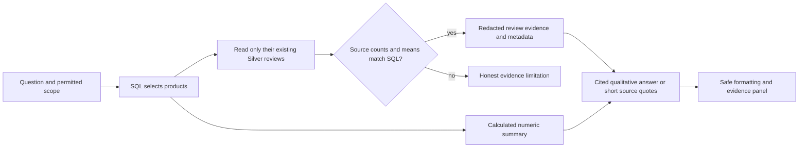

# Practical answer-quality workaround

> This note includes dated intermediate results. The latest consolidated status
> and publication/verification boundaries are in [answer-quality-status.md](../answer-quality-status.md).

2026-11-03. User authorized fixing the explained coverage, metadata and output
problems. Implemented and ready for quality review; publication status is tracked in the current handoff.
Stage 3 fixture infrastructure has not been activated or declared accepted.

## What changed

- Supported lowest-rated-product explanations now read the selected products'
  existing Silver reviews directly. They do not need those reviews to be in the
  vector index. Category/ASIN permissions apply before reading; source review
  counts and average ratings must match SQL selection before evidence is used.
- Read limits: at most 25 selected products, 5,000 source rows by default, three
  negative examples per product under the query's top-k budget, and 12,000 characters
  per complete review. Missing, mismatched, oversized or unsupported sources fail
  honestly. No unrelated products or unverifiable review identities are substituted.
- Source metadata includes product name, review rating/date, available price/vendor
  average, private parent identity and pinned Silver version. Ordinary indexed
  reviews get metadata only on a unique exact ASIN+original-text chunk-ID match,
  never an ASIN-only guess. PII is redacted again before composition/display.
- SQL-only narration is calculated from actual rows instead of generated by a
  model. Complete category extrema/ties and partial-result limits are handled
  explicitly; other shapes get a neutral table introduction. The exact unqualified
  category review-count question uses scoped COUNT(*); qualifiers are not discarded.
  Product vendor averages remain distinct from review-weighted ratings.
- Qualitative generation receives delimited JSON source data and non-citable
  memory, with known prevalence/numeric/ranking/update/malformed-output guards.
  Short fallback quotes prefer explanatory body text and later explicit resolutions,
  rather than titles or long source dumps. Full redacted passages remain inspectable.
- Grouped/adjacent citations share the same numeric-list grammar across backend
  validation, source retention, frontend rendering and replay. Optional citation
  `passage` is additive; old snapshots remain compatible.
- Answers use a safe Markdown subset (headings, emphasis, lists, tables, code and
  evidence buttons). Raw HTML never executes; source HTML is normalized after
  retrieval without changing stored text/vectors. Generated arbitrary links are
  rendered as labels, not activated URLs.
- All roles use validated data dimensions: category/product comparisons sorted by
  actual values or chronological time series with actual time spacing. Ambiguous,
  incomplete, mixed-granularity or invalid-date data stays a table. Categories do
  not become time/sentiment trends; no unsorted ordinal ranks or invented themes.

No serving ETL, schema migration, reindex, corpus embedding, provider/model change,
deployment, commit or push was performed. This is read-only retrieval over an
existing table, not ETL invoked per query. General review search still uses the
sampled vector corpus and cannot establish population-wide theme prevalence.

## Evidence

| Check | Observed result |
|---|---|
| Scoped backend regression | **152 passed, 1 explicitly deselected** old real-model test; inspected DB-free suites use `--noconftest`, SQL tests read Gold into in-memory DuckDB |
| Cached-model fixture regression | **18 checks passed** with real local embeddings/SQLite/Delta/pipeline; output `/private/tmp/ric-stage4-regression-fixture.json`; Stage 3 artifacts preserved |
| Frontend | Build/typecheck and `npm run test:answer-quality` pass; actual components tested for safe formatting, group references, comparison/time semantics, incomplete data and replay |
| Real missing Toys product | **2 verified source review passages**, with product/date/rating metadata, replacing the previous coverage-only answer |
| Real missing Electronics product | **3 verified source review passages**, with selection aggregates checked; Wi-Fi/setup/longevity complaints are visible in actual source text |
| Real count narration | Clothing, Shoes and Jewelry **72,198** highest; Books **33,513** lowest, matching actual SQL, not the earlier incorrect generated narrative |
| Final browser run | **8 actual React/FastAPI queries** across marketing/executive, real existing data, generation disabled; evidence opening, full passages and actual ephemeral history replay checked |
| Browser formatting fixture | Separate synthetic API response for Markdown/grouped citations; source 3 opens correctly. This is UI-only evidence, not hosted-generation support evidence |
| Phone emulation | 390×844, no horizontal overflow; evidence sheet opens, close receives focus, Escape closes, native-click trigger regains focus |
| Corpus preservation | Final read-only check confirms **225,000 review/79 document chunks**, unchanged review-ID checksum and unchanged Gold/Silver Delta versions |
| Spend | **$0 additional**; cumulative earlier hosted actual remains $0.003323754 |

Browser testing used isolated Chrome/React/FastAPI services and ephemeral chat
storage, with Postgres transactions enforced read-only and audit/tracing disabled.
The browser run was repeated after visual inspection found title/heading-only
fallbacks; explanatory body excerpts replaced them. An initial CDP quoting error
was corrected without treating it as an application defect. Final run has no
observed JavaScript exceptions. All temporary services were stopped.

Local live evidence (redacted, outside Git):
`/private/tmp/ric-stage4-final-live-check.json` and
`/private/tmp/ric-stage4-browser/{responses.json,browser-results.json,*.png}`.
Only synthetic fixture observations belong in the acceptance artifact. Prior Stage
1 `quality-baseline.*`, Stage 2 `quality-stage2.*` and Stage 3 `evidence-stage3.*`
were preserved.

## Limits and operation

The source workaround applies to supported SQL-selected product explanations.
Other review questions retain sampled retrieval, not full review-population
coverage. Conservative rating filters and lexical/update checks can reject useful
nuanced evidence. Exact legacy metadata matches can remain ambiguous/unavailable.
Changing/deleting source data can cause aggregate mismatch and an honest limitation;
it cannot silently explain a different population.

The tested fixes prevent the demonstrated SQL-only narration contradictions, known
rendering defects and missing selected-product evidence in these cases. They do
not establish general factual entailment. Citation syntax, lexical checks and a
plausible answer are not proof of support. Hosted-model wording, general semantic
faithfulness, length-limit/finish-reason recovery, arbitrary generated SQL semantics,
durable DB-backed history/ownership and physical-device accessibility remain
unmeasured here. Stage 5 tuning/bake-offs have not started.

`SOURCE_REVIEW_FALLBACK=false` disables source-first retrieval and exact metadata
enrichment without altering data. Normal app restart loads the code changes;
`.env` was left untouched (including its existing parser warning). Existing
provider adapters and governance remain in place. No bulk migration is required
for this workaround; any future full backfill/cutover still needs its own plan.

Build metadata: no subagents; approval-to-completion wall time was not independently
timed; additional cloud spend $0. Original module statuses remain unchanged.

## Reported combined-question correction (2026-11-03)

The product explanation plus damaged-item policy question was classified once as
SQL/review. Its policy wording also bypassed the supported lowest-product SQL
template, allowing a calculation failure and skipping document retrieval.
This was query planning, unrelated to embeddings or new raw_meta fields.

Explicit independently phrased questions now run separately through the same
scoped executor, then combine into numbered sections with globally remapped
grouped citations. The caller shares one budget and persists one combined turn.
One part failing preserves the others. Category lists/dependent clauses remain
intact; over four explicit parts asks for a shorter request. This is bounded
decomposition, not general multi-step language planning. A single resulting SQL
block is retained; several calculations retain cited summaries without attaching
one table to all answers. Frontend audit types add compound/composite.

Complaint “most common” requests explicitly disclose that retrieved examples
cannot establish prevalence. No population theme ranking was implemented.
Extractive examples now have paragraph separation. Citation validation remains
a syntax check, not factual entailment.

Verification was intentionally narrow: 78 tests across combined-question, Stage2,
router and composer suites pass in 0.69 seconds; scoped ruff/black and frontend
type/build pass. A single real combined-question scenario is checked read-only
with generation disabled; details in context/WORKLOG.md. No browser campaign,
provider requests, indexing, ETL, downloads, commits or deployment.
