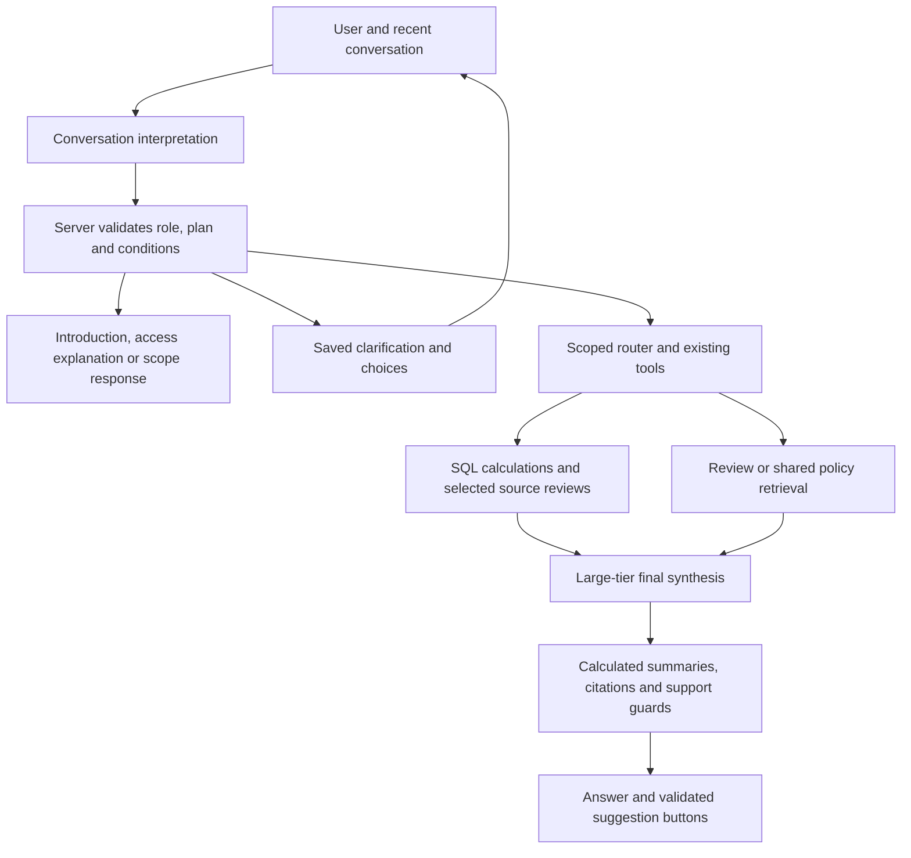
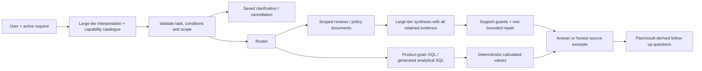

# Conversational planning correction

> This note includes dated intermediate results. The latest consolidated status
> and publication/verification boundaries are in [answer-quality-status.md](../answer-quality-status.md).

User authorized analysis and implementation on 2026-11-03. Spec:
`.claude/specs/M4_conversational_planning.md`. Prior staged work and human
acceptance boundaries remain unchanged.

## Reported failures and causes

| Observation | Cause | Change |
|---|---|---|
| Marketing Automotive asks for clarification | One intent classifier can clarify prohibited data | Code checks requested categories against actual policy before retrieval; explains access and offers permitted alternatives |
| Marketing Home/Kitchen and support Beauty show generic empty state | UI replaces uncited replies with no-evidence copy | Deliberate conversational/access path renders the actual explanation |
| Own-role question retrieves irrelevant reviews | Capability question falls through to customer-voice route | Answer from server policy, no retrieval |
| Hello asks what user wants | No introduction handler | Capability introduction and permitted suggestions |
| Python request retrieves programmable remotes | Unrelated request falls through after clarification | Out-of-domain response before retrieval, including short reply “python code” |
| “automative” searches multiple permitted categories | Typo fails canonical category matching | Only unambiguous close vocabulary matches canonicalized; filters still intersect role |
| “how about Pet Supplies?” loses context | Missing follow-up cue | Preserve prior question/sentiment while replacing category |
| Lowest-products selection silently uses one tiny product | Missing business definition | Clarify rank vs threshold and minimum review count; default up to five after definition, maximum25 |
| Beauty praise includes criticism from a high-rated review | High star rating does not make every sentence positive | Stronger synthesis instructions preserve mixed feedback/caveats and treat customer safety beliefs as opinions; hosted wording remains unmeasured |

## Implemented flow

Obvious greetings, own-role questions, unrelated coding requests and prohibited
categories use deterministic handling. Remaining interpretation uses the existing
configured large tier (`understand`); final composition also uses large. This is a
user-requested policy change, not a claim that a larger model was benchmarked as
better. Free/Azure adapters keep their configured deployment; no new model slug,
provider or download. Model output is typed, maximum four parts, with role-owned
filters and original qualifiers preserved rather than trusting arbitrary rewrites.

Product clarification state lives in the existing message JSON payload. Mode,
average threshold, minimum reviews and count limit are validated. “below 2” then
“2” resumes as average below2/minimum2 reviews; invalid replies remain questions.
Standalone topic changes can leave clarification. Unknown selection qualifiers
(price/date/brand/verified/time partitions) ask to restate supported criteria;
they are never silently dropped. All averages use all available rated review
rows. Absolute threshold is applied in HAVING, not to individual review rows.
Counts reflect this dataset, not a complete external review history.

Compound requests share one ledger and persist once. Per-part evidence is prepared
without per-part generation, then one bounded final composition call sees each
part's question and retained redacted passages. It returns typed per-part prose;
cross-part/missing citations, known unsupported prevalence/numeric/update claims
fall back to source excerpts. SQL summaries are added in code; source mappings,
partial coverage and access notices survive. These guards do not prove entailment.

Suggestions are optional additive response/history fields. The model can choose
from supported structured actions; code renders canonical questions and filters
categories against policy. Three deterministic alternatives remain available.
Clarification choices use the same UI. Buttons fill and focus the composer without
submitting. Old snapshots tolerate absent fields. PII is redacted from saved
clarification state. No database DDL or corpus mutation.

## Verification

- 116 focused backend tests pass (0.74s); no shared conftest/serving DB mutation.
  Prior regression requests now supply explicit criteria where the new UX
  intentionally clarifies. Original Stage1–3 acceptance artifacts are unchanged.
- Scoped black/ruff and frontend type/build pass. Existing frontend harness tests
  role replies surviving empty-source rendering, clarification/replay choices,
  button click callbacks/type=button, plus prior safe formatting/citation/chart
  contracts. This is component verification, not a new full browser campaign.
- 11 real API-handler queries with generation disabled cover reported controls,
  category typo/follow-up, and compound selection+policy. Read-only live data
  selects five Electronics products averaging below2 with minimum2 reviews,
  checks source aggregates, and returns SQL+review+docs with7 citations.
  Artifact `/private/tmp/ric-conversation-smoke.json` stays outside Git.
- Final three-turn API-handler smoke (question → below2 → minimum2) also selects
  five products and returns seven citations; artifact
  `/private/tmp/ric-conversation-final-smoke.json`. PostgreSQL read-only enforced;
  225000 review/79 document chunks preserved.
- Stage3 offline smoke request now states criteria explicitly; its prior artifact
  is preserved and that separate cached-model smoke was not rerun this turn.
- Test-harness corrections: fixture adapters now patch the new planner to avoid
  accidental provider calls; scripted signatures accept structured selection.
  Node component harness supplies its Vite base-URL constant when panel-state
  imports API types. Earlier first-run guard tests exposed a missing allowed
  connective (“at”), corrected before final verification.

## Limits and review status

No hosted model request was made. Real provider interpretation/synthesis quality,
latency/cost changes, unrestricted paraphrase understanding and physical browser
focus behavior are not established by these tests. No perfect-answer claim.
General review search is still sampled; theme frequency aggregation over hundreds
of complete reviews has not been implemented. Bounded all-review source checks,
source-size/row limits and honest missing/partial states remain in force.

No ETL/index/backfill/schema/data mutation, model downloads, deployment, commits
or pushes. Additional cloud spend$0. Human review pending; Stage3/full quality
acceptance is not inferred. Wall time not separately measured;0 subagents.

## Real-user conversation repair — 2026-11-03

The user's live transcript disproved the earlier confidence in natural conversation.
The previous generation-disabled smoke tested tool wiring, not hosted interpretation.
This pass used actual Chrome → React → FastAPI → configured hosted models, existing
Gold/Silver/indexed data, isolated RAM-only chats and PostgreSQL read-only sessions.

| Observed defect | Implemented correction |
|---|---|
| Category price/discovery questions repeatedly clarified | Entry capability catalogue describes review grain, product fields, operations, missing prices and source limitations |
| Filler words and “five” rejected before interpretation | Removed selection word whitelist; semantic interpretation precedes selection validation; numeric words and ordinary articles supported |
| Structured output discarded, then raw query misrouted | Normalize safe model shape variations, validate conditions/categories/numbers and preserve simple executable catalogue contracts on model failure |
| Previous average/threshold inserted into new request | Current operation/count/order/mode wins; preserve typed active request separately from plain findings; standalone questions retain independence |
| Category became a product-name filter | Distinguish canonical category from literal title substring; disclose title matching rather than claim a smartphone taxonomy |
| Raw AVG(price) over-weighted heavily reviewed products | Product queries deduplicate ASIN/category before averaging/ranking/counting; show known-price and missing-price counts; price metadata is not a live quote |
| Clarification state disappeared; “do it” loop lost choices | Persist typed active plan and missing selection slots in existing message JSON; retain choices when material conditions remain missing; explicit cancellation/reset |
| Model dropped policy question or repeated old tasks | Preserve independent-question cardinality and policy companions, including imperative and reverse-order clauses |
| Review requests acquired unrelated price tasks | Validate explicit feedback intent; preserve praise/dislike through category/“drawbacks” follow-ups; enforce role scope before tools |
| “Ignore my role” returned an introduction | Explicit prohibited data requests produce a denial with permitted alternatives; no review/SQL tools |
| Generic no-evidence UI concealed genuine zero matches | Render the backend's specific zero-match/failure explanation in live/replayed answers |
| Suggestions repeated unrelated policy/review prompts | Generate executable questions from typed plan, category/title/price constraints, selected criteria and empty results; preserve composer-only/focus behavior |
| Final synthesis saw only fallback's three quotes | Keep all retrieved sources in an internal non-serialized evidence pool until final synthesis; retain only used citations in the public answer |
| Model inferred full purchase refund from shipping-fee clause | Prefer return-policy documents for return questions; reject unsupported full-refund wording; distinguish policy language from unmeasured review prevalence; one bounded same-source repair before excerpts |

### Verification and corrections during the live run

- 71 real browser turns across 27 distinct query strings, including debug replays
  and affected-case rechecks. This is NOT 71 successful final-build tests. Real
  failures were inspected, repaired and replayed; targeted rechecks replaced
  restarting the whole matrix after each edit.
- 25 named final/latest-outcome checks pass against independently written Gold
  aggregations, scopes, selection-source aggregate checks and inspected outputs.
  These checks do not constitute a complete answer-quality benchmark.
- Electronics: product-weighted recorded-price average **67.341765…**, 26,504
  products with prices, 13,244 without; previous raw review-weighted answer 64.69
  was wrong for the user's product question. Exact cheapest-product IDs/order
  and reverse price/count corrections match independent aggregation.
- Electronics “smartphone” title substring: **718 products**, mean recorded price
  **68.688518…** among 432 with prices, 286 without. Literal title search also
  finds accessories; it is not a verified handset classifier.
- Electronics averages below 2/5 with at least 50 reviews: **zero matches**.
  The five lowest among products with 50+ reviews average **4.08–4.47**, so the
  answer explicitly avoids calling them poorly rated overall.
- Independently verified generated SQL: **2,733 Electronics reviews in 2023**,
  `AVG(rating) = 4.290523234540798`. Count and average remain separate cited parts.
- Marketing/Support role denials, permitted policy companion, category typo,
  praise → drawbacks, category-only follow-up, natural count/order correction,
  cancellation and unrelated coding request exercised through the real app.
- Actual source links, RAM-backed history replay, composer-only suggestion click
  and focus (after the scheduled animation frame), and 390px no-horizontal-overflow
  checked in Chrome. No browser JavaScript exceptions in completed checks.
- 138 focused DB-free tests pass in 0.86s (`--noconftest`); scoped black/ruff/diff,
  frontend answer-quality harness and production build pass. The final standalone
  global-question guard has scoped coverage; no additional hosted matrix rerun.
- PostgreSQL read-only enforced. Final 225,000 review / 79 document chunks,
  identical review-ID SHA256 using the original newline-per-ID algorithm, and
  Gold structured/reviews + Silver Delta versions all **1**. No migration/backfill,
  corpus writes, ETL/reindex, model download, deployment, commit or push.

Local artifacts (not committed): `/private/tmp/ric-natural-browser/` contains
`responses.json`, `model-output.json`, `ground-truth.json`, `checks.json`,
`final-data-check.json`, `budget.json`, browser drivers and screenshots. Earlier
Stage 1–3 acceptance artifacts remain unchanged. All temporary servers/Chrome stopped.

### Honest limits

Some Pet Supplies and policy drafts still fail support/prevalence checks after a
bounded repair and display source excerpts. This is deliberate degradation, not a
claim that final wording is consistently polished. Syntax/number/source-retention
checks do not prove every generated assertion follows from its citations. Specific
passages were manually compared for the tested Beauty, drawback, selected-product
and policy examples; no complete semantic-entailment evaluation is claimed.
General review retrieval remains sampled and does not measure population complaint
frequency. Arbitrary generated SQL and unlimited natural-language variations remain
outside the named checks. Suggestions derive from supported plan/result context;
they do not assert that every proposed next query has matching rows.

Build metadata: 0 subagents; wall-clock time not separately metered. Provider-reported
additional spend **$0.010445375**, 118 attempts, 114 with reported cost and 4 hosted
HTTP failures without cost. Conservative reservations retained **$0.42382848** within
the shared $1.50 test cap and original $2 authorization. Earlier reported spend
$0.003323754; cumulative reported **$0.013769129**. Runtime configuration and .env
unchanged. Human review/acceptance and full answer-quality acceptance remain pending.

## Selected-product demo follow-up repair — 2026-11-04

Read-only audit inspection confirmed the reported ranking → “What do reviewers
 dislike about those products?” sequence: history loaded, but the second plan
rewrote names into sampled review search, skipped SQL/source selection and returned
zero citations. The original “Which three” also defaulted to five products.

Explicit negative-feedback references now reuse the saved typed rating criteria
before model interpretation, rerun scoped SQL, and use existing aggregate-checked
Silver reviews by product ID. Count extraction recognizes “Which three”. New
categories, global questions, positive feedback and additional qualifiers do not
enter this negative-review shortcut. This reruns criteria on the current data;
immutable cross-snapshot selection is not claimed. Start a fresh chat to replace
an already failed turn that overwrote its active selection state.

Verification: **185 inspected offline tests passed**, scoped Ruff/Black passed.
Generation-disabled real-data execution selected exactly three products, then
returned SQL + review tools, four citations and six review parents; Silver v1
count/mean checks passed for every selected product with no missing IDs. Network
was blocked during this smoke; no provider calls, history/audit writes, data/index/
schema changes or application restart. The hosted/browser interaction was not
rerun. Local smoke: `/private/tmp/ric-demo-followup-smoke.py`.
