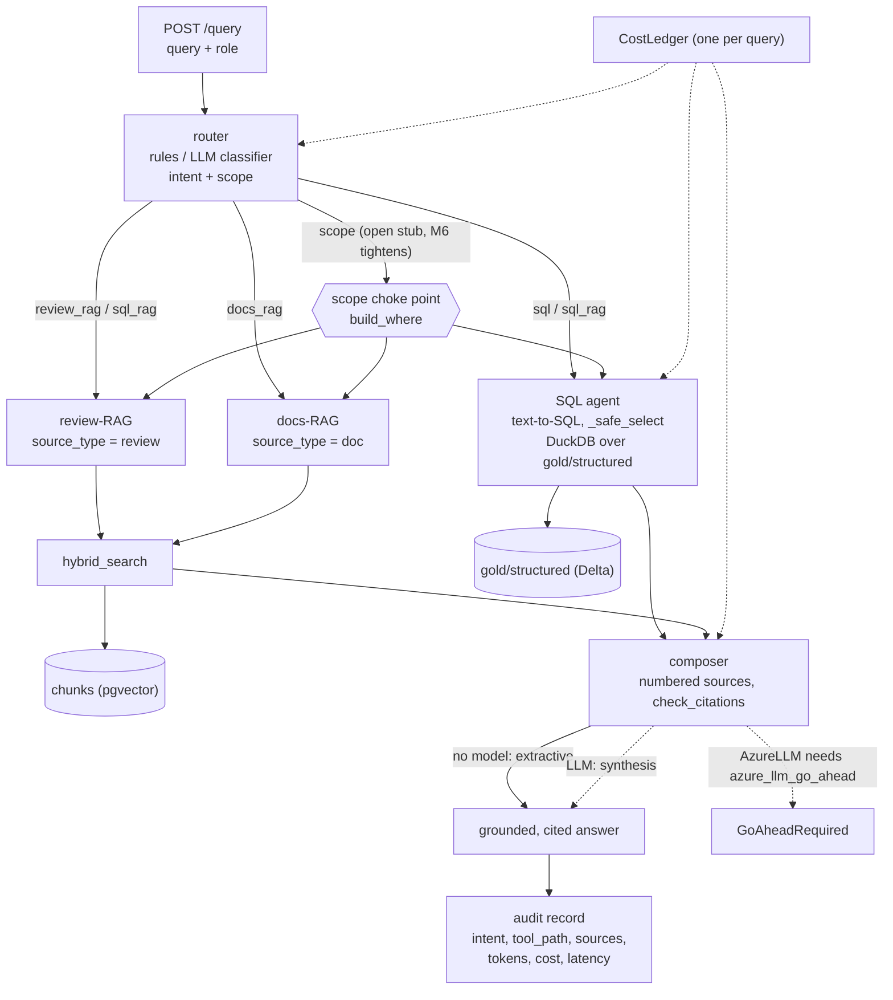
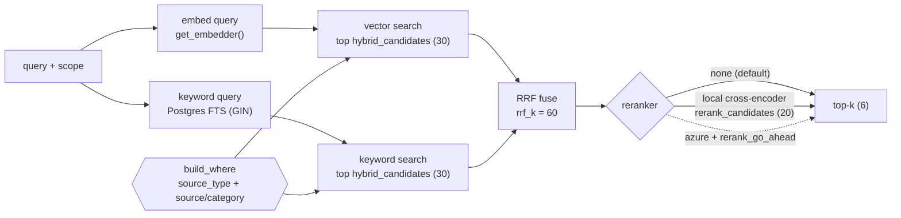

# M4 — Retrieval & agents

Date: 2026-10-27. Spec: `.claude/specs/M4_retrieval_agents.md`. Cloud spend: $0.

## What was built

A query-time pipeline over M3's `chunks` store and M2's Gold `structured` table: a router picks a tool, the tool gathers evidence, a composer writes a cited answer, and an audit record is returned with it. It is exposed as `POST /query`. The whole free path runs at $0 with no hosted model. Azure LLM and Azure rerank sit behind gated seams and were not run.

| Sub-module | Delivered | Key files |
|---|---|---|
| M4.1 LLM adapter + cost wrapper | `LLM` seam: `FreeLLM` (free-tier model), a deterministic no-LLM extractive fallback when no model is configured, and `AzureLLM`, which raises `GoAheadRequired` unless keys and `azure_llm_go_ahead` are set. Every call goes through `CostLedger` (tokens, USD, `llm_max_tokens`) | `backend/agents/llm.py`, `backend/tests/test_llm.py` (6) |
| M4.2 Hybrid retrieval | Vector search plus Postgres full-text (GIN index) fused by reciprocal-rank fusion (`rrf_k=60`), then a rerank seam (`none` default, `local` cross-encoder, `azure` gated). All filtering goes through one `build_where` choke point | `backend/retrieval/hybrid.py`, `rerank.py`, edits to `schema.py` and `vector_store.py`, `backend/tests/test_hybrid.py` (8, live pgvector) |
| M4.3 Review-RAG and docs-RAG | Thin agents over a shared helper that pins `source_type` (`review` or `doc`) on top of the caller's scope, runs `hybrid_search`, and returns hits | `backend/agents/_rag.py`, `review_rag.py`, `docs_rag.py`, `backend/tests/test_rag_agents.py` (3, in-memory fake store) |
| M4.4 SQL agent | Text-to-SQL over Gold `structured`. In-memory DuckDB reads the Delta table. Generated SQL passes a read-only `_safe_select` guard before it runs | `backend/agents/sql_agent.py`, `backend/tests/test_sql_agent.py` (17, no LLM or network) |
| M4.5 Router | `route(query, role, ledger)` returns `RouteDecision{intent, scope, rationale}`. Ordered rule classifier is the fallback; an LLM JSON classifier is used when a model is available. `derive_scope(role)` is an open-scope stub for M6 | `backend/agents/router.py`, `backend/tests/test_router.py` (14) |
| M4.6 Composer + pipeline + API | `compose()` builds numbered sources, answers (LLM synthesis or extractive list), then enforces citations in code. `pipeline.answer()` runs router, tool(s), composer under one `CostLedger` and attaches the audit record. `POST /query` maps failures to typed errors | `backend/agents/composer.py`, `pipeline.py`, `backend/app/main.py`, `backend/tests/test_composer.py`, `test_pipeline.py` |

### Settings keys added

| Key | Default | Purpose |
|---|---|---|
| `azure_llm_go_ahead` | `false` | Real Azure LLM calls refuse unless true (keys alone are not enough) |
| `llm_max_tokens` | 512 | Output-token cap per LLM call |
| `azure_llm_usd_per_1m_tokens` | 1.0 | Price used by `CostLedger` to estimate Azure LLM spend |
| `reranker` | `none` | `none`, `local` or `azure` (gated) |
| `rerank_go_ahead` | `false` | Azure rerank refuses unless true |
| `rerank_model_local` | `cross-encoder/ms-marco-MiniLM-L-6-v2` | Local cross-encoder |
| `retrieval_top_k` | 6 | Hits returned to the agent / composer |
| `hybrid_candidates` | 30 | Candidates pulled from each of vector and keyword search |
| `rerank_candidates` | 20 | Fused candidates passed to the reranker |
| `rrf_k` | 60 | RRF damping constant |

New backend dependency: `duckdb`.

### API and audit record

`POST /query` takes a query and role and returns `AnswerResult{answer, citations, audit}`. The audit record is built in `pipeline.answer()`:

| Field | Meaning |
|---|---|
| `query`, `role` | The request |
| `intent` | Router decision |
| `tool_path` | Tools actually run, e.g. `["review_rag"]` |
| `sources` | Chunk ids, plus a SQL source marker when the SQL agent ran |
| `tokens`, `cost_usd` | From the shared `CostLedger` |
| `latency_ms` | Wall clock for the whole pipeline |

## Key decisions

| Decision | Why | Rejected alternative |
|---|---|---|
| LLM seam with three implementations: `FreeLLM`, deterministic extractive fallback, gated `AzureLLM` | CI and the e2e smoke run end to end at $0 even with no hosted model. Azure cannot spend without an explicit flag | Mocked LLM in the smoke test; keys alone enabling Azure |
| Hybrid search = vector + Postgres full-text (GIN) fused by RRF (`rrf_k=60`) | Catches both semantic and exact-term matches with no extra service. RRF needs no score calibration between the two rankers. Fits M3's single `chunks` table | Vector only; weighted score blending; a separate BM25 engine |
| Rerank is a seam: `none` default, `local` cross-encoder, `azure` gated | Default stays fast and free. Local reranker is available without cloud. Azure follows the same go-ahead rule as everything else | Mandatory rerank; Azure-only rerank |
| One `build_where` choke point for every retrieval filter (`source_type`, plus `source` / `category`) | Access scope is applied in one place, before the LLM. This is the hook M6 tightens, so M6 changes policy, not plumbing | Per-agent filter code; asking the model to stay in scope |
| `_rag.py` pins `source_type` over any caller scope | A caller scope cannot turn a docs query into a review query or the reverse | Trusting the scope dict as given |
| `_safe_select` guard: one statement, must start with SELECT, no blocked keywords | Text-to-SQL output is untrusted. Read-only is enforced in code, not by prompt | Prompting the model to write only SELECT |
| In-memory DuckDB over the Delta Gold `structured` table | No server, no write path, $0, no Spark at query time (Databricks/ETL stays build-time only) | Spark at query time; querying Postgres |
| Router rule order: `sql_rag` before `sql` | "Why did X drop" needs numbers and review evidence. Checking plain `sql` first would miscatch it as aggregate-only | Single-intent keyword match |
| Composer enforces citations in code (`check_citations`): dangling `[n]` and uncited claim lines are issues | Grounding is a property of the output, not a hope about the prompt. Citations are resolved against the numbered sources actually retrieved | Trusting the model's citations |
| Audit record built once in the pipeline and returned with the answer | Reconstructs why an answer was given: query, role, intent, tool path, sources, tokens, cost, latency | Logging inside each agent |
| Cost posture: free path $0, Azure paths gated by `GoAheadRequired` | Same gate as M1 to M3. A cloud call never runs silently | Silent fallback to local when Azure is requested |

## Problems faced & fixes

| Problem | Resolution |
|---|---|
| **SQL guard is conservative.** It rejects blocked keywords even inside string literals | Accepted. Gold `structured` has no free-text column, so there are no legitimate literals to trip it. Safer to over-reject than to parse SQL |
| **CTEs are rejected.** The guard requires the statement to start with `select` | Accepted for now. Aggregations in scope are expressible as a single SELECT. Revisit only if a real query needs a `WITH` |
| **`run_sql` can surface a raw DuckDB `CatalogException`** (for example, Gold table missing or a hallucinated column) | `pipeline.answer()` catches generic exceptions and re-raises a `PipelineError`, which `/query` maps to a typed 502. No unhandled 500 |
| **No project venv** | Built and tested in the scratch venv again. CI note: provision Python 3.12 plus `duckdb` and the M1 to M3 deps |
| **Retrieval quality on the tiny slice.** The committed 6-review slice returned an Electronics hit for a Home_and_Kitchen query | Not an M4 defect. With 6 reviews there is little to rank. Flagged for M7 evaluation on a larger free-embedder run |
| **Free-mode answers are not synthesised.** With no model, the answer is an extractive list of cited snippets | By design. The LLM path produces synthesis. Free mode still satisfies "grounded and cited" |

## Discussion / corrections

No reviewer course-corrections to scope. The router's access scope is deliberately an open-scope stub: M4 routes every call through the choke point, and M6 supplies the real role policy.

## Visuals

Query-time flow. Solid edges ran in the smoke test. Dotted edges are gated and were not run.



Hybrid retrieval pipeline:



### Captured `POST /query` (free mode, live pgvector, $0)

Review-themes question routed to `review_rag`, extractive path, HTTP 200:

```jsonc
// POST /query  {"query": "what are common complaints about Home_and_Kitchen?", "role": "support"}
{
  "answer": "review B000000010 (Electronics): Review 24 Solid build quality. Would not buy again. [1]\nreview B000000005 (Home_and_Kitchen): Review 33 Solid build quality. Would not buy again. Contact me at [EMAIL] for details. [2]\nreview B000000011 (Home_and_Kitchen): Review 25 Solid build quality. Would buy again. [3]\n...",
  "citations": [
    {"n": 1, "source_id": "16c0f0d0…fae3", "label": "review B000000010 (Electronics)"},
    {"n": 2, "source_id": "f25229d0…1f55", "label": "review B000000005 (Home_and_Kitchen)"},
    {"n": 3, "source_id": "3dbdccd5…63c8", "label": "review B000000011 (Home_and_Kitchen)"}
  ],
  "audit": {
    "query": "what are common complaints about Home_and_Kitchen?",
    "role": "support", "intent": "review_rag", "tool_path": ["review_rag"],
    "tokens": 0, "cost_usd": 0.0, "grounding": {"path": "extractive", "issues": []}
  }
}
```

Two things worth seeing in this capture: (1) every `[n]` resolves to a `source_id` the tool
returned (grounding enforced in code, not by prompt); (2) the `[EMAIL]` token in review
`B000000005` shows M2's ingestion-time PII redaction carried through retrieval end to end.
The Electronics hit under a Home_and_Kitchen query is the tiny-slice retrieval-quality
observation (6 review chunks; top-k ≈ whole slice) deferred to the M7 eval gate, not an M4 defect.

## Result

- **Verdict: PASS (module gate).** Full backend suite: 73 passed, 0 skipped, 0 failed, run live against pgvector. ruff and black clean.
- **Real e2e smoke (free mode, no hosted model, real embedder, live pgvector, not mocked):**

| Query type | Route | Outcome |
|---|---|---|
| Review themes | `review_rag` | Grounded and cited, $0 |
| Policy question | `docs_rag` | Grounded and cited, $0 |
| Aggregate | `sql` | Refuses cleanly as a typed 502 (free mode has no model to write SQL) |

- All Azure paths (LLM, rerank) raise `GoAheadRequired`; none were run.
- **Next:** M6 replaces the `derive_scope` stub with a real role policy and enforces it at `build_where`. M7 evaluates retrieval and answer quality on a larger index, including the Electronics-on-Home_and_Kitchen observation. The audit record is the base for M6 auditability.

## Build metadata

- Build time (checkpoint-1 approval → module done): ~19 min of sub-agent runtime (run serially).
- Sub-module cycles: 6 | sub-agent calls: 15 total — planner ×1, developer ×6, tester ×7
  (one per sub-module + one module-level gate), documenter ×1. No re-build cycles (every
  sub-module passed its scoped test first pass).
- Cloud spend this module: $0.00 (from COST.md; free path only, all Azure paths gated).
- Claude session usage: run `/cost` for this session's token usage.

## Change — D-1 (2026-10-28)

Scoped `/change` fix after acceptance testing. Module history above is unchanged.

**Defect D-1 (High):** category-scoped roles (`support`, `marketing`) retrieved **zero** docs.

**Root cause:** a role's product-`category` allowlist (from `ACCESS_POLICY` in `backend/governance/policy.py`) was merged into the retrieval filters for both source types. Doc chunks have `category = NULL`, so `category = ANY(...)` matched no doc rows.

**Decision (Option A, ADR in `context/DECISIONS.md`):** fix it at the single merge choke point, `backend/agents/_rag.py::rag()`.

| Option | Verdict | Why |
|---|---|---|
| **A. Drop `category` for `source_type == "doc"` in `rag()`** | Chosen | One merge point; docs stay scoped by `source_type`; review/SQL category enforcement unchanged |
| B. Strip category inside `docs_rag.py` | Rejected | Splits scope-shaping away from the single merge point |
| C. Per-role `source`/doc-type allowlist in the policy | Rejected | Changes the scope contract M5/M6 depend on, for scope not needed today |

**The change:**

```python
filters: Filters = {**(scope or {}), "source_type": source_type}
if source_type == "doc":
    # Docs are not product-scoped, so a role's product-category filter doesn't apply.
    filters.pop("category", None)
```

Merge-first order is preserved, so the agent's own `source_type` pin still wins.

**Before / after (role scope `category = [...]`):**

| Path | Before | After |
|---|---|---|
| `review_rag` | category applied | category applied (unchanged) |
| `docs_rag` | category applied, 0 hits (docs have `NULL` category) | category dropped, scoped by `source_type` only |
| `sql` | category enforced | unchanged |

**Spec touched:** `.claude/specs/M4_retrieval_agents.md`, sub-module M4.3: new "Docs are not product-scoped (D-1)" acceptance criterion and build step.

**Verification:**

- Unit: `backend/tests/test_rag_agents.py` 6/6 pass, including three new D-1 tests: `test_docs_rag_drops_category_scope_so_scoped_roles_still_get_docs`, `test_review_rag_still_applies_category_scope`, `test_docs_rag_keeps_non_category_scope_keys`.
- Live smoke (human-verified): `docs_rag("What is the return and refund policy?", scope_for_role("support"))` returns 6 doc hits. `review_rag` with a marketing scope returns 0, so the category filter still applies to reviews.
- Not run: whole-suite regression (intentionally out of this scoped pass).

**Acceptance impact:** AC-9 (was failing as D-1 in `docs/testing/acceptance/RESULTS.md`) now passes. AC-4 is unaffected (executive, unrestricted scope).

## Change — D-3 (2026-10-28)

Scoped `/change` fix after acceptance testing. Module history above is unchanged.

**Defect D-3 (Medium):** the SQL agent checked that generated SQL was a single read-only `SELECT`, but not that it was *executable*. A semantically broken query (`SELECT price`, no `FROM`) passed the guard, raised a raw DuckDB `BinderException` at execution, and `pipeline.answer`'s catch-all wrapped it in a `PipelineError`. `/query` returned that verbatim as `502 "Upstream failure: BinderException: ..."`.

**Decision (Option A, graceful 200, ADR "D-3 fix (M4.4)" in `context/DECISIONS.md`):** validate harder, retry once, then degrade cleanly instead of failing the request.

| Option | Verdict | Why |
|---|---|---|
| **A. Require `FROM`, retry once, then degrade to a 200** | Chosen | Fixes the cause and the symptom; the composer still answers from any remaining evidence |
| B. Return a clean 502 | Rejected | Hides the text but still fails a request that could be answered from other evidence |
| C. Static `FROM` check only | Rejected | Does not cover other binder errors (e.g. a bad column) |

**The change** (`backend/agents/sql_agent.py`, `backend/agents/pipeline.py`):

| Piece | Before | After |
|---|---|---|
| `_safe_select` | single statement, SELECT-only, forbidden keywords | same checks, plus requires a `FROM`; otherwise raises the existing `UnsafeSQLError` ("SELECT must read FROM the table") |
| `sql_agent` attempts | 1 | at most 2: on `UnsafeSQLError` or any `duckdb.Error` (covers `BinderException`) it logs the detail at warning level and regenerates once |
| Second failure | raw DuckDB error propagates | raises new `SQLComputeError(RuntimeError)` with the fixed message "Could not compute a valid SQL answer for this question." and no DuckDB text |
| Not retried | n/a | `SQLGenerationUnavailable` (no LLM) and `FileNotFoundError` propagate unchanged |
| `pipeline.answer` | catch-all wraps it, giving a 502 | catches `SQLComputeError` locally: `sql_result = None`, `"sql_agent"` stays in `tool_path`, `audit["sql_error"] = "could not compute"` (present only on failure), then continues to the composer |

The request returns 200. The raw binder text appears only in server logs, never in the answer or the audit.

**Spec touched:** `.claude/specs/M4_retrieval_agents.md`, sub-module M4.4: the read-only validator criterion now requires a `FROM`, plus a new "never leak a DuckDB error (D-3)" acceptance criterion and build step.

**Verification:**

- Unit: `backend/tests/test_sql_agent.py` 21 passed (scoped run, not the full suite). New tests:
  - `_safe_select` rejects a no-`FROM` query and accepts a valid `FROM` query.
  - Retry-once succeeds when attempt 1 is invalid (both a no-`FROM` case and a real bad-column `BinderException` case) and attempt 2 is valid, asserting exactly 2 LLM calls.
  - Two bad generations raise `SQLComputeError` with exactly 2 calls and no "Binder" text in the message.
- Live integrated smoke (tester): real `_safe_select`, real DuckDB on the registered Gold `structured` table, and real pipeline exception handling. Only the LLM SQL-generation step was stubbed, to emit invalid SQL twice. `pipeline.answer(...)` returned normally with no `PipelineError`. The answer was "No supporting evidence was found for this question.", `audit.sql_error == "could not compute"`, and `tool_path == ['sql_agent']`. The 200 is inferred from `answer()` returning without raising; the HTTP route was not invoked.
- Live AC-2 re-run (orchestrator, free mode, $0, pgvector + Ollama llama3.2:3b): across 4 runs `sql_error` was always `None` and no `PIPELINE`/502 occurred, so the original crash does not recur. When the answer routed to `sql` it returned an exact GROUP-BY count cited to the SQL result (e.g. "4 reviews for Sports and Outdoors ... 5 for Toys and Games ..."). The small model is nondeterministic: some runs misrouted AC-2 to `review_rag` and returned "No supporting evidence". That is the separate, still-open **D-2** routing defect, not D-3.
- Not run: whole-suite regression (intentionally out of this scoped pass).

**Acceptance impact:** D-3 is resolved. The SQL path no longer leaks a DuckDB binder error or returns a 502, and on unrecoverable SQL it degrades to a clean 200. AC-2's routing flakiness stays tracked under D-2 and is unchanged by this fix.

## Change — D-2 (2026-10-28)

Scoped `/change` fix after acceptance testing. Module history above is unchanged.

**Defect D-2 (High):** the intent router was LLM-first. It called the local LLM first and used keyword rules only as a fallback. With `llama3.2:3b` (nondeterministic) this misrouted clear aggregates: AC-2 ("how many reviews are there per category?") intermittently went to `review_rag`/`sql_rag`, where the model "counted the retrieved snippets" instead of running a structured `GROUP BY`.

**Decision (Option A, rule-first routing, ADR in `context/DECISIONS.md`):** the regex rules were already correct for exactly the inputs the LLM got wrong, so make them authoritative. This removes the nondeterminism at its source, and skips an LLM call (latency/cost) on every clear question while still letting the model disambiguate open customer-voice questions.

**The change** (`backend/agents/router.py`, `route()`): precedence inverted.

| Step | Before (LLM-first) | After (rule-first) |
|---|---|---|
| 1 | Call LLM, accept a valid JSON intent | Run keyword rules |
| 2 | On failure, fall back to rules | High-confidence hit wins and the LLM is **not called**: why-changed → `sql_rag`; count/average/total/trend/top-N/per-month/how-many → `sql`; policy/warranty/return/how-to/manual → `docs_rag` |
| 3 | Default `review_rag` | No rule matched (the would-be `review_rag` default): consult the LLM; a valid JSON intent wins, else stay `review_rag` |

`_rule_intent` now returns `None` on no-match instead of silently defaulting. The `RouteDecision{intent, scope, rationale}` contract is unchanged, so `pipeline.answer` and downstream agents were untouched.

**Spec touched:** `.claude/specs/M4_retrieval_agents.md`, sub-module M4.5: acceptance criteria updated to rule-first.

**Verification:**

- Scoped tester: `backend/tests/test_router.py` 15 passed, ruff + black clean. Two tests that encoded the old LLM-first precedence were repointed to a genuinely ambiguous query ("tell me about the headphones", matches no rule) to prove the LLM still decides those. New test `test_rule_hit_wins_and_llm_is_not_called` uses a spy LLM (would answer `review_rag`) and confirms "how many reviews per category" still routes to `sql` and the spy's `complete` is never called.
- Live re-run (free mode, $0, pgvector + Ollama `llama3.2:3b`): AC-1 → `sql`; AC-2 → `sql` on all 5 consecutive runs (the intermittent misroute is gone; it runs a structured aggregate, not a snippet count); AC-6 → `sql_rag` with `tool_path=[sql_agent, review_rag]`.
- Not run: whole-suite regression (intentionally out of this scoped pass).

**Residual caveat (not D-2):** the answer *text* for AC-1/AC-6 still wobbles (e.g. generated SQL computed `avg(price)` instead of `avg(rating)`; an empty SQL result on AC-6). This is the separately documented weak-model text-to-SQL nondeterminism of `llama3.2:3b` (`docs/testing/acceptance/RESULTS.md`, Decision 3), not routing. Routing is now deterministic and correct.

**Acceptance impact:** D-2 is resolved; AC-2 no longer flakes on routing. This also closes the AC-2 misroute noted under D-3. Cross-references: `docs/testing/acceptance/RESULTS.md` (D-2 row and resolution note), `context/DECISIONS.md` (D-2 ADR).
