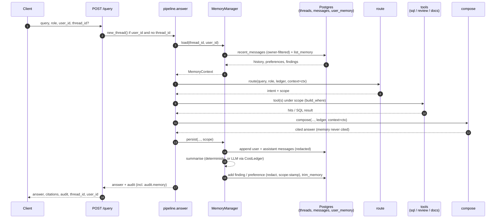
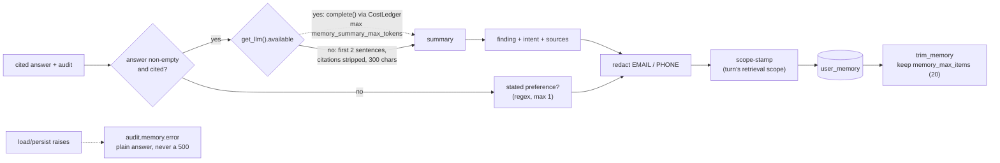

# M5 — Conversation & memory

Date: 2026-10-27. Spec: `.claude/specs/M5_conversation_memory.md`. Cloud spend: $0.

## What was built

A memory layer wrapped around the M4 turn. `pipeline.answer` can now load a thread's recent history plus the user's durable memory, hand it to the router and composer as prompt context, then persist the turn (messages, a summarised finding, any stated preference). It is exposed through the same `POST /query`. The whole path runs at $0 on local Postgres with a deterministic summariser. The Azure summariser sits behind the existing M4 provider seam and was not run.

| Sub-module | Delivered | Key files |
|---|---|---|
| M5.1 Memory store | Three relational tables in the existing pgvector Docker Postgres: `threads`, `messages`, `user_memory` (independent of `chunks`, no embeddings). `MemoryStore` with `create_thread`, `append_message`, `recent_messages`, `add_memory`, `list_memory`, `trim_memory`; per-call psycopg connect like `PgVectorStore`; `get_memory_store()` factory | `backend/memory/schema.py`, `store.py`, `backend/tests/test_memory_store.py` (3, live) |
| M5.2 Load path + context seam | `Turn`, `MemoryContext.render()` (bounded block), `MemoryManager.load(thread_id, user_id, *, limit)`. `route(..., *, context=None)` and `compose(..., *, context=None)` prepend `context.render()` to the LLM user message only | `backend/memory/manager.py`, edits to `agents/router.py`, `agents/composer.py`, `config.py`, `backend/tests/test_memory_manager.py` |
| M5.3 Persist + summarisation | `MemoryManager.persist(...)`: append user and assistant messages, summarise (LLM through `CostLedger` when available, else deterministic), redact, scope-stamp, store at most one `finding` plus one stated `preference`, trim to `memory_max_items` | `backend/memory/manager.py`, `store.py` (`trim_memory`), `config.py`; 4 more tests in `test_memory_manager.py` (10 total) |
| M5.4 Pipeline + API + e2e | `answer(query, role, *, thread_id=None, user_id=None)` loads, passes, persists and emits `audit["memory"]`. `ensure_memory_schema()` once per process. `POST /query` takes optional `thread_id`/`user_id`, creates a thread when only `user_id` is given, returns both | `backend/agents/pipeline.py`, `backend/app/main.py`, `backend/tests/test_pipeline_memory.py` (4, live two-turn smoke) |

### Integration seams

| Seam | How it works |
|---|---|
| Into `route` / `compose` | Additive keyword `context: MemoryContext | None = None`. When set and `render()` is non-empty, the block is prepended to the LLM `user` message. The extractive (no-LLM) composer path ignores it. With `None` the code path is the M4 one |
| Into `pipeline.answer` | Memory is on only if `thread_id` and `user_id` are both set and `memory_enabled`. Load runs in `asyncio.to_thread`; the context is passed via a `**ctx` dict that is empty when memory is off, so M4's call shape is unchanged |
| Out of `pipeline.answer` | After the M4 audit is built, `persist(...)` runs with the router's `scope` and the shared `CostLedger`. Then `audit["memory"] = {thread_id, history_turns_used, persisted[, error]}`, and `tokens`/`cost_usd` are refreshed so summariser spend is counted |
| Storage | Same Docker Postgres as `chunks`, `database_url` reused. `threads(id, user_id, role, created_at)`, `messages(id, thread_id, turn, role_kind, content, created_at)`, `user_memory(id, user_id, kind, content, scope JSONB, created_at)` |

### Settings keys added

| Key | Default | Purpose |
|---|---|---|
| `memory_history_turns` | 6 | Cap on history messages loaded and rendered |
| `memory_enabled` | `true` | Global switch; off means no load or persist |
| `memory_summary_max_tokens` | 256 | Output cap for the LLM summariser |
| `memory_max_items` | 20 | Durable rows kept per user; oldest trimmed |

All four are documented in `.env.example`. `memory` was also added to the setuptools `packages` in `pyproject.toml`.

### API

`POST /query` request gains optional `thread_id`, `user_id`; `QueryResponse` is `AnswerResult` plus `thread_id`, `user_id`. Upstream failures stay typed `PipelineError` to HTTP errors as in M4.

## Key decisions

| Decision | Why | Rejected alternative |
|---|---|---|
| Relational memory, no embeddings | Recency and preference recall needs no vector index and costs nothing. Reuses the existing Postgres. Semantic/vector memory recall and the product-issue-fix / user-preference knowledge graph stay documented PRD §3 stretch | Embedded memory retrieval now; a separate memory service |
| Per-user scope key (`user_id`) plus a `scope` JSONB stamped on every finding | A user loads only their own rows, and a finding records the retrieval scope it was learned under. That is the hook M6 uses to enforce role-to-scope on memory reads, so M6 changes policy, not schema | Enforcing role policy in M5 (M4's `derive_scope` is still an open stub) |
| Deterministic $0 summariser behind the provider seam | `get_llm().available` picks LLM summary through `CostLedger` (capped by `memory_summary_max_tokens`); otherwise first two sentences of the answer, citation markers stripped, truncated to 300 chars. CI and the e2e smoke stay at $0. Azure stays gated by `azure_llm_go_ahead` | Always calling an LLM; failing the turn if the summariser fails |
| Memory is never a citable source | `render()` labels the block "background only; cite only the numbered sources" and findings "context only, not citable". Citations are still resolved against the numbered retrieved sources, and a test asserts memory is not added as a citation. Grounding rules are untouched | Letting prior findings be cited |
| Backward-compatible default-`None` seam | `context=None` and absent ids give the M4 path exactly, so all M4 tests and the $0 path are unaffected | Changing the `route`/`compose` signatures |
| Findings only for cited answers | `persist` writes a finding only when the answer is non-empty and has citations, so refusals and ungrounded text do not become durable memory | Summarising every turn |
| Redact before every write | Query, answer, finding and preference all pass `_redact` (email and phone) before they reach the DB | Redacting at read time |
| Memory is optional and fails soft | Load and persist errors are caught, logged by exception type only, and recorded in `audit.memory.error`; the turn returns a plain cited answer | Letting a memory outage become a 500 |

## Problems faced & fixes

| Problem | Resolution |
|---|---|
| **Wrong premise in the brief.** It said `answer` and `route` already took a per-query context. They did not | The spec stated this explicitly: M5 creates the seam. It was added as an additive default-`None` kwarg on `route` and `compose`, and `answer` gained `thread_id`/`user_id` |
| **`ensure_schema()` was wired nowhere.** M5.1 built it but no app path called it, so a fresh DB would 500 on first memory use | M5.4 added `ensure_memory_schema()` in `pipeline.py`, a one-time-per-process guard (`_schema_ready`), called from both `new_thread` and `_load_context`. The DDL is also `IF NOT EXISTS` |
| **M2 redaction is not importable.** `data/etl/silver.py` holds `EMAIL_RE`/`PHONE_RE` but imports pyspark and lives outside the backend package | Copied the two regexes by value into `memory/manager.py` with a comment saying why. Cost: two copies to keep in sync (see limitations) |
| **`memory` package missing from packaging.** `pyproject.toml` setuptools `packages` did not list it, so an installed build would not contain it | Added `memory` to the list |
| **Spec file list lacked a trim operation.** `memory_max_items` needs oldest-first deletion, but the spec named no store method for it | Added `MemoryStore.trim_memory(user_id, keep)` beyond the spec file list. It is called only when `persist` wrote something |
| **Circular import.** `composer` imports `MemoryContext` from `memory.manager`, and the manager needs `AnswerResult` from `composer` | The manager imports `AnswerResult` under `TYPE_CHECKING` only |
| **Audit cost went stale.** The M4 audit was built before persist, so summariser tokens would not appear | After persist, the pipeline refreshes `tokens` and `cost_usd` from the ledger |

## Discussion / corrections

The only correction was the brief's premise (above), handled in the spec rather than by rework. No re-build cycles were needed. Scope enforcement was deliberately left to M6, as the spec states.

## Known limitations / deferred

These go to CHECKPOINT 2 and are not defects against the M5 acceptance criteria.

| Limitation | Detail | Owner |
|---|---|---|
| **Phone regex is US/NANP-oriented** | The reused `PHONE_RE` misses UK and other international formats, so such numbers could persist unredacted in memory (and were already unredacted in M2 ingestion) | Flag for M6 PII hardening |
| **Caller-supplied `thread_id` is not verified against `user_id` on the write path** | `load` filters history by owner (`recent_messages(..., user_id=...)`), but `append_message` does not check ownership. A caller who supplies another user's `thread_id` reads nothing from it but can append messages to it | M6 access enforcement |
| **No role-to-scope enforcement on memory reads, no durable audit-log store** | Memory is keyed by user and scope-stamped, but reads do not filter by the stamped scope. The audit `memory` block is returned, not stored | M6 |
| **Memory's effect on answer quality, cost, latency is unmeasured** | No evaluation of whether history improves follow-ups | M7 |
| **Summariser exceptions are swallowed** | A failed LLM summary silently falls back to the deterministic one (by design, so memory never fails the turn), but is not logged | Accepted |
| **Free-mode follow-ups don't resolve ellipsis** | With no model the router uses rules and the composer is extractive, which ignore context, so history is stored and loaded but only changes behaviour on the LLM path | By design; LLM path ungated-run is not exercised |

## Visuals

Memory-wrapped turn. Solid edges ran in the smoke test. Dotted edges are gated or only taken when a model is configured.



Persist step and failure guard:



Audit block added by this module (shape from `pipeline.answer`):

```jsonc
"memory": {"thread_id": "<hex>", "history_turns_used": 2, "persisted": 1}
// on a memory failure: adds "error": "load: <ExcType>" or "persist: <ExcType>"
```

TODO for the human: no `POST /query` screenshot or raw capture of the two-turn run was recorded for this note. The behaviour is asserted by `test_two_turn_thread_loads_turn_one_and_persists_at_zero_cost`; a captured two-request curl transcript can be added here if wanted.

## Result

- **Verdict: PASS (module gate).** Full backend suite: 90 passed, 0 skipped, 0 failed, run live against Docker Postgres. ruff and black clean at line-length 100.
- **Real two-turn e2e smoke (free mode, no hosted model, live Postgres, not mocked):** turn 2 on the same `thread_id`/`user_id` recalls turn 1 (`audit.memory.history_turns_used == 2`) and persists a durable item, at $0.

| Check | Outcome |
|---|---|
| Two-turn thread | Turn 1 persisted; turn 2 loads it; $0 |
| `POST /query` with only `user_id` | Thread created, both ids returned |
| Memory failure (load/persist raises) | Plain cited answer, `audit.memory.error` set, no 500 |
| No ids supplied | No `memory` block; identical to M4 |
| PII in query/answer | Email and US-format phone redacted before write; scope stored with the finding |
| `memory_max_items` | Oldest rows trimmed |

- All Azure paths remain gated by `GoAheadRequired`; none were run.
- **Next:** M6 replaces the open `derive_scope` stub with a real role policy, enforces role-to-scope on memory reads using the stamped `scope`, verifies thread ownership on the write path, hardens PII patterns, and persists the audit record. M7 evaluates memory's effect on quality, cost, and latency. M8 adds the chat/thread UI on the extended `POST /query`.

## Build metadata

- Build time (checkpoint-1 approval → module done): ~25 min wall-clock (≈19 min of sub-agent runtime; no rebuild cycles — every sub-module passed first-pass).
- Sub-agent calls this module: **10** — planner ×1 (pre-checkpoint), developer ×4 (M5.1–M5.4), tester ×4 (one scoped per sub-module; the M5.4 run also covered the module-level gate + end-to-end smoke), documenter ×1.
- Cloud spend this module: $0.00 (free path only; Azure summariser gated).
- Claude session usage: run `/cost` for this session's token usage.
