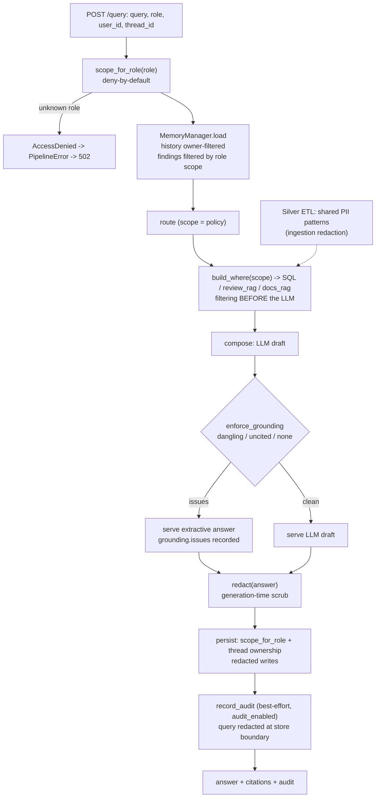

# M6 — Governance

Date: 2026-10-27. Spec: `.claude/specs/M6_governance.md`. Cloud spend: $0.

## What was built

A `backend/governance/` package that turns the M4 open `derive_scope` stub and the M5 "enforced later" hooks into real controls: a role-to-scope policy enforced at retrieval and on memory reads, thread ownership on writes, shared hardened PII patterns, an extracted grounding gate, and a durable audit log. Everything runs at $0 on local Postgres.

| Sub-module | Delivered | Key files |
|---|---|---|
| M6.1 Access policy + retrieval enforcement | `ACCESS_POLICY` (role to `Filters`), `scope_for_role(role)` deny-by-default (`AccessDenied` for unknown or empty role). `router.derive_scope` now delegates to it, so the existing `build_where` path filters retrieval and SQL before any LLM call. `pipeline.answer` maps `AccessDenied` to `PipelineError`, so the API returns 502 | `backend/governance/policy.py`, `agents/router.py`, `agents/pipeline.py`, `tests/test_access_policy.py` (8) |
| M6.2 Memory access + thread ownership | `MemoryManager.load(..., role, ...)` filters prior findings in SQL by the role's scope; `persist` calls `scope_for_role` first (unknown role writes nothing). `MemoryStore.append_message` appends only if `user_id` owns the thread, otherwise raises | `backend/memory/manager.py`, `store.py`, `tests/test_memory_access.py` (6) |
| M6.3 PII hardening | One source of truth for `EMAIL_PATTERN`/`PHONE_PATTERN` and `redact()`, shared by Silver (Spark `regexp_replace`), memory, audit and the composer. Phone pattern widened from US-only to international, UK national, US/NANP and bare local forms. Composer scrubs the final answer (generation-time) | `backend/governance/pii.py`, `data/etl/silver.py`, `memory/manager.py`, `agents/composer.py`, `tests/test_pii.py` (6) |
| M6.4 Grounding gate | `enforce_grounding(answer, valid)` returns issues: dangling `[n]`, uncited claim lines, citation-free answer. The composer calls it on the LLM draft; on any issue the grounded extractive answer is served and `grounding.issues` records why | `backend/governance/grounding.py`, `agents/composer.py`, `tests/test_grounding.py` (5) |
| M6.5 Durable audit log | `audit_log` table and `AuditStore.record`. `pipeline.answer` writes the finished audit dict (query, role, intent, tool path, sources, tokens, cost, latency, grounding, memory) once per turn. `audit_enabled` switch | `backend/governance/audit.py`, `agents/pipeline.py`, `app/config.py`, `.env.example`, `tests/test_audit_log.py` (3) |

### Role to scope policy

| Role | Scope (`Filters`) |
|---|---|
| `executive`, `admin`, `analyst` | `{}` (full access) |
| `support` | `category` in Electronics, Home_and_Kitchen, Automotive, Pet_Supplies |
| `marketing` | `category` in Beauty_and_Personal_Care, Toys_and_Games, Books |
| anything else / empty | `AccessDenied` (502 at the API) |

### Settings key added

| Key | Default | Purpose |
|---|---|---|
| `audit_enabled` | `true` | Persist each answer's audit record to Postgres (best-effort) |

Documented in `.env.example`.

## Key decisions

| Decision | Why | Rejected alternative |
|---|---|---|
| Executive/admin/analyst = `{}`; support and marketing = category subsets | Matches the PRD role split with a policy small enough to read at a glance. `analyst` was added as full-access so existing tests and callers keep working | Per-role source lists for every role; dropping `analyst` and rewriting tests |
| Scoped roles use `category` lists only (no `source_type`) | `build_where` accepts `category` for both vector retrieval and SQL, so the two stay consistent. Each RAG agent pins `source_type` itself and that pin must keep winning | A `source_type` allow-list in the policy that would fight the agents' own pin |
| Findings stamped `{}` are hidden from scoped roles | A finding learned under full access must not leak into a scoped role's context; the M5 `scope` JSONB stamp is the hook, so M6 changed policy, not schema | Showing all findings and trusting the prompt |
| Enforcement before the LLM, deny-by-default | Per `security.md`: access is a retrieval filter, not a prompt instruction. An unknown role fails closed | Defaulting unknown roles to a least-privilege scope |
| Ownership checked in `append_message`, not just on read | Closes the M5 gap where a caller could append to another user's thread | Read-side filter only |
| Phone pattern = 5 ordered alternatives (intl, two UK, US, bare local), most specific first | Alternation is leftmost-first, so looser forms must not pre-empt. Lookarounds and a shared Java/Python regex subset avoid over-redacting ids and ratings while catching UK and `+cc` forms | One loose digit-run regex |
| Single `governance/pii.py` imported by Silver, memory, audit, composer | Removes the two copied regexes M5 flagged; one place to harden | Per-module copies |
| Grounding gate is a behaviour-preserving extraction of the M4 check | Same logic, now named, tested alone and reusable; M4 composer tests still pass unchanged | Rewriting the rules while moving them |
| Generation-time PII scrub in the composer | The LLM can echo PII from a source; redacting the final answer protects the user whatever the model does | Trusting ingestion redaction alone |
| Audit write is best-effort, swallowed (type name logged), gated on `audit_enabled` | An audit outage must not fail a user's turn; the switch keeps CI and local runs optional | Failing the request when audit fails |
| Stored audit `query` is redacted at the store boundary | `security.md` requires redacted audit content; doing it in `AuditStore.record` covers every caller | Redacting only in the pipeline |

## Problems faced & fixes

| Problem | Resolution |
|---|---|
| **`sentence-transformers` missing from the scratch venv**, so live embedder tests could not run | Installed it so the live retrieval and e2e paths ran for real rather than skipping |
| **Spark/`delta` env gap.** Silver ETL PII tests need pyspark, delta and Java | Installed pyspark/delta plus `openjdk@17`; the 16 data tests, including Silver PII, passed live under it. The final shell had no Java, so those could not be re-run at the end (see Result) |
| **Unredacted stored audit query.** The first M6.5 build stored the raw `query`; `security.md` requires redacted audit content | The orchestrator routed it back to the developer once. Fix: `redact(audit["query"])` inside `AuditStore.record`, so the boundary guarantees it. Verified by the live round-trip test |
| **Policy vs agent pin.** Putting `source_type` in scoped policies would have overridden the agents' own pin | Scoped roles carry `category` only (see decisions) |
| **Module-test cleanup blocked.** The permission classifier refused the cleanup of test rows left in the dev DB (a `chunks` table and `audit_log` rows from the smoke) | Not worked around. A manual `TRUNCATE audit_log; DROP TABLE chunks;` is pending for the human (see below) |

## Discussion / corrections

One correction cycle: the redacted-audit-query issue above, caught at review and routed back to the developer, fixed and re-tested. No other rebuilds.

Pending human action: run `TRUNCATE audit_log; DROP TABLE chunks;` against the dev Postgres to remove module-test residue.

## Visuals

Where each control sits in a turn:

Live smoke (executive vs marketing, free mode, live Postgres): executive retrieved 6 sources, marketing 0 for the same query, decided before the LLM. No screenshot was captured. TODO for the human: optionally add a curl transcript of the two roles to `docs/img/`.

## Result

- **Verdict: PASS (module gate).** Full backend suite: 138 passed, 0 skipped, 0 failed, run live against Docker Postgres.
- **Live e2e smoke (not mocked):**

| Check | Outcome |
|---|---|
| Same query as executive vs marketing | 6 sources vs 0, scope difference applied before the LLM |
| Unknown role | `AccessDenied`, HTTP 502 |
| PII in LLM output | Scrubbed from the served answer |
| Uncited stub-LLM draft | Blocked; extractive answer served |
| Audit rows | Written, queries redacted |

- **Data/ETL:** Silver PII tests (16 data tests) passed live earlier under `openjdk@17`. They could not run in the final shell, which lacked Java, so they were not re-run at the end.
- **Minor coverage gap:** the `audit_enabled=false` path was verified by code-read only, with no test.
- All Azure paths remain gated; none were run.
- **Next:** M7 builds the evaluation gate (retrieval, answer quality, cost, latency) on the governed pipeline, including measuring memory's effect. M8 adds the UI on `POST /query`, where a 502 for an unknown role should be surfaced in the UI.

## Build metadata

- Build time (checkpoint-1 approval to module done): n/a (not supplied to the Documenter; the orchestrator holds the wall-clock).
- Sub-module cycles: 5 (M6.1–M6.5), one developer re-route (audit query redaction). Sub-agent call count: n/a (orchestrator to supply).
- Cloud spend this module: $0.00 (free path only).
- Claude session usage: run `/cost` for this session's token usage.

## Changes after close

- **2026-10-28 (via `/change`, ADR in `context/DECISIONS.md`): M6.1 marketing scope revised.**
  `ACCESS_POLICY["marketing"]` changed from `{Beauty_and_Personal_Care, Toys_and_Games, Books}`
  to `{Electronics, Beauty_and_Personal_Care, Toys_and_Games}` so the PRD §2 marketing persona's
  flagship question (complaints about wireless earbuds = `Electronics`) resolves in-scope. Support
  and marketing now overlap only on `Electronics`; they stay distinct otherwise. Surfaced by the
  Design-Track value review. Scoped re-test: `test_access_policy.py` 9 passed (marketing exact set,
  unrestricted roles `{}`, unknown role → `AccessDenied`, support≠marketing with overlap pinned to
  `{Electronics}`, `source_type` pin intact). Cloud spend $0. One pre-existing unrelated failure
  remains in that file — `test_query_endpoint_returns_502_for_denied_role` expects 502 but the M8.1
  API-boundary edge check now returns a typed 400 for unknown roles; the "Next" note above (written
  at M6 close) still says 502, which M8.1 superseded. Left for a separate fix.
