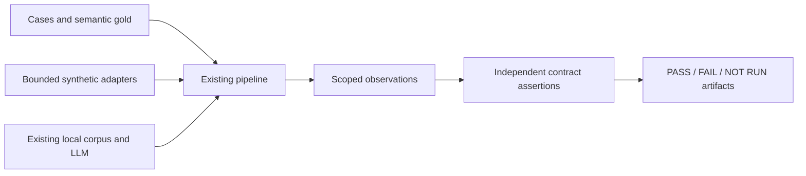

# M7 — Answer-quality baseline, stage 1

> This note includes dated intermediate results. The latest consolidated status
> and publication/verification boundaries are in [answer-quality-status.md](../answer-quality-status.md).

2026-11-03. Option B/stage 1 approved; implementation ready for review.
Stages 2–5 have not started. Original M7 module status and docs-only CI thresholds
are unchanged. Spec: `.claude/specs/M7_evaluation.md` (approved change appendix).

## What was built

- 12 core acceptance cases × marketing/executive, including role-specific query
  sequences, plus 10 explicitly pending boundary cases.
- A bounded, independently authored fixture: 12 review rows, six products, four
  categories, known category averages and minimum-two-review product selections.
- `python -m eval.quality_baseline` observes real pipeline routing, query resolution,
  SQL execution, hybrid retrieval, composition and ephemeral MemoryManager flows.
  It writes JSON evidence and a Markdown result table. External adapters in
  synthetic mode are scripted; live mode is a separate read-only local-only path.
- The existing acceptance README documents commands, data safety and interpretation.

The LLM/corpus branch is optional and guarded. Neither mode writes serving corpus,
durable memory or audit data. No production agent/UI/schema files were edited.

## Evidence and result

See [baseline table](../testing/acceptance/quality-baseline.md) and its companion
JSON for complete observations, expectations and assertion reasons.

- **31 tests pass:** new harness tests plus existing grounding/metric primitives.
- Scoped ruff and black checks pass.
- Real CLI-to-artifact **synthetic** smoke: 24 backend case/role executions,
  **12 FAIL, 22 NOT RUN, 0 complete PASS** across 34 report rows. Ten of the rows
  represent pending boundary cases. The intentionally red baseline exits 1.
- Demonstrated failures include missing requested-category constraints, SQL-only
  explanation routing, standalone-query contamination, missing product evidence
  joins and empty SQL represented as evidence.
- Live A02/A04 probe for both roles: **4 NOT RUN**. Current provider configuration
  does not meet the keyless loopback free-provider preflight. No provider call made.
- Browser checks, actual embedding/model quality, qualitative source support and
  durable-memory ownership checks are **not validated** by this implementation.
  Do not read partial assertion PASS results as a passing answer-quality gate.

## Decisions and practical limits

The baseline measures current behavior rather than repairing it. Scripted SQL is
deliberately not evaluated as model-generated SQL accuracy; real DuckDB results are
checked against independent fixture values. Source echo is not good synthesis.
Actual source passages are captured for later qualitative review instead of
inventing a semantic-faithfulness score from citation syntax.

Memory storage is temporary and omits durable cross-thread findings. Requested
categories and SQL-visible scope are checked separately; SQL projections lacking
category retain an explicit unmeasured provenance check. Full source version and
generation finish-reason metadata are unavailable from current runtime contracts.

Fixtures forbid external I/O and restore instrumented adapters after execution.
Hermetic tests use `--noconftest` to avoid the shared DB-creating pytest hook; they
explicitly fail if Postgres/network is attempted. Live output is restricted to
outside the repo and still needs human privacy review before sharing.

## Handoff

Review stage-1 artifacts. The next proposed stage is scoped M4/M5 interpretation
and tool execution, with M6 access invariants preserved; product explanation stays
incomplete until metadata/coverage dependencies in stage 3 are addressed.

Build metadata: one M7 change, no subagent calls, $0 hosted/cloud spend; no model
downloads, ETL or reindexing. Approval-to-build wall-clock duration was not measured.

## Hosted extension authorized 2026-11-03

The user approved bounded live testing with existing credentials up to $2,
read-only data/index access, local results, no reindex/deployment/commit/push.
Added a separate OpenRouter probe with run-wide reservations and a 60-request
ceiling, provider price ceilings, read-only Postgres sessions, and finish-reason /
cost journaling. Existing local-only runner and runtime app behavior are unchanged.

Preflight proved database access with `transaction_read_only=on`, 225,000 review
chunks and 79 document chunks, cached 384-dimensional embeddings and one document
vector hit. No downloads or model-generation calls were made during preflight.
Automatic approval review rejected starting the hosted probe because sending
private evidence excerpts to OpenRouter/model providers needs specific transfer
authorization. The user then explicitly approved that transfer; the bounded probe was started under that authorization. No bypass was attempted.

### Completed live replay

After the user's explicit evidence-transfer approval, all 12 main answers returned
(six core questions × two roles, with role-specific preceding turns). Automated
checks: 5 FAIL, 7 incomplete/NOT RUN; assertions 34 PASS, 16 FAIL, 20 NOT RUN.
These are assertion-coverage states, not seven absent executions. Agent review
of actual passages separately confirmed category contamination, multi-turn query
contamination, SQL-only explanations, mismatched rating metric, faulty selection,
empty SQL cited for historical claims and fallback SQL dumps. No aggregate
faithfulness score or independent human review is claimed.

Additional live findings Q25/Q26: grouped citation markers evade single-number
parsing/source retention; review corrections saying a problem was fixed can be
ignored when synthesizing complaints. The proposal inventory now includes both.
React server rendering confirms literal Markdown and category-as-trend / unsorted
ranking defects. No browser automation was available; layout/clicks untested.

60 requests completed with finish_reason=stop; provider-reported cost
**$0.002433719**, cost reported on every request, below the approved $2 cap.
Conservative retained reservations $0.07857544 are not charges. The request ceiling
was reached; no further hosted calls. No length truncation observed in this run.
Local raw/review artifacts are under `/private/tmp/ric-quality-*`, including
`ric-quality-stage1-review.md`; these temporary files are outside Git and may be
cleaned by the OS. 36 hermetic tests pass; scoped lint/format pass. Runtime app,
provider config and serving data remain unchanged; stage 2 has not started.
