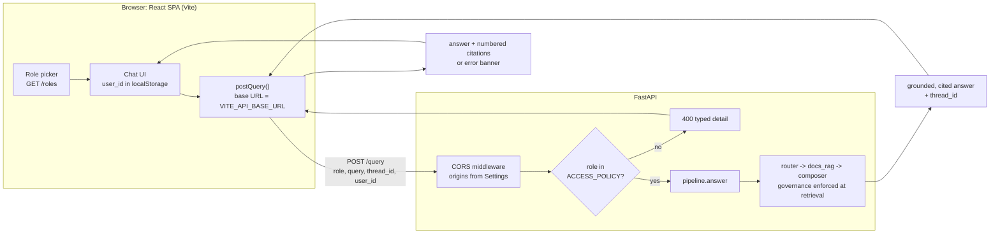
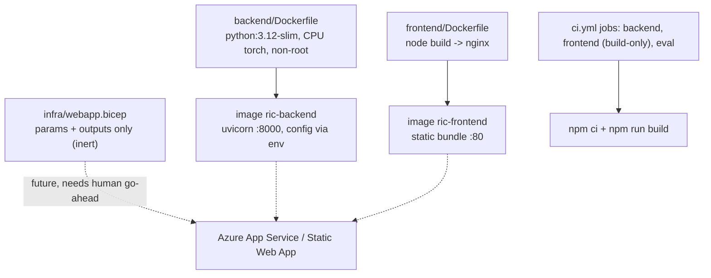

# M8 — Serving & UI (FastAPI hardening + React chat + inert deploy)

Date: 2026-10-28. Spec: `.claude/specs/M8_serving_ui.md`. Cloud spend: $0.

## What was built

A user-visible serving layer over the existing `POST /query`: a hardened backend edge, a typed React client, a chat UI, and deploy packaging that is deliberately inert. No pipeline, retrieval or governance code was changed.

| Sub-module | Delivered | Key files |
|---|---|---|
| M8.1 Backend serving hardening | CORS origins read from `Settings` (`cors_allow_origins`), `GET /roles` (lists `ACCESS_POLICY` roles), and a real edge check: unknown role returns 400 before the pipeline runs. `AccessDenied` to 400 kept as a fallback. New key in `.env.example` | `backend/app/main.py`, `backend/app/config.py`, `backend/.env.example`, `backend/tests/test_serving_api.py` (4 tests) |
| M8.2 Frontend client layer | Typed request/response mirroring the backend contract; `getRoles()` and `postQuery()` over one `request<T>` helper that turns non-2xx into `ApiError(status, detail)`. Base URL from Vite env `VITE_API_BASE_URL` (default `http://localhost:8000`) | `frontend/vite.config.ts`, `src/api/{types,client}.ts`, `src/vite-env.d.ts`, `frontend/.env.example` |
| M8.3 Chat UI | Role picker populated from `/roles`, message list with numbered citations, error banner (`role="alert"`), loading state, send disabled until role and text exist. `user_id` persisted in `localStorage`; `thread_id` returned by the server and re-sent so follow-ups continue the thread | `src/App.tsx`, `src/App.css`, `src/components/{MessageList,Citations}.tsx` |
| M8.4 Inert deploy artifacts + CI | Backend Dockerfile (CPU-only torch, non-root user, config via runtime env) and frontend multi-stage Dockerfile (Node build, nginx serve), each with `.dockerignore`. `infra/webapp.bicep` declares parameters and outputs only. New build-only `frontend` CI job (`npm ci`, `npm run build`) | `backend/Dockerfile`, `frontend/Dockerfile`, `infra/webapp.bicep`, `.github/workflows/ci.yml` |

## Key decisions

| Decision | Why | Rejected alternative |
|---|---|---|
| Unknown role is an API-boundary edge check returning **400** | A bad role string is a client input error, not a governance event. Scope enforcement (role to allowed sources) stays server-side at retrieval, before the LLM. Putting the check at the edge also lets the acceptance test hit a REAL request | Letting the pipeline reject it (surfaced as 502, see problem 1); asserting the 400 only via a monkeypatched `answer` |
| CORS origins in `Settings`, frontend base URL in Vite env | No hard-coded URLs (code_style rule). Same image or bundle moves between dev and cloud by changing env only. Bicep param `corsAllowOrigins` mirrors `CORS_ALLOW_ORIGINS` | Literal origins in `main.py`; literal `localhost:8000` in components |
| Deploy kept **inert**: Bicep stub, build-only CI, no live Azure | Cost gate: no cloud spend without human go-ahead. Follows the M1 Bicep-stub pattern; the future resources are commented, not created | Provisioning an App Service / Static Web App now; adding a deploy CI job |
| CPU-only torch installed first in the backend Dockerfile | The default wheel pulls multi-GB CUDA libraries the free-tier embedder never uses | Plain `pip install .` (huge image, slow build) |
| API base URL baked at frontend build time via `ARG VITE_API_BASE_URL` | Static bundle, no secrets involved, nginx stays trivial | Runtime config injection (extra moving parts for a reference build) |
| `thread_id` owned by the server, `user_id` by the browser | Backend already creates a thread when it gets a `user_id` and none exists; the UI just echoes what it receives | Client-generated thread ids |

## Problems faced & fixes

| # | Problem | Resolution |
|---|---|---|
| 1 | **M8.1 passed its 400 criterion for the wrong reason (the one build-back cycle).** The first cut satisfied "unknown role returns 400" only under a monkeypatched `answer` that raised `AccessDenied`. A real unknown-role request still returned **502**, because the pipeline wraps `AccessDenied` into `PipelineError`, which the route maps to 502. A mocked test was green while the real path was wrong (the exact failure `testing.md` warns about) | Added an edge check in `/query`: `if req.role not in ACCESS_POLICY` raises 400 before any pipeline work. The test now posts `{"role": "ghost"}` through `TestClient` with no monkeypatch and asserts 400 plus the role name in `detail`. The `AccessDenied` handler stays as a fallback |

No other sub-module needed a re-run.

## Discussion / corrections

- **M8.1 routed back to the developer once** (problem 1). Result: real 400, verified live in the module smoke, not just in the unit test.
- Governance boundary clarified in the process: the edge check validates *input shape* (is this a known role?). It does not replace retrieval-time scope enforcement, which is unchanged.

## Visuals

Request flow (serving path):

Deploy packaging (nothing deployed):

No screenshot of the running UI was captured. TODO for the human: add a screenshot of the chat UI (role selected, answer with numbered citations) to `docs/img/` and link it here.

## Result

- **Verdict: PASS.** Each sub-module passed its scoped test pass. Module-level real end-to-end smoke against a live free-mode backend:

| Check | Outcome |
|---|---|
| Real `POST /query` | Grounded, cited answer, cost $0, no grounding issues |
| Follow-up with returned `thread_id` | Same thread reused; `history_turns_used` went 0 to 2 |
| CORS | Header present for allowed origin, absent for disallowed |
| Unknown role | Typed 400 with `detail` |
| `backend/tests/test_serving_api.py` | 4 passed |
| Frontend `npm run build` | Green |
| Docker builds | Backend and frontend both succeeded |
| `ci.yml` | Parses; jobs `backend`, `frontend`, `eval` |

- Cloud spend: $0. Nothing was deployed; the Bicep file provisions nothing.
- Known limits: the CI `frontend` job has not been observed running on GitHub from this build. The UI has no automated browser test, and the full UI-in-browser flow was verified through the API contract and build, not a recorded screenshot. Streaming responses and auth are out of scope.
- **Next:** a future deploy step can fill in `infra/webapp.bicep` and push the two images, once the human approves cloud spend. The eval gate (M7) continues to guard answer quality for backend changes.

## Build metadata

- Build time (checkpoint-1 approval to module done): ~12 min of sub-agent wall-clock.
- Sub-module cycles: 4 (M8.1-M8.4), with one build-back on M8.1. Sub-agent calls: 12 (1 planner, 4 developer + 1 M8.1 re-route, 4 scoped tester, 1 module tester, 1 documenter).
- Cloud spend: $0.00 (free mode; deploy artifacts inert). See `COST.md`.
- Cloud spend this module: $0.00 (logged in COST.md).
- Claude session usage: run `/cost` for this session's token usage.
