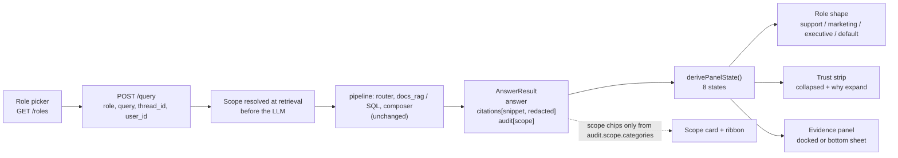

# M8 v2 — Serving & UI (design-driven rebuild)

Date: 2026-10-28. Spec: `.claude/specs/M8v2_serving_ui.md`. Cloud spend: $0.
Design inputs: `docs/design/03_handoff.md` (build spec), `docs/design/02_decisions.md` (D-01..D-15 + deferred list), `docs/design/mockups/m8-chat.html` (approved D2 visual).

> **Framing.** This is SDLC **iteration 2**, not design-first from the start. M8 v1 (`docs/modules/M8_serving_ui.md`) was an engineering spike that proved the serving path with a minimal chat. v2 redoes the UI surface after a Design Track (brief, wireframes, mockup, decisions, handoff). The git history and `context/WORKLOG.md` are dated and show v1 first. The v1 note and spec are left intact.

## What was built

A role-adaptive, trust-legible chat UI on the **unchanged backend pipeline**. The only backend change is two small, additive, backward-compatible response fields. Everything else is frontend.

| Sub-module | Delivered | Key files |
|---|---|---|
| M8v2.1 Backend contract edges | `citations[].snippet` (source text, whitespace-collapsed, trimmed to `MAX_QUOTE_CHARS`, run through `redact()` inside `build_sources()`; `None` only if no source text). `audit.scope = {restricted, categories}` set in the pipeline from the real retrieval `decision.scope`. Answer text, grounding, routing, memory and SQL untouched | `backend/agents/composer.py` (+18/-4), `backend/agents/pipeline.py` (+2), `backend/tests/test_contract_edges_m8v2.py` (5 tests) |
| M8v2.2 API layer | `Citation.snippet`; typed `Audit`, `Grounding`, `Memory`, `Scope` replace `Record<string, unknown>`. `client.ts`, `ApiError{status,detail}` and `BASE_URL` reused as-is | `frontend/src/api/types.ts` |
| M8v2.3 Shell, state machine, role rail | 3-column grid `236px / 1fr / 300px`, 2 columns under 1080px (Evidence becomes a bottom sheet), 1 column under 760px. `App.tsx` owns the `user_id` (localStorage) / `thread_id` round trip and one active panel state, derived by a pure function in `panelState.ts`. Rail: brand line, role picker from `GET /roles`, read-only scope card, session card (live `cost_usd`/`tokens`/`latency_ms`), theme toggle via `data-theme` over `prefers-color-scheme`. Token-based light/dark `App.css` | `App.tsx`, `panelState.ts`, `App.css`, `components/{RoleRail,BrandCard,ScopeCard,SessionCard,ThemeToggle}.tsx` |
| M8v2.4 Conversation panel, shapes, trust strip | `answer.ts` splits the answer by line and parses `[n]` into real `<button>` markers (`aria-label="Show evidence n"`). Three shapes (support, marketing, executive) plus a default shape for admin/analyst/unknown roles. Citation chips, scope ribbon, and a per-turn trust strip (collapsed `intent / grounding.path / latency / $0`, `aria-expanded`, "why" expand with the full audit). v1 `MessageList` and `Citations` removed | `answer.ts`, `components/{ConversationPanel,UserTurn,AssistantTurn,ClaimLine,ScopeRibbon,CitationChips,TrustStrip}.tsx`, `components/shapes/*` |
| M8v2.5 Evidence, states, a11y | Docked Evidence panel (bottom sheet on narrow screens) listing `[n]`, label, source id and the redacted snippet; chip click highlights and scrolls the item in. Designed screens for empty, loading, 400, 502. Authored degradation copy from field presence. Focus ring, reduced motion, Escape, focus-in and focus-return | `components/{EvidencePanel,ErrorBanner,EmptyState,LoadingState}.tsx`, `copy.ts`, `App.css` |

### The two additive backend edges, and why not frontend stubs

| Edge | Source of truth | Why a real backend field |
|---|---|---|
| `citations[].snippet` | The same source text the extractive path already quotes, redacted at the composer boundary | The Evidence panel is meant to show *what* the evidence said. A frontend stub could only show label and id, or invent text. Redacting at the boundary keeps raw source text from ever reaching the client |
| `audit.scope` | `list(decision.scope.get("category", []))`, the scope retrieval **actually used** | A client-side category list would duplicate governance config in the UI and rot when `ACCESS_POLICY` changes (D-08). Deriving from the real decision also proves the UI reports enforcement rather than asserting it |

Both fields are purely additive: `QueryResponse` picks them up through `AnswerResult`, so old consumers keep working. `citations[].source_type` was deliberately **not** added and stays UI-derived.

### The three `/change` ADR conditions, and how each was met

| # | Condition (from `context/CURRENT_TASK.md` / ADR 2026-10-28) | How it was met | Evidence |
|---|---|---|---|
| 1 | Marketing scope stays `{Electronics, Beauty_and_Personal_Care, Toys_and_Games}` (Books dropped) as a regression guard | `policy.py` not touched. Contract test asserts marketing resolves to exactly those three categories in `audit.scope` | Contract test; live e2e shows the same three categories |
| 2 | `citations[].snippet` is PII-redacted at the boundary | `redact()` applied in `build_sources()` before the `Citation` is constructed | Test: email and phone in source text become `[EMAIL]` / `[PHONE]`. Live: no PII in returned snippets |
| 3 | No hard-coded category chips | `ScopeCard` and `ScopeRibbon` render chips only from `audit.scope.categories`. If empty or absent, the UI says a scope applies (from role) without naming categories | Empty grep for category names across `frontend/src` |

## Key decisions

| Decision | Why | Rejected alternative |
|---|---|---|
| Docked Evidence panel, opened by citation click (D-01, D-03) | Evidence needs room for label, id and snippet; keeps the answer uncluttered. Trust strip (the "how") and panel (the "what") stay separate | A permanent full-audit sidebar (reads as a dev console) |
| Per-turn trust strip, collapsed plus "why" expand (D-02) | Trust sits with the claim it explains and is glanceable | Modal, separate route, or hover tooltip |
| Three role shapes, charts gated on `"sql"` in `audit.sources` (D-04, D-05) | Same grounded answer, different useful shape per persona; charts must never imply data the response did not carry | One uniform renderer; always drawing a chart |
| Scope is a read-only fact (D-07, D-08) | Policy is enforced at retrieval; the UI has no control, toggle or param that could widen it | A "show all categories" toggle |
| Every state is a designed screen (D-09) via a pure `derivePanelState()` | v1 rendered blank or identical screens for empty, degraded and error | One renderer with blanks |
| Degradation is a designed answer, not an error (D-10) | `sql_error` and `grounding.path == "none"` are honest HTTP 200s; red is reserved for HTTP failures | Red banner for any degradation |
| 400 (amber, reselect role, no retry) vs 502/500 (red, retry and copy) (D-11) | The remedy differs; the user turn is preserved in both | One generic error banner |
| Loading is a generic staged label set with Cancel (D-12) | Backend returns once; labels must not claim anything about this turn | Fake live `tool_path` telemetry |
| $0 and latency shown honestly (D-13) | True consequence of free mode (`audit.cost_usd`); provider mode itself stays invisible | Hiding cost as internal telemetry |
| Light/dark tokens, 16px gutter, no horizontal scroll at phone width (D-14) | Portfolio-grade baseline | Single fixed theme |
| Memory reported, not rendered (D-15) | A line "used N prior turns" in the expanded strip; no history UI | Thread list and switcher |

## UI states

`derivePanelState()` in `panelState.ts` is the only place a state is chosen; exactly one is active.

| State | Trigger | What renders |
|---|---|---|
| `empty` | no response, no error, not in flight | Role-conditioned authored starter prompts |
| `loading` | request in flight | Staged generic labels, Cancel, composer disabled, no audit shown |
| `error-400` | `ApiError` with status 400 | Amber banner (`role="alert"`), reselect role, no retry; user turn kept |
| `error-502` | any other error (incl. bare 500) | Red banner, Retry and copy details; user turn kept |
| `degraded-SQL` | `audit.sql_error` set | Amber warn-line; RAG answer still shown and cited; metric strip suppressed; `sql_error` in the expanded strip |
| `no-evidence` | `grounding.path == "none"` or no citations | Calm (non-red) "no supporting evidence" block |
| `fallback` | `grounding.issues.length > 0` | Answer with an issues note (draft blocked, extractive path) |
| `grounded` | none of the above | Role shape, `[n]` markers, chips, trust strip |

## Sub-module to acceptance criteria

| Sub-module | Files | Criterion satisfied |
|---|---|---|
| M8v2.1 | `composer.py`, `pipeline.py`, `test_contract_edges_m8v2.py` | Additive `snippet` + `audit.scope`; PII regression guard; marketing scope guard |
| M8v2.2 | `api/types.ts` | Typed `Audit`; `typecheck` passes; `ApiError` preserved |
| M8v2.3 | `App.tsx`, `panelState.ts`, rail components, `App.css` | 3/2/1-column layout; role picker from `/roles`; read-only scope from `audit.scope`; session card; theme toggle |
| M8v2.4 | `answer.ts`, conversation components, `shapes/*` | `[n]` buttons; three shapes plus default; chips; trust strip with `aria-expanded` |
| M8v2.5 | `EvidencePanel`, `ErrorBanner`, `EmptyState`, `LoadingState`, `copy.ts` | Evidence with redacted snippet; all non-grounded states; focus ring, reduced motion, Escape, focus return, `role="alert"` |

## Problems faced & fixes

| # | Issue | Resolution / status |
|---|---|---|
| 1 | **Mockup chips vs. missing contract fields.** The approved mockup showed category chips and a quote body, but the v1 response carried neither `audit.scope` nor a snippet. Hard-coding them would have copied governance config into the UI | Added the two backend edges (M8v2.1) instead of stubbing; chips and snippets now bind to real fields |
| 2 | **Marketing demo mismatch** (inherited from the Design Track): the mockup labelled an earbud review as `Toys_and_Games` because marketing could not reach `Electronics` | Resolved upstream by the 2026-10-28 ADR; v2 only guards it with a test |
| 3 | **Shape selection key.** Spec said "role + `audit.intent`". The developer keyed the shape on `audit.role`, and handled intent through chart gating (`"sql"` in `audit.sources`) and the state machine | Accepted: unknown roles fall through to `DefaultShape`, charts only appear with SQL evidence, behaviour matches the intent of D-04/D-05 |
| 4 | **Marketing "theme bars"** have no per-theme numeric data in the response | Rendered as claim lines, not fabricated bars (honesty guard, D-05) |
| 5 | **Loose sqlMetrics heuristic.** In sql-cited lines, the first number is taken as the metric value; the "Sentiment trend" caption is fixed text | Known limitation, not fixed. Could mislabel a line whose first number is not the metric |
| 6 | **Bottom sheet is not a full focus trap.** It does focus-in on open, return on close, and Escape/backdrop close, but Tab can leave the sheet | Accepted for a reference build |

## Discussion / corrections

- No tester-to-developer build-back cycles were recorded in `CURRENT_TASK.md`; each sub-module was built and passed `npm run build` (or its test file) in one pass.
- Judgment calls 3 to 6 above were reviewed and accepted as honest trade-offs rather than defects.

## Visuals

Request, governance and render flow:



Frontend component tree:

```
App  (user_id/thread_id, panel state, theme, activeCiteN)
├─ RoleRail
│  ├─ BrandCard   ├─ role picker   ├─ ScopeCard   ├─ SessionCard   └─ ThemeToggle
├─ ConversationPanel
│  ├─ EmptyState | LoadingState | ErrorBanner
│  ├─ UserTurn
│  └─ AssistantTurn
│     ├─ ScopeRibbon
│     ├─ shapes/ Support | Marketing | Executive | Default  (Bars, Trend)
│     │   └─ ClaimLine  ([n] buttons via answer.ts)
│     ├─ CitationChips
│     └─ TrustStrip
└─ EvidencePanel  (dock / bottom sheet)
```

Mockup reference: `docs/design/mockups/m8-chat.html`.

**TODO for the human:** no screenshot of the running v2 UI was captured. Add one per persona (support, marketing, executive) to `docs/img/` and link them here, consistent with the same open item in the v1 note.

> ### ⚠ Known limitation — visual design not ported (behaviour shipped, look did not)
> M8 v2 is **functionally** correct against the handoff — all states, shapes, trust
> strip, Evidence panel, backend edges, a11y, and the live $0 e2e pass — **but the
> built UI does not match the D2-approved mockup's visual design.** `frontend/src/App.css`
> is **~109 lines** against the mockup (`docs/design/mockups/m8-chat.html`, **~1157 lines**):
> the mockup's design tokens, typography scale, spacing system, and card/chat/evidence/
> chart styling were **not** carried across. **Why it happened:** `03_handoff.md` carried
> *behaviour, states, and data bindings* but treated the mockup only as a "visual
> reference" rather than enumerating the visual spec (tokens/type/spacing), so the build
> matched the behavioural contract and produced functional-but-plain styling; and the
> module gate was build + grep + live-JSON e2e, so **no browser visual-QA ran** to catch
> it. **Fix:** a **scoped `/change`** that ports the mockup's design tokens + component
> styling into `App.css` and adds a browser visual-QA pass (plus the per-persona
> screenshots above) — not a reopen of this module. See `context/DECISIONS.md` (M8 v2
> visual-fidelity entry) for the full rationale and the process lesson.

## Result

- **Verdict: PASS** on the automated and API-level checks below. Live in-browser QA is open.

| Check | Outcome |
|---|---|
| Per-sub-module scoped passes | Each sub-module passed its scoped test or build |
| `backend/tests/test_contract_edges_m8v2.py` | 5 passed |
| `npm run build` (typecheck + vite) | Green, 57 modules |
| Category-name grep over `frontend/src` | Empty |
| Live e2e, free mode, $0: `GET /roles` | OK |
| Live: `audit.scope` executive vs marketing | Unrestricted vs the 3 categories |
| Live: PII in snippets | None |
| Live: `cost_usd` | 0.0 |
| Live: nonsense query | Degrades gracefully to the extractive path |

- **Not done / deferred:** no streaming (backend returns once); no auth (role is a self-selected persona); no multi-turn history UI or thread switcher (memory reported only); `citations[].source_type` left UI-derived; deployment stays inert ($0); live UI-in-browser check and screenshot pending (open item).
- **Next:** the Design Track package is consumed. Remaining follow-ups are browser and visual QA, an optional backend `source_type`, and a thread UI as a separable feature.

## Build metadata

- Build time (CHECKPOINT 1 approval to module done): single session; cumulative sub-agent wall time ≈ 11 min (sum of agent durations), all within one orchestrator session on 2026-10-28.
- Sub-module cycles: 5 (M8v2.1 → M8v2.5), **zero tester→developer build-backs** — every sub-module passed its scoped gate first pass.
- Sub-agent calls: **13 total** — 1 planner, 5 developer (one per sub-module), 5 scoped testers (one per sub-module), 1 module-level tester (live e2e), 1 documenter.
- Cloud spend: **$0** (free provider mode; nothing provisioned; deployment stays inert).
- Cloud spend this module: $0.00 (free mode; deployment inert). See `COST.md`.
- Claude session usage: run `/cost` for this session's token usage.

---

## Visual-fidelity `/change` (2026-10-29)

A scoped `/change` (ADR 2026-10-29 in `context/DECISIONS.md`, **Approach A**) closed the known
visual-fidelity gap: the v2 build was functionally correct but did not match the D2 mockup
(`docs/design/mockups/m8-chat.html`) — `App.css` was ~109 lines / ~8 flat tokens with no shadows,
radius, or type scale, and the component DOM diverged from the DOM the mockup's stylesheet targets.

**What changed (restyle only — no behaviour, data-binding, state-machine, or governance change):**

- `frontend/src/App.css` replaced with a port of the mockup stylesheet (**109 → ~417 lines**):
  full light + dark token sets (both the `prefers-color-scheme` and `[data-theme="dark"]` guards),
  type scale, `--shadow`/`--radius`, `color-mix` usage, and all component styling. The mockup's
  demo-only chrome (`.demobar`, `.pending`, `.foot`) was deliberately not ported.
- Every shell / rail / panel / shape / trust / evidence / state component re-marked to the mockup's
  DOM so the ported CSS applies (e.g. trust strip → `button.th` + `.pill.route`/`.pill.ground` + a
  `.tbody` grid of `.f` field cards; executive → `.quote`/`.lead` + `.datacard` + `.ranked`/`.rrow`;
  support → `.kv .k/.t` + `.policy`; marketing → `.themes`/`.theme-row`; chips → `.chip-cite`;
  evidence → `.ev-item .eh/.eid/.esnip`). Two optional display-only props added (`ClaimLine.variant`,
  `CitationChips.activeN`); data flow unchanged.
- **Session-card overflow fix** (found during QA): long `thread_id`/`user_id` values overflowed the
  rail card onto the chat. `.session .r .v` now has `min-width:0` + `overflow-wrap:anywhere` +
  right-aligned, with `.k { flex:none }` — long ids wrap inside the card.

**New gate — browser visual-QA** (the process gap the v1 note flagged). Driven live against the
running stack (pgvector + backend `PROVIDER_MODE=free` with a local LLM + Vite) at desktop (1440px)
and phone (500px, the OS window minimum) widths, light and dark:

| Surface / state | Result |
|---|---|
| Empty, loading (staged pills + shimmer + Cancel) | Match |
| Grounded — support shape (FIX rows, policy card, `[n]` markers, fallback note, grounding-issues) | Match |
| Grounded — marketing shape (Themes datacard + bar, `source: SQL`) — chart populates from real SQL | Match |
| Grounded — executive shape (`.quote`/`.lead`) | Match |
| Scope ribbon + scope card from `audit.scope` (support 4 cats / marketing 3 incl. Electronics / executive unrestricted, no chips) | Match |
| Citation chips; trust strip collapsed + expanded (field grid, memory, issues) | Match |
| Evidence panel + redacted snippets + type tags; bottom-sheet + close on phone | Match |
| Session card live metrics (after the overflow fix) | Match |
| Dark mode (full token adaptation); phone 1-col stacked, no horizontal scroll | Match |

**Honest divergences (data-driven, not styling defects):** support rows all render `FIX` (the real
extractive answer is cited lines, not an authored issue/fix split); marketing showed one theme-row
and no trend (trend needs ≥2 metrics; the aggregate returned one row); an executive query that routes
to `docs_rag` shows no ranked bars (the marketing run proved the SQL chart path populates).

**Not driven live** (lower-risk banner/calm-block variants; CSS ported, fallback/issues observed):
`400` (the role picker offers only valid roles), `502/500` (needs the backend downed), pure
`no-evidence` calm block, `degraded-SQL` amber. User accepted this coverage as sufficient.

**Gates:** `npm run build` green; category-name grep over `frontend/src` empty; snippets still bound
to `citations[].snippet` (redacted server-side); scope read-only. Cloud spend **$0**.
