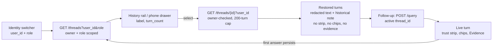

# M8 v3 — Serving & UI (conversation / memory layer)

Date: 2026-10-29. Spec: `.claude/specs/M8v3_serving_ui.md`. Cloud spend: $0.
Design inputs: `design/iteration-3/03_handoff.md` (build spec) and the rest of the `design/iteration-3/` package (brief, wireframes, v3 mockup, decisions incl. D-21).

> **Framing.** SDLC **iteration 3**, successor to `docs/modules/M8v2_serving_ui.md`. v2 reported memory ("used N prior turns") but had no history UI. v3 adds the conversation layer: owner-scoped thread history, multi-turn stacking, resume, and one-at-a-time Evidence. The v1 and v2 notes are left intact.

## What was built

A conversation/memory UI on the **unchanged retrieval/answer pipeline**. Backend change is one read-only edge in three files (`main.py`, `store.py`, `schema.py`). No pipeline change and no schema DDL change.

| Sub-module | Delivered | Key files |
|---|---|---|
| M8v3.1 Backend edge | `MemoryStore.list_threads(user_id, role)`: one parameterised query; `label` derived in-query from the first redacted user message (correlated subselect, `LEFT(content,48)`); `turn_count` = `COUNT`; `HAVING COUNT>0` so empty threads never show; `ORDER BY created_at DESC`. `get_thread(thread_id, user_id)` with owner check. Read-only routes `GET /threads?user_id=&role=` and `GET /threads/{id}?user_id=` (owner-checked, 200-turn cap). Errors: 400 unknown role, 422 missing param, 404 non-owner or unknown, 503 store failure. `ThreadListRow` model only | `backend/memory/store.py`, `backend/memory/schema.py`, `backend/app/main.py`, `backend/tests/test_threads_endpoint_m8v3.py` (5 tests) |
| M8v3.2 TS contract | `ThreadListItem` / `ThreadDetail` types; `getThreads` / `getThread` client methods with URL-encoded params. Typecheck green | `frontend/src/api/types.ts`, `frontend/src/api/client.ts` |
| M8v3.3 Identity + history rail | `identities.ts` maps demo identities to roles (`support_1`/`support_2` to support, `marketing_1` to marketing, `executive_1` to executive). `IdentitySwitcher` replaces the v2 anonymous localStorage user id. `HistoryRail`: populated, empty, active-row states, "+ new chat". Switching identity resets the centre and reloads the rail; a new row appears when the first answer lands (re-fetch) | `identities.ts`, `components/{IdentitySwitcher,HistoryRail}.tsx`, `RoleRail.tsx`, `App.tsx` |
| M8v3.4 Stacked turns + resume | `turns.ts`: discriminated union `live \| restored`. `StackedTurns` renders the stack; follow-ups append and post the active `thread_id`; only the newest turn shows the loading skeleton. Resume via `getThread` with the **honest degrade** (below) | `turns.ts`, `components/{StackedTurns,AssistantTurn,ConversationPanel}.tsx`, `copy.ts` |
| M8v3.5 Evidence, drawer, a11y | Evidence renders only `citations.find(n === activeN)`, replaced in place. Phone history drawer (`☰`) reusing `HistoryRail`. A11y deltas. Two resume-error fixes | `components/{EvidencePanel,HistoryDrawer}.tsx`, `App.tsx`, `App.css` |

### The honest degrade for resumed turns (D-21)

`messages` stores redacted text only. Per-turn `audit` and `citations` are **not persisted**, so a restored assistant turn cannot show them. Rather than fabricate, restored turns render:

| Shown | Not shown |
|---|---|
| Stored redacted text, `[n]` markers stripped, plus a muted note "historical turn — reasoning & evidence not stored for replay" | Trust strip, citation chips, clickable evidence, any audit or citation data |

A follow-up asked after a resume is a normal **live** turn with the full trust strip and evidence.

## Key decisions

| Decision | Why | Rejected alternative |
|---|---|---|
| One backend edge only; no pipeline or schema-DDL change | Keeps governance and the answer path untouched; the thread list is derivable from existing `messages` | New `threads` table or label column |
| Label derived in-query (`LEFT(content,48)` from the first redacted user message) | Redacted text only, so no raw PII reaches the rail; no stored state to drift | Storing a title at write time |
| `HAVING COUNT>0` (developer judgment) | Matches the flow where a thread appears only once its first answer persists | Listing empty threads |
| Owner + role scoping in the query, 404 (not 403) for non-owners | Does not reveal that another user's thread exists | Filtering client-side |
| Identity switcher is a demo owner selector, **not auth** | Gives a real owner key to prove isolation without building auth | Keeping the anonymous localStorage id |
| `audit.scope` and redacted `citations[].snippet` bound directly | Both are real fields now (iteration-2 Pending #1/#2 resolved) | Client-side category lists or stubs |
| Evidence shows one citation at a time, replace-in-place, focus stays on the clicked marker, no `scrollIntoView` | Predictable reading position and keyboard flow | Scrolling list of all evidence |
| Persisting per-turn audit/citations (§2 option c) **deferred** as a named future schema change | It is the honest reason restored turns degrade; out of scope for a no-DDL module | Reconstructing audit from text (fabrication) |

## Problems faced & fixes

| # | Issue | Resolution / status |
|---|---|---|
| 1 | **Full-fidelity resume is impossible with current storage.** Only redacted message text is persisted | Designed degrade (D-21) instead of fabricating audit/citations; persistence deferred as a separate schema change |
| 2 | **Resume error handling.** Retry did not re-run the resume, and a failed resume left the previous turn stack visible under the error banner | Retry now re-runs the resume via `failedResumeId`; a failed resume clears `turns` and `threadId` so no stale stack sits under the banner |
| 3 | **Stale `failedResumeId` (caught by the M8v3.5 tester).** `send()` did not clear it, so a later action could retry the old resume | One-line fix routed back to the developer: clear `failedResumeId` at the top of `send()`. Caught and fixed in the build loop, not shipped as a defect |
| 4 | **Phone viewport could not be driven below ~1353px** in the QA environment, so the phone layout reflow at true phone width was not visually confirmed | Verified the drawer's component behaviour by driving the real React component with the phone chrome force-shown (open/close, focus-in, Escape, backdrop, ARIA, content). Layout reflow stays an open item (below) |
| 5 | **Null snippet** for a citation | Renders "snippet unavailable" rather than blank |

## Discussion / corrections

- One tester-to-developer build-back (problem 3, M8v3.5), resolved with a one-line fix and re-test.
- `HAVING COUNT>0` was a developer judgment beyond the spec text; accepted as consistent with the intended flow.

## Visuals

Thread read path and resume degrade:



Centre column:

```
App  (identity, threadId, turns[], activeN, failedResumeId)
├─ RoleRail ─ IdentitySwitcher ─ HistoryRail (+ new chat)
├─ HistoryDrawer  (phone: ☰, role=dialog, reuses HistoryRail)
├─ ConversationPanel
│  └─ StackedTurns  (turns.ts: live | restored)
│     ├─ live:     AssistantTurn + TrustStrip + CitationChips
│     └─ restored: HistoricalTurn (text + muted note only)
└─ EvidencePanel  (one citation: citations.find(n === activeN))
```

Mockup reference: `design/iteration-3/` (v3 mockup). **TODO for the human:** no screenshots were committed. Capture desktop light/dark (live turn, stacked follow-up, resume degrade, identity switch) and the phone drawer to `docs/img/` and link them here.

## Result

**Verdict: PASS.**

| Check | Outcome |
|---|---|
| Scoped backend test `test_threads_endpoint_m8v3.py` (owner isolation, role filtering, label/turn_count shape, non-owner detail) | 5/5 on live Postgres |
| Live e2e, free mode, $0: `POST /query` | Grounded and cited |
| Follow-up continuity | `history_turns_used` 0 to 4 |
| `GET /threads` | Derived label and `turn_count`, no snippets |
| `GET /threads/{id}` | Ordered turns |
| Isolation, live | Other user: `{"threads":[]}` / 404; same user, wrong role: `[]` |
| `audit.scope` | Executive `restricted:false`; marketing `restricted:true` with Electronics, Beauty_and_Personal_Care, Toys_and_Games |
| `npm run build` | Green |
| Category-name grep over `frontend/src` | Clean |
| `git diff --stat` backend | Only `main.py`, `store.py`, `schema.py` |

**Browser visual-QA gate** (desktop 1440px, light and dark, driven live): empty state; live turn (trust strip, support shape, scope chips from `audit.scope`, `[n]` citations); one-at-a-time Evidence with replace-in-place; follow-up stacking; "+ new chat" reset; resume honest-degrade (muted note, no strip or evidence); identity switch (rail reload, centre reset, marketing scope, owner scoping: a support thread is hidden from marketing); dark mode clean; phone drawer behaviour (component-level, see problem 4). Governance confirmed live: scope chips only from `audit.scope`, snippets redacted verbatim, $0.

**Open items for the human**
- Phone layout reflow not visually confirmed at true phone width (env viewport floor ~1353px). Spot-check on a real phone or emulator.
- Four error states (400, 502, no-evidence, degraded-SQL banners) not force-driven live (carried from M8v2).
- Per-turn audit/citations persistence (§2 option c) is a pending, separate schema change needed for full-fidelity resume.
- Demo thread for `user_id=support_1` ("What is the return policy?", about 4 turns plus memory rows) was left in the dev DB by the browser QA. Harmless; deletable.

**Next:** optional `/value-review`; the schema change above if full-fidelity resume is wanted; no auth yet (identity is a demo selector).

## Build metadata

- Build time (CHECKPOINT 1 approval to module done): ~45 min wall-clock (approximate; includes the live browser visual-QA gate driven by the orchestrator).
- Sub-module cycles: 5 (M8v3.1 to M8v3.5), 1 tester-to-developer build-back (M8v3.5). Sub-agent call count: 14 (1 planner + 5 developer + 5 tester + 1 developer build-back + 1 module tester + 1 documenter); the browser visual-QA gate was run by the orchestrator, not a sub-agent.
- Cloud spend this module: $0.00 (free provider mode; nothing provisioned; deploy inert). See `COST.md`.
- Claude session usage: run `/cost` for this session's token usage.
