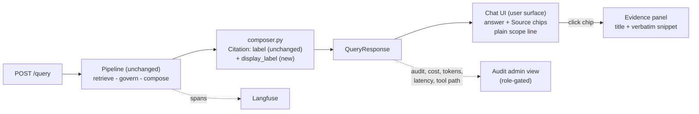

# M8 v4 — Serving & UI (user-centred declutter + trust redesign)

> Historical baseline note. Later answer-quality changes supersede affected
> contracts; see [current status](../answer-quality-status.md) and
> [module index](README.md) for implementation, tests and review boundaries.

Date: 2026-11-02. Spec: `.claude/specs/M8v4_serving_ui.md`. Cloud spend: $0.
Design inputs: `design/iteration-4/03_handoff.md` (authoritative build spec), `design/iteration-4/02_decisions.md` (D-22 to D-30), approved D2 mockup `design/iteration-4/mockups/m8-chat.html`. Governing rule: `.claude/rules/ux-surface.md`.

> **Framing.** SDLC **iteration 4**, successor to `docs/modules/M8v3_serving_ui.md`. v3 shipped the conversation layer but leaked operator data (cost, tokens, latency, routing, ids) into a retail-user surface. v4 is a frontend-and-copy declutter plus trust redesign on the **unchanged pipeline**, with **exactly one** additive backend field. The v1 to v3 notes are left intact.

## What was built

| Sub-module | Delivered | Key files |
|---|---|---|
| M8v4.1 Backend edge | `Citation.display_label: str` (new, distinct from the unchanged `label`), derived server-side by source type via `_display_label(hit)` + `_humanize()` + `SQL_DISPLAY_LABEL = "Calculated from your data"`. Review: `customer review · <Category>` (underscores to spaces, title-cased; no category gives `customer review`). Doc: prettified `<Title> · <Section>` from the real heading, never the slug. SQL: "Calculated from your data". PII-safe by construction (category/title/section only, no review/user text, no ASIN). `main.py` unchanged (`QueryResponse(AnswerResult)` passes it through). Mirrored in TS `Citation` | `backend/agents/composer.py`, `frontend/src/api/types.ts`, `backend/tests/test_composer_display_label.py` (6 tests) |
| M8v4.2 Remove operator instrumentation | Deleted `SessionCard`, `TrustStrip`, `ScopeCard`, `ScopeRibbon` (the last also removed: it printed "Retrieval was filtered server-side" and a restricted lock per answer). Cleaned mounts/imports/props. `audit.scope` wiring kept for the later plain scope line | `RoleRail.tsx`, `AssistantTurn.tsx`, `App.tsx` |
| M8v4.3 Copy, brand, header | `BrandCard` tagline to `grounded · cited` (dropped `$0/query`). `ConversationPanel` header to an `answering as: <role>` pill (intent half removed; `audit.intent` no longer read). Re-authored `FALLBACK_NOTE`, `SQL_DEGRADED`, `NO_EVIDENCE` as plain reassurance; removed `STAGES`; added `SYSTEM_ERROR`; swept orphaned `.pill.cost` / `.trust .fallback-note` CSS | `BrandCard.tsx`, `ConversationPanel.tsx`, `copy.ts`, `LoadingState.tsx`, `App.css` |
| M8v4.4 Source chips + evidence | `CitationChips` render `Source: <display_label>` as real `<button>`s, one active at a time across the thread; active state is not colour-only (`aria-pressed` + bold + visible "viewing" word); group label "Where this came from". `EvidencePanel` shows one source: readable title + verbatim redacted snippet; raw `source_id`/`eid` line and `.etag` type tag removed. Empty state and null-snippet text in plain words. Phone bottom-sheet focus/Escape/backdrop/return-focus contract kept. Dropped unused `evidenceType()` | `CitationChips.tsx`, `EvidencePanel.tsx` |
| M8v4.5 Demo switcher, states, styling | `IdentitySwitcher` is a dashed `.demo` card with a "demo - not a login" tag, accessible `<select>`, not-a-login note; options read `user_id (<team> team)`. `EmptyState`: logo, tagline, derived scope line, 2 role starters. `LoadingState`: "Looking through the sources..." + spinner, no stages (reduced-motion disables spin). System error shows `SYSTEM_ERROR` + Try again with no status/detail/provider. `HistoryRail` raw-error leak fixed. Bounded `.stream` (max-height 72vh, scroll, `aria-live=polite`, auto-scroll). Full `App.css` pass to match the mockup; dead `.load .stages`, `.stage`, `.banner*`, `.noevid` removed | `IdentitySwitcher.tsx`, `EmptyState.tsx`, `LoadingState.tsx`, `ErrorBanner.tsx`, `HistoryRail.tsx`, `identities.ts`, `App.css` |

## Declutter: before to after

| Surface element | v3 (iteration 3) | v4 | Now lives in |
|---|---|---|---|
| SESSION panel (cost, tokens, latency, thread id, user id, provider) | Shown | Removed | Audit admin view, Langfuse |
| Per-answer chips (routing tag, `grounded (extractive)`, latency, cost, `why`, fallback token) | Shown | Removed (`TrustStrip` deleted) | Audit admin view |
| Scope ribbon / card ("filtered server-side", lock) | Shown per answer | Removed; one plain scope line instead | Derived from `audit.scope` |
| Header tagline | `... $0/query` | `grounded · cited` | n/a |
| Conversation header | `role · <intent>` | `answering as: <role>` | n/a |
| Citations | `[n]` markers, raw `source_id`, type tag | `Source: <display_label>` buttons | Evidence: title + verbatim snippet |
| Honest states | System wording (`extractive`, `query failed`) | Plain reassurance | `copy.ts` |
| Identity switcher | Product-styled control | Dashed "demo - not a login" card | n/a |
| Transcript | Growing page | Bounded scroll region, newest at bottom | n/a |
| Errors | Could leak HTTP status/detail | `SYSTEM_ERROR` + Try again | n/a |

## Key decisions

| Decision | Why | Rejected alternative |
|---|---|---|
| Exactly one new backend field (`display_label`) | Human-readable chip text must be computed where the source type and heading are known; all else binds to the shipped contract | Client-side label building from `label` (would parse ASINs/slugs in the UI) |
| New field, `label` left unchanged | `label` is consumed by audit/other paths; additive is safe | Overwriting `label` |
| PII-safe by construction: category/title/section only | Governance: no raw review text, user text, or ASIN can reach the chip | Truncated review text as label |
| Delete `ScopeRibbon` as well as the three listed cards | It rendered "filtered server-side"/lock per answer, violating ux-surface | Keep and re-word |
| Scope line derived from `audit.scope`, neutral sentence before first query, never widened | Frontend has no scope data until the server answers; it must not over-promise | Hard-coded category list |
| Active-state conveyed by `aria-pressed` + bold + "viewing" word | Not colour-only (a11y) | Colour highlight only |
| Operator data routed to audit view + Langfuse | Per `.claude/rules/ux-surface.md` | Hiding with CSS |
| B-15 (vague follow-up routing) and B-16 (audit enrichment) out of scope | Keeps this a UI/copy iteration; pipeline, retrieval, governance, memory, `GET /threads` untouched | Bundling backend fixes |



## Problems faced & fixes

| # | Issue | Resolution |
|---|---|---|
| 1 | Handoff listed three cards to delete, but `ScopeRibbon` also printed internal wording ("Retrieval was filtered server-side", restricted lock) | Deleted it too; the scope message is re-expressed as a plain derived scope line |
| 2 | Review chips could not carry a product title: the `Chunk` model has no title field | Review `display_label` is always the category form (`customer review · Electronics`). A product-title form needs a retrieval/schema change, so it is a documented limitation, not a defect |
| 3 | `HistoryRail` leaked a raw error string on load failure | Replaced with "We couldn't load your conversations right now." |
| 4 | Raw `label` for reviews is `review B08HR9H86W (Electronics)` (exposes an ASIN) | Chips bind only to `display_label`; verified live that marketing chips show `customer review · Electronics` |
| 5 | Scope data does not exist client-side before the first answer | Neutral sentence "Answers only draw on the sources you have access to." until `audit.scope` arrives |
| 6 | Dead code after the removals (`STAGES`, `evidenceType()`, `.stages`/`.stage`/`.banner*`/`.noevid`, `.pill.cost`) | Swept in the same sub-modules that orphaned them |

## Discussion / corrections

- **Zero build-backs.** All 5 sub-modules passed their scoped test on the first pass.
- Reviewer-driven course correction came earlier, at design level (D1/D2 approval of iteration 4), not during the build.

## Visuals

Reference mockup: `design/iteration-4/mockups/m8-chat.html` (approved D2).

```
App
├─ RoleRail ─ BrandCard (grounded · cited)
│            ├─ IdentitySwitcher  [dashed "demo - not a login" card]
│            └─ HistoryRail
├─ ConversationPanel  (header: answering as: <role>)
│  └─ .stream  (bounded, scrollable, aria-live=polite, auto-scroll)
│     ├─ EmptyState (logo, tagline, scope line, 2 starters)
│     ├─ LoadingState ("Looking through the sources...")
│     └─ AssistantTurn: plain answer + CitationChips "Where this came from"
└─ EvidencePanel  (one Source: title + verbatim redacted snippet)
```

**TODO for the human:** no screenshots were captured and no browser visual-QA was run this pass. Capture per-persona screenshots (empty state, answer with chips, evidence open, fallback note, system error, demo switcher; light/dark; phone sheet) into `docs/img/` and link them here.

## Result

**Verdict: PASS** (each sub-module scoped-tested; module gate below).

| Check | Outcome |
|---|---|
| Live `POST /query` "What is the return policy?" (executive, free mode, pgvector up) | 200, grounded, 6 citations |
| `display_label` samples | `Return and Refund Policy · Return window`, `... · Non Returnable Items`, `Used Book Condition Grading · Guarantee`; no underscore, ASIN, filename, or id. Old `label` unchanged (`Return and Refund Policy / Non-returnable items`) |
| Vague follow-up "And what about opened electronics?" on same `thread_id` | 200, cited ("Opened electronics can be returned within 15 days [2]...") |
| Forbidden-surface grep (frontend/src minus `admin/*` and `api/types.ts`) | 0 rendered hits; residual hits are plumbing/comments |
| Governance spot-check | Executive `{restricted:false, categories:[]}`; marketing `{restricted:true, categories:[Electronics, Beauty_and_Personal_Care, Toys_and_Games]}` (strict subset, not widened) |
| `test_composer_display_label.py` | 6 passed |
| ruff / black | Clean |
| `npm run build` | Clean (62 modules) |
| `cost_usd` | 0.0 throughout |

Honest note: live `grounding.path` was `"llm"` (free-tier LLM generated, still $0), not extractive, so the verbatim-fallback wording was not exercised live.

**Open items for the human**
- Carried-forward, **not fixed here**: the inherited `HISTORICAL_NOTE` on restored turns ("historical turn - reasoning & evidence not stored for replay") is slightly technical. It predates i4 and was not in the MODIFY list. Candidate for a future copy pass / backlog.
- Restored-turn source chips still need per-turn `citations` persisted (handoff §3.1 open item); unchanged, out of scope.
- Browser visual-QA and per-persona screenshots (see Visuals TODO).
- B-15 and B-16 remain in the backlog.

**Next:** optional `/value-review`; a copy pass on `HISTORICAL_NOTE`; per-turn citation persistence for full-fidelity resume.

## Build metadata

- Build time (CHECKPOINT 1 approval to module done): ~15 min wall-clock (summed sub-agent run time ~9 min).
- Sub-module cycles: 5 (M8v4.1 to M8v4.5), 0 build-backs. Sub-agent calls: 13 (1 planner + 5 developer + 5 sub-module tester + 1 module tester + 1 documenter).
- Cloud spend: $0 (free mode, no gated path triggered).
- Cloud spend this module: $0.00 (free provider mode; nothing provisioned). See `COST.md`.
- Claude session usage: run `/cost` for this session's token usage.
