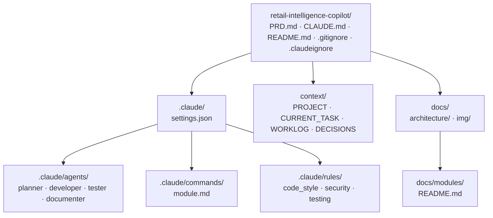

# Repo evolution — what grows each module

A visual tracker of the repository structure as the build progresses. One
snapshot per module; **highlighted (amber) rectangles = nodes added or changed
since the previous snapshot.** Folder nodes list their files inline. Build
artifacts (`__pycache__`, `.ruff_cache`, `.pytest_cache`, `node_modules`,
`*.egg-info`) are gitignored and omitted.

> Legend: plain box = existing · **amber box = new/changed this module**.

---

## Snapshot 0 — Initial scaffolding (before M1)

The orchestration backbone only; no application code yet.

---

## Snapshot 1 — After M1 (Foundations)

Adds the app skeleton (`backend/ frontend/ infra/`), CI, cost tracking, the M1
spec and its module note. (`docs/testing/` and the PRD versioning note were
process-doc additions made alongside M1.)

```mermaid
flowchart TB
    ROOT["retail-intelligence-copilot/<br/>PRD.md · CLAUDE.md · README.md · .gitignore · .claudeignore"]
    CLA[".claude/<br/>settings.json"]
    AG[".claude/agents/<br/>planner · developer · tester · documenter"]
    CM[".claude/commands/<br/>module.md"]
    RU[".claude/rules/<br/>code_style · security · testing"]
    CX["context/<br/>PROJECT · CURRENT_TASK · WORKLOG · DECISIONS"]
    DC["docs/<br/>architecture/ · img/"]
    DM["docs/modules/<br/>README.md · M1_foundations.md"]

    SPEC[".claude/specs/<br/>M1_foundations.md"]
    COST["COST.md"]
    GH[".github/workflows/<br/>ci.yml"]
    BE["backend/<br/>pyproject.toml · .env.example"]
    BEAPP["app/<br/>config.py · cost.py · main.py"]
    BEPKG["agents/ · retrieval/ · governance/ · eval/<br/>(package stubs)"]
    BET["tests/<br/>test_cost.py · test_health.py"]
    FE["frontend/<br/>index.html · package.json · tsconfig.json"]
    FES["src/<br/>App.tsx · main.tsx"]
    INF["infra/<br/>main.bicep · budget.bicep · main.bicepparam · teardown.sh · README.md"]
    DATA["data/<br/>.gitkeep"]
    DT["docs/testing/<br/>unit-testing.md · sit.md"]

    ROOT --> CLA
    CLA --> AG
    CLA --> CM
    CLA --> RU
    CLA --> SPEC
    ROOT --> CX
    ROOT --> DC
    DC --> DM
    DC --> DT
    ROOT --> COST
    ROOT --> GH
    ROOT --> BE
    BE --> BEAPP
    BE --> BEPKG
    BE --> BET
    ROOT --> FE
    FE --> FES
    ROOT --> INF
    ROOT --> DATA

    classDef new fill:#fff3bf,stroke:#f08c00,stroke-width:3px,color:#000;
    class SPEC,COST,GH,BE,BEAPP,BEPKG,BET,FE,FES,INF,DATA,DM,DT new;
```

**Added/changed this module:**
- `.claude/specs/M1_foundations.md` · `docs/modules/M1_foundations.md`
- `COST.md` · `.github/workflows/ci.yml`
- `backend/` (pyproject.toml, .env.example; `app/`: config.py, cost.py, main.py; `agents/ retrieval/ governance/ eval/` stubs; `tests/`: test_cost.py, test_health.py)
- `frontend/` (Vite React-TS: index.html, package.json, tsconfig.json; `src/`: App.tsx, main.tsx)
- `infra/` (main.bicep, budget.bicep, main.bicepparam, teardown.sh, README.md)
- `data/.gitkeep`
- `docs/testing/` (unit-testing.md, sit.md) — process docs

---

## Snapshot 2 — After M2 (Data ingestion & ETL)

Fills out `data/` with the medallion ETL (`data/etl/` + tests + a committed
sample), adds the M2 spec and module note, and extends `backend/app/config.py`
and `backend/.env.example` with the ETL/PII settings. Generated lake layers
(`data/bronze|silver|gold`) are gitignored and omitted here.

```mermaid
flowchart TB
    ROOT["retail-intelligence-copilot/<br/>PRD.md · CLAUDE.md · README.md · .gitignore · .claudeignore"]
    CLA[".claude/<br/>settings.json"]
    AG[".claude/agents/<br/>planner · developer · tester · documenter"]
    CM[".claude/commands/<br/>module.md"]
    RU[".claude/rules/<br/>code_style · security · testing"]
    CX["context/<br/>PROJECT · CURRENT_TASK · WORKLOG · DECISIONS"]
    DC["docs/<br/>architecture/ · img/ · repo-evolution.md"]
    DM["docs/modules/<br/>README.md · M1_foundations.md · M2_data_ingestion_etl.md"]

    SPEC[".claude/specs/<br/>M1_foundations.md · M2_data_ingestion_etl.md"]
    COST["COST.md"]
    GH[".github/workflows/<br/>ci.yml"]
    BE["backend/<br/>pyproject.toml · .env.example"]
    BEAPP["app/<br/>config.py · cost.py · main.py"]
    BEPKG["agents/ · retrieval/ · governance/ · eval/<br/>(package stubs)"]
    BET["tests/<br/>test_cost.py · test_health.py"]
    FE["frontend/<br/>index.html · package.json · tsconfig.json"]
    FES["src/<br/>App.tsx · main.tsx"]
    INF["infra/<br/>main.bicep · budget.bicep · main.bicepparam · teardown.sh · README.md"]
    DATA["data/<br/>pyproject.toml"]
    DETL["data/etl/<br/>spark_session · storage · bronze · silver · gold · pipeline"]
    DSAMP["data/sample/<br/>amazon_reviews_sample.jsonl"]
    DTST["data/tests/<br/>test_storage · test_bronze · test_silver · test_gold"]
    DT["docs/testing/<br/>unit-testing.md · sit.md"]

    ROOT --> CLA
    CLA --> AG
    CLA --> CM
    CLA --> RU
    CLA --> SPEC
    ROOT --> CX
    ROOT --> DC
    DC --> DM
    DC --> DT
    ROOT --> COST
    ROOT --> GH
    ROOT --> BE
    BE --> BEAPP
    BE --> BEPKG
    BE --> BET
    ROOT --> FE
    FE --> FES
    ROOT --> INF
    ROOT --> DATA
    DATA --> DETL
    DATA --> DSAMP
    DATA --> DTST

    classDef new fill:#fff3bf,stroke:#f08c00,stroke-width:3px,color:#000;
    class SPEC,DM,DETL,DSAMP,DTST,DATA,BEAPP,BE new;
```

**Added/changed this module:**
- `.claude/specs/M2_data_ingestion_etl.md` · `docs/modules/M2_data_ingestion_etl.md`
- `data/pyproject.toml` (pyspark, delta-spark; ruff/black)
- `data/etl/` (spark_session.py, storage.py, bronze.py, silver.py, gold.py, pipeline.py)
- `data/sample/amazon_reviews_sample.jsonl` (40 synthetic rows)
- `data/tests/` (test_storage.py, test_bronze.py, test_silver.py, test_gold.py)
- `backend/app/config.py` (ETL + PII `Settings` keys) · `backend/.env.example` (new keys documented)

---

## Snapshot 3 — After M3 (Indexing)

Builds out `backend/retrieval/` (embedding + vector-store adapters, chunking,
the two indexers) and adds the authored doc corpus under `data/docs/`, a local
pgvector `infra/docker-compose.yml`, the M3 spec + module note, and new
`backend/app/config.py` / `.env.example` indexing settings. The generated
`chunks` table lives in Postgres (Docker), not the repo, so it is omitted here.

```mermaid
flowchart TB
    ROOT["retail-intelligence-copilot/<br/>PRD.md · CLAUDE.md · README.md · .gitignore · .claudeignore"]
    CLA[".claude/<br/>settings.json"]
    AG[".claude/agents/<br/>planner · developer · tester · documenter"]
    CM[".claude/commands/<br/>module.md"]
    RU[".claude/rules/<br/>code_style · security · testing"]
    CX["context/<br/>PROJECT · CURRENT_TASK · WORKLOG · DECISIONS"]
    DC["docs/<br/>architecture/ · img/ · repo-evolution.md"]
    DM["docs/modules/<br/>README · M1_foundations · M2_data_ingestion_etl · M3_indexing"]

    SPEC[".claude/specs/<br/>M1 · M2 · M3_indexing"]
    COST["COST.md"]
    GH[".github/workflows/<br/>ci.yml"]
    BE["backend/<br/>pyproject.toml · .env.example"]
    BEAPP["app/<br/>config.py · cost.py · main.py"]
    BERET["retrieval/<br/>embeddings · schema · vector_store · chunking · index_reviews · index_docs"]
    BEPKG["agents/ · governance/ · eval/<br/>(package stubs)"]
    BET["tests/<br/>test_cost · test_health · test_embeddings · test_vector_store · test_index_reviews · test_index_docs"]
    FE["frontend/<br/>index.html · package.json · tsconfig.json"]
    FES["src/<br/>App.tsx · main.tsx"]
    INF["infra/<br/>main.bicep · budget.bicep · main.bicepparam · teardown.sh · docker-compose.yml · README.md"]
    DATA["data/<br/>pyproject.toml"]
    DETL["data/etl/<br/>spark_session · storage · bronze · silver · gold · pipeline"]
    DSAMP["data/sample/<br/>amazon_reviews_sample.jsonl"]
    DDOCS["data/docs/<br/>authored/ (18 md) · manuals/ (4 pdf) · make_manual_pdfs.py"]
    DTST["data/tests/<br/>test_storage · test_bronze · test_silver · test_gold"]
    DT["docs/testing/<br/>unit-testing.md · sit.md"]

    ROOT --> CLA
    CLA --> AG
    CLA --> CM
    CLA --> RU
    CLA --> SPEC
    ROOT --> CX
    ROOT --> DC
    DC --> DM
    DC --> DT
    ROOT --> COST
    ROOT --> GH
    ROOT --> BE
    BE --> BEAPP
    BE --> BERET
    BE --> BEPKG
    BE --> BET
    ROOT --> FE
    FE --> FES
    ROOT --> INF
    ROOT --> DATA
    DATA --> DETL
    DATA --> DSAMP
    DATA --> DDOCS
    DATA --> DTST

    classDef new fill:#fff3bf,stroke:#f08c00,stroke-width:3px,color:#000;
    class SPEC,DM,BERET,BET,BEAPP,BE,INF,DDOCS,DATA new;
```

**Added/changed this module:**
- `.claude/specs/M3_indexing.md` · `docs/modules/M3_indexing.md`
- `backend/retrieval/` (embeddings.py, schema.py, vector_store.py, chunking.py, index_reviews.py, index_docs.py) — was a package stub, now the indexing layer
- `backend/tests/` (test_embeddings.py, test_vector_store.py, test_index_reviews.py, test_index_docs.py)
- `backend/app/config.py` (embedding/vector-store `Settings` keys) · `backend/.env.example` (new keys + local `DATABASE_URL` hint)
- `backend/pyproject.toml` (sentence-transformers, pgvector, psycopg[binary], deltalake[pyarrow], pypdf; `docs-gen` extra = reportlab)
- `data/docs/authored/` (18 policy/manual md docs) · `data/docs/manuals/` (4 synthetic PDFs) · `data/docs/make_manual_pdfs.py`
- `infra/docker-compose.yml` (local `pgvector/pgvector:pg16` for tests/dev)

## Snapshot 4 — After M4 (Retrieval & agents)

Turns the `backend/agents/` package stub into the query-time agent layer (LLM
seam, router, SQL agent, the two RAG agents, composer, pipeline), adds
`hybrid.py` + `rerank.py` to `backend/retrieval/` (extending `schema.py` with a
GIN full-text index and `vector_store.py` with keyword search + the `build_where`
scope choke point), exposes `POST /query` in `backend/app/main.py`, and adds the
M4 spec + module note and new `config.py` / `.env.example` retrieval/LLM settings.

```mermaid
flowchart TB
    ROOT["retail-intelligence-copilot/<br/>PRD.md · CLAUDE.md · README.md · .gitignore · .claudeignore"]
    CLA[".claude/<br/>settings.json"]
    AG[".claude/agents/<br/>planner · developer · tester · documenter"]
    CM[".claude/commands/<br/>module.md"]
    RU[".claude/rules/<br/>code_style · security · testing"]
    CX["context/<br/>PROJECT · CURRENT_TASK · WORKLOG · DECISIONS"]
    DC["docs/<br/>architecture/ · img/ · repo-evolution.md"]
    DM["docs/modules/<br/>README · M1 · M2 · M3 · M4_retrieval_agents"]

    SPEC[".claude/specs/<br/>M1 · M2 · M3 · M4_retrieval_agents"]
    COST["COST.md"]
    GH[".github/workflows/<br/>ci.yml"]
    BE["backend/<br/>pyproject.toml · .env.example"]
    BEAPP["app/<br/>config.py · cost.py · main.py (+ /query)"]
    BEAGT["agents/<br/>llm · router · sql_agent · review_rag · docs_rag · _rag · composer · pipeline"]
    BERET["retrieval/<br/>embeddings · schema · vector_store · chunking · index_reviews · index_docs · hybrid · rerank"]
    BEPKG["governance/ · eval/<br/>(package stubs)"]
    BET["tests/<br/>+ test_llm · test_hybrid · test_rag_agents · test_sql_agent · test_router · test_composer · test_pipeline"]
    FE["frontend/<br/>index.html · package.json · tsconfig.json"]
    FES["src/<br/>App.tsx · main.tsx"]
    INF["infra/<br/>main.bicep · budget.bicep · main.bicepparam · teardown.sh · docker-compose.yml · README.md"]
    DATA["data/<br/>pyproject.toml"]
    DETL["data/etl/<br/>spark_session · storage · bronze · silver · gold · pipeline"]
    DSAMP["data/sample/<br/>amazon_reviews_sample.jsonl"]
    DDOCS["data/docs/<br/>authored/ (18 md) · manuals/ (4 pdf) · make_manual_pdfs.py"]
    DTST["data/tests/<br/>test_storage · test_bronze · test_silver · test_gold"]
    DT["docs/testing/<br/>unit-testing.md · sit.md"]

    ROOT --> CLA
    CLA --> AG
    CLA --> CM
    CLA --> RU
    CLA --> SPEC
    ROOT --> CX
    ROOT --> DC
    DC --> DM
    DC --> DT
    ROOT --> COST
    ROOT --> GH
    ROOT --> BE
    BE --> BEAPP
    BE --> BEAGT
    BE --> BERET
    BE --> BEPKG
    BE --> BET
    ROOT --> FE
    FE --> FES
    ROOT --> INF
    ROOT --> DATA
    DATA --> DETL
    DATA --> DSAMP
    DATA --> DDOCS
    DATA --> DTST

    classDef new fill:#fff3bf,stroke:#f08c00,stroke-width:3px,color:#000;
    class SPEC,DM,BEAGT,BERET,BEAPP,BET,BE new;
```

**Added/changed this module:**
- `.claude/specs/M4_retrieval_agents.md` · `docs/modules/M4_retrieval_agents.md`
- `backend/agents/` (llm.py, router.py, sql_agent.py, review_rag.py, docs_rag.py, _rag.py, composer.py, pipeline.py) — was a package stub, now the query-time agent layer
- `backend/retrieval/` +hybrid.py, +rerank.py; `schema.py` (GIN full-text index), `vector_store.py` (keyword_query + `build_where` scope choke point)
- `backend/app/main.py` (`POST /query`)
- `backend/tests/` (test_llm, test_hybrid, test_rag_agents, test_sql_agent, test_router, test_composer, test_pipeline)
- `backend/app/config.py` (LLM/rerank/retrieval `Settings` keys) · `backend/.env.example` (new keys documented)
- `backend/pyproject.toml` (duckdb)

---

## Snapshot 5 — After M5 (Conversation & memory)

Adds a new `backend/memory/` package (the memory store, the manager, their
schema) reusing the existing pgvector Docker Postgres for three plain relational
tables (`threads`, `messages`, `user_memory`); threads an additive `context`
kwarg through `backend/agents/router.py` + `composer.py`; makes
`backend/agents/pipeline.py` memory-aware (`answer(..., *, thread_id, user_id)`,
one-time `ensure_memory_schema`, `audit["memory"]`, failure guard) and extends
`backend/app/main.py` `POST /query` with optional `thread_id`/`user_id`; adds the
M5 spec + module note and new `config.py` / `.env.example` memory settings. The
memory tables live in Postgres (Docker), not the repo, so they are omitted here.

```mermaid
flowchart TB
    ROOT["retail-intelligence-copilot/<br/>PRD.md · CLAUDE.md · README.md · .gitignore · .claudeignore"]
    CLA[".claude/<br/>settings.json"]
    AG[".claude/agents/<br/>planner · developer · tester · documenter"]
    CM[".claude/commands/<br/>module.md"]
    RU[".claude/rules/<br/>code_style · security · testing"]
    CX["context/<br/>PROJECT · CURRENT_TASK · WORKLOG · DECISIONS"]
    DC["docs/<br/>architecture/ · img/ · repo-evolution.md"]
    DM["docs/modules/<br/>README · M1 · M2 · M3 · M4 · M5_conversation_memory"]

    SPEC[".claude/specs/<br/>M1 · M2 · M3 · M4 · M5_conversation_memory"]
    COST["COST.md"]
    GH[".github/workflows/<br/>ci.yml"]
    BE["backend/<br/>pyproject.toml · .env.example"]
    BEAPP["app/<br/>config.py · cost.py · main.py (+ thread_id/user_id)"]
    BEAGT["agents/<br/>llm · router (+context) · sql_agent · review_rag · docs_rag · _rag · composer (+context) · pipeline (+memory)"]
    BEMEM["memory/<br/>schema · store · manager"]
    BERET["retrieval/<br/>embeddings · schema · vector_store · chunking · index_reviews · index_docs · hybrid · rerank"]
    BEPKG["governance/ · eval/<br/>(package stubs)"]
    BET["tests/<br/>+ test_memory_store · test_memory_manager · test_pipeline_memory"]
    FE["frontend/<br/>index.html · package.json · tsconfig.json"]
    FES["src/<br/>App.tsx · main.tsx"]
    INF["infra/<br/>main.bicep · budget.bicep · main.bicepparam · teardown.sh · docker-compose.yml · README.md"]
    DATA["data/<br/>pyproject.toml"]
    DETL["data/etl/<br/>spark_session · storage · bronze · silver · gold · pipeline"]
    DSAMP["data/sample/<br/>amazon_reviews_sample.jsonl"]
    DDOCS["data/docs/<br/>authored/ (18 md) · manuals/ (4 pdf) · make_manual_pdfs.py"]
    DTST["data/tests/<br/>test_storage · test_bronze · test_silver · test_gold"]
    DT["docs/testing/<br/>unit-testing.md · sit.md"]

    ROOT --> CLA
    CLA --> AG
    CLA --> CM
    CLA --> RU
    CLA --> SPEC
    ROOT --> CX
    ROOT --> DC
    DC --> DM
    DC --> DT
    ROOT --> COST
    ROOT --> GH
    ROOT --> BE
    BE --> BEAPP
    BE --> BEAGT
    BE --> BEMEM
    BE --> BERET
    BE --> BEPKG
    BE --> BET
    ROOT --> FE
    FE --> FES
    ROOT --> INF
    ROOT --> DATA
    DATA --> DETL
    DATA --> DSAMP
    DATA --> DDOCS
    DATA --> DTST

    classDef new fill:#fff3bf,stroke:#f08c00,stroke-width:3px,color:#000;
    class SPEC,DM,BEMEM,BEAGT,BEAPP,BET,BE new;
```

**Added/changed this module:**
- `.claude/specs/M5_conversation_memory.md` · `docs/modules/M5_conversation_memory.md`
- `backend/memory/` (NEW package: schema.py = `memory_ddl()` + table constants + row models; store.py = `MemoryStore` + `get_memory_store()` + `trim_memory`; manager.py = `Turn`, `MemoryContext`, `MemoryManager.load`/`persist`)
- `backend/agents/router.py` + `composer.py` (additive `context=None` kwarg; render block prepended to the LLM `user` message only)
- `backend/agents/pipeline.py` (`answer(..., *, thread_id, user_id)`, `ensure_memory_schema` one-time guard, `audit["memory"]` block, memory-failure guard)
- `backend/app/main.py` (`QueryRequest`/`QueryResponse` gain optional `thread_id`/`user_id`; thread created when `user_id` given without one)
- `backend/tests/` (test_memory_store.py, test_memory_manager.py, test_pipeline_memory.py)
- `backend/app/config.py` (`memory_enabled`, `memory_history_turns`, `memory_summary_max_tokens`, `memory_max_items`) · `backend/.env.example` (new keys documented)
- `backend/pyproject.toml` (`memory` added to setuptools packages)

---

## Snapshot 6 — After M6 (Governance)

Turns the `backend/governance/` package stub into the governance layer (access
policy, PII, grounding gate, audit-log store) and wires it into the existing
agents and memory: `router.py` delegates `derive_scope` to the policy,
`composer.py` delegates grounding + scrubs the answer, `pipeline.py` maps
`AccessDenied` → 502 and best-effort-writes the audit row, `memory/store.py` +
`manager.py` gain the scope filter + ownership check, and `data/etl/silver.py`
imports the shared PII patterns. Adds the M6 spec + module note, a new
`audit_enabled` setting, and five governance test files. The `audit_log` table
(and the memory tables) live in Postgres (Docker), not the repo, so they are
omitted here. (`eval/` is the last remaining package stub.)

```mermaid
flowchart TB
    ROOT["retail-intelligence-copilot/<br/>PRD.md · CLAUDE.md · README.md · .gitignore · .claudeignore"]
    CLA[".claude/<br/>settings.json"]
    AG[".claude/agents/<br/>planner · developer · tester · documenter"]
    CM[".claude/commands/<br/>module.md"]
    RU[".claude/rules/<br/>code_style · security · testing"]
    CX["context/<br/>PROJECT · CURRENT_TASK · WORKLOG · DECISIONS"]
    DC["docs/<br/>architecture/ · img/ · repo-evolution.md"]
    DM["docs/modules/<br/>README · M1 · M2 · M3 · M4 · M5 · M6_governance"]

    SPEC[".claude/specs/<br/>M1 · M2 · M3 · M4 · M5 · M6_governance"]
    COST["COST.md"]
    GH[".github/workflows/<br/>ci.yml"]
    BE["backend/<br/>pyproject.toml · .env.example"]
    BEAPP["app/<br/>config.py (+audit_enabled) · cost.py · main.py"]
    BEAGT["agents/<br/>llm · router (→policy) · sql_agent · review_rag · docs_rag · _rag · composer (→grounding +redact) · pipeline (+access/audit)"]
    BEGOV["governance/<br/>policy · pii · grounding · audit"]
    BEMEM["memory/<br/>schema · store (+owner check/scope) · manager (+role)"]
    BERET["retrieval/<br/>embeddings · schema · vector_store · chunking · index_reviews · index_docs · hybrid · rerank"]
    BEPKG["eval/<br/>(package stub)"]
    BET["tests/<br/>+ test_access_policy · test_memory_access · test_pii · test_grounding · test_audit_log"]
    FE["frontend/<br/>index.html · package.json · tsconfig.json"]
    FES["src/<br/>App.tsx · main.tsx"]
    INF["infra/<br/>main.bicep · budget.bicep · main.bicepparam · teardown.sh · docker-compose.yml · README.md"]
    DATA["data/<br/>pyproject.toml"]
    DETL["data/etl/<br/>spark_session · storage · bronze · silver (→governance.pii) · gold · pipeline"]
    DSAMP["data/sample/<br/>amazon_reviews_sample.jsonl"]
    DDOCS["data/docs/<br/>authored/ (18 md) · manuals/ (4 pdf) · make_manual_pdfs.py"]
    DTST["data/tests/<br/>test_storage · test_bronze · test_silver · test_gold"]
    DT["docs/testing/<br/>unit-testing.md · sit.md"]

    ROOT --> CLA
    CLA --> AG
    CLA --> CM
    CLA --> RU
    CLA --> SPEC
    ROOT --> CX
    ROOT --> DC
    DC --> DM
    DC --> DT
    ROOT --> COST
    ROOT --> GH
    ROOT --> BE
    BE --> BEAPP
    BE --> BEAGT
    BE --> BEGOV
    BE --> BEMEM
    BE --> BERET
    BE --> BEPKG
    BE --> BET
    ROOT --> FE
    FE --> FES
    ROOT --> INF
    ROOT --> DATA
    DATA --> DETL
    DATA --> DSAMP
    DATA --> DDOCS
    DATA --> DTST

    classDef new fill:#fff3bf,stroke:#f08c00,stroke-width:3px,color:#000;
    class SPEC,DM,BEGOV,BEAGT,BEMEM,BEAPP,BET,DETL,BE new;
```

**Added/changed this module:**
- `.claude/specs/M6_governance.md` · `docs/modules/M6_governance.md`
- `backend/governance/` (was a package stub, now the governance layer): policy.py (`ACCESS_POLICY`, `scope_for_role`, `AccessDenied`), pii.py (`EMAIL_PATTERN`/`PHONE_PATTERN` + `redact`), grounding.py (`enforce_grounding` + `CITE`), audit.py (`audit_ddl`, `AuditStore`, `get_audit_store`, `ensure_audit_schema`, `record_audit`)
- `backend/agents/router.py` (`derive_scope` → `scope_for_role`), `composer.py` (delegates to `enforce_grounding`; `redact(answer)` on both paths), `pipeline.py` (`AccessDenied`→502; best-effort audit write; threads `role` into memory)
- `backend/memory/store.py` (owner check on `append_message`; scope filter on `list_memory`) · `manager.py` (`load`/`persist` take `role`, call `scope_for_role`)
- `data/etl/silver.py` (imports the shared `EMAIL_PATTERN`/`PHONE_PATTERN` from `governance.pii`; local regexes removed)
- `backend/tests/` (test_access_policy.py, test_memory_access.py, test_pii.py, test_grounding.py, test_audit_log.py)
- `backend/app/config.py` (`audit_enabled`, default true) · `backend/.env.example` (`AUDIT_ENABLED`)

---

## Snapshot 7 — After M7 (Evaluation)

Turns the last `backend/eval/` package stub into the evaluation layer (pure
metric primitives, the retrieval and answer harnesses, the `run_eval` CI-gate
runner, config-driven `thresholds.json`, and a small authored `ground_truth/`
set), adds the five eval test files, a new `eval_judge` setting, and an `eval`
job to `.github/workflows/ci.yml` (pgvector service, free mode, HF model cache +
pre-fetch). Reuse-only: no pipeline/agents/retrieval/governance/memory code
changed. All `backend/` package stubs are now filled.

```mermaid
flowchart TB
    ROOT["retail-intelligence-copilot/<br/>PRD.md · CLAUDE.md · README.md · .gitignore · .claudeignore"]
    CLA[".claude/<br/>settings.json"]
    AG[".claude/agents/<br/>planner · developer · tester · documenter"]
    CM[".claude/commands/<br/>module.md"]
    RU[".claude/rules/<br/>code_style · security · testing"]
    CX["context/<br/>PROJECT · CURRENT_TASK · WORKLOG · DECISIONS"]
    DC["docs/<br/>architecture/ · img/ · repo-evolution.md"]
    DM["docs/modules/<br/>README · M1 · M2 · M3 · M4 · M5 · M6 · M7_evaluation"]

    SPEC[".claude/specs/<br/>M1 · M2 · M3 · M4 · M5 · M6 · M7_evaluation"]
    COST["COST.md"]
    GH[".github/workflows/<br/>ci.yml (+eval job)"]
    BE["backend/<br/>pyproject.toml · .env.example"]
    BEAPP["app/<br/>config.py (+eval_judge) · cost.py · main.py"]
    BEAGT["agents/<br/>llm · router · sql_agent · review_rag · docs_rag · _rag · composer · pipeline"]
    BEGOV["governance/<br/>policy · pii · grounding · audit"]
    BEMEM["memory/<br/>schema · store · manager"]
    BERET["retrieval/<br/>embeddings · schema · vector_store · chunking · index_reviews · index_docs · hybrid · rerank"]
    BEEVAL["eval/<br/>metrics · retrieval_eval · answer_eval · run_eval · thresholds.json · ground_truth/"]
    BET["tests/<br/>+ test_eval_metrics · test_eval_retrieval · test_eval_answer · test_eval_gate"]
    FE["frontend/<br/>index.html · package.json · tsconfig.json"]
    FES["src/<br/>App.tsx · main.tsx"]
    INF["infra/<br/>main.bicep · budget.bicep · main.bicepparam · teardown.sh · docker-compose.yml · README.md"]
    DATA["data/<br/>pyproject.toml"]
    DETL["data/etl/<br/>spark_session · storage · bronze · silver · gold · pipeline"]
    DSAMP["data/sample/<br/>amazon_reviews_sample.jsonl"]
    DDOCS["data/docs/<br/>authored/ (18 md) · manuals/ (4 pdf) · make_manual_pdfs.py"]
    DTST["data/tests/<br/>test_storage · test_bronze · test_silver · test_gold"]
    DT["docs/testing/<br/>unit-testing.md · sit.md"]

    ROOT --> CLA
    CLA --> AG
    CLA --> CM
    CLA --> RU
    CLA --> SPEC
    ROOT --> CX
    ROOT --> DC
    DC --> DM
    DC --> DT
    ROOT --> COST
    ROOT --> GH
    ROOT --> BE
    BE --> BEAPP
    BE --> BEAGT
    BE --> BEGOV
    BE --> BEMEM
    BE --> BERET
    BE --> BEEVAL
    BE --> BET
    ROOT --> FE
    FE --> FES
    ROOT --> INF
    ROOT --> DATA
    DATA --> DETL
    DATA --> DSAMP
    DATA --> DDOCS
    DATA --> DTST

    classDef new fill:#fff3bf,stroke:#f08c00,stroke-width:3px,color:#000;
    class SPEC,DM,BEEVAL,BEAPP,BET,GH,BE new;
```

**Added/changed this module:**
- `.claude/specs/M7_evaluation.md` · `docs/modules/M7_evaluation.md`
- `backend/eval/` (was a package stub, now the evaluation layer): metrics.py (`recall_at_k`, `mrr`, `percentile`, `mean`), retrieval_eval.py (`evaluate_retrieval`, `ensure_docs_indexed`), answer_eval.py (`evaluate_answers`, `answer_docs`, `judge_deterministic`, `judge_llm`), run_eval.py (`main`, `load_thresholds`), thresholds.json, ground_truth/ (retrieval.json, answers.json — 10 items each)
- `backend/tests/` (test_eval_metrics.py, test_eval_retrieval.py, test_eval_answer.py, test_eval_gate.py)
- `backend/app/config.py` (`eval_judge`, default `deterministic`) · `backend/.env.example` (`EVAL_JUDGE`)
- `.github/workflows/ci.yml` (new `eval` job: pgvector service, `PROVIDER_MODE=free`, HF cache + pre-fetch, `python -m eval.run_eval`)

---

## Snapshot 8 — After M8 (Serving & UI)

Makes the existing API browser-ready and builds the React chat UI on top. Backend:
`app/main.py` gains `CORSMiddleware` (origin from new `Settings.cors_allow_origins`),
`GET /roles` (from `governance.policy.ACCESS_POLICY`), and an unknown-role → 400 edge
check in `/query`; `test_serving_api.py` is added. Frontend: fills out the bare Vite
scaffold with `vite.config.ts`, a typed `src/api/` client (`types.ts` mirroring the
backend contract, `client.ts` reading `VITE_API_BASE_URL`), a rewritten `App.tsx` chat
container, `components/` (`MessageList`, `Citations`), `App.css`, `vite-env.d.ts`, and
`.env.example`. Deploy (inert, $0): `backend/Dockerfile` + `frontend/Dockerfile`
(+`.dockerignore` each), an inert `infra/webapp.bicep` stub (M1 style), and a build-only
`frontend` job added to `.github/workflows/ci.yml`. No retrieval/agents/governance/memory
logic changed.

```mermaid
flowchart TB
    ROOT["retail-intelligence-copilot/<br/>PRD.md · CLAUDE.md · README.md · .gitignore · .claudeignore"]
    CLA[".claude/<br/>settings.json"]
    AG[".claude/agents/<br/>planner · developer · tester · documenter"]
    CM[".claude/commands/<br/>module.md"]
    RU[".claude/rules/<br/>code_style · security · testing"]
    CX["context/<br/>PROJECT · CURRENT_TASK · WORKLOG · DECISIONS"]
    DC["docs/<br/>architecture/ · img/ · repo-evolution.md"]
    DM["docs/modules/<br/>README · M1 · M2 · M3 · M4 · M5 · M6 · M7 · M8_serving_ui"]

    SPEC[".claude/specs/<br/>M1 · M2 · M3 · M4 · M5 · M6 · M7 · M8_serving_ui"]
    COST["COST.md"]
    GH[".github/workflows/<br/>ci.yml (+frontend job)"]
    BE["backend/<br/>pyproject.toml · .env.example · Dockerfile · .dockerignore"]
    BEAPP["app/<br/>config.py (+cors) · cost.py · main.py (+CORS +/roles +400)"]
    BEAGT["agents/<br/>llm · router · sql_agent · review_rag · docs_rag · _rag · composer · pipeline"]
    BEGOV["governance/<br/>policy · pii · grounding · audit"]
    BEMEM["memory/<br/>schema · store · manager"]
    BERET["retrieval/<br/>embeddings · schema · vector_store · chunking · index_reviews · index_docs · hybrid · rerank"]
    BEEVAL["eval/<br/>metrics · retrieval_eval · answer_eval · run_eval · thresholds.json · ground_truth/"]
    BET["tests/<br/>+ test_serving_api"]
    FE["frontend/<br/>index.html · package.json · tsconfig.json · vite.config.ts · .env.example · Dockerfile · .dockerignore"]
    FES["src/<br/>App.tsx (chat) · main.tsx · App.css · vite-env.d.ts"]
    FEAPI["src/api/<br/>types · client"]
    FECMP["src/components/<br/>MessageList · Citations"]
    INF["infra/<br/>main.bicep · budget.bicep · main.bicepparam · teardown.sh · docker-compose.yml · webapp.bicep · README.md"]
    DATA["data/<br/>pyproject.toml"]
    DETL["data/etl/<br/>spark_session · storage · bronze · silver · gold · pipeline"]
    DSAMP["data/sample/<br/>amazon_reviews_sample.jsonl"]
    DDOCS["data/docs/<br/>authored/ (18 md) · manuals/ (4 pdf) · make_manual_pdfs.py"]
    DTST["data/tests/<br/>test_storage · test_bronze · test_silver · test_gold"]
    DT["docs/testing/<br/>unit-testing.md · sit.md"]

    ROOT --> CLA
    CLA --> AG
    CLA --> CM
    CLA --> RU
    CLA --> SPEC
    ROOT --> CX
    ROOT --> DC
    DC --> DM
    DC --> DT
    ROOT --> COST
    ROOT --> GH
    ROOT --> BE
    BE --> BEAPP
    BE --> BEAGT
    BE --> BEGOV
    BE --> BEMEM
    BE --> BERET
    BE --> BEEVAL
    BE --> BET
    ROOT --> FE
    FE --> FES
    FES --> FEAPI
    FES --> FECMP
    ROOT --> INF
    ROOT --> DATA
    DATA --> DETL
    DATA --> DSAMP
    DATA --> DDOCS
    DATA --> DTST

    classDef new fill:#fff3bf,stroke:#f08c00,stroke-width:3px,color:#000;
    class SPEC,DM,BEAPP,BET,FE,FES,FEAPI,FECMP,GH,INF,BE new;
```

**Added/changed this module:**
- `.claude/specs/M8_serving_ui.md` · `docs/modules/M8_serving_ui.md`
- `backend/app/main.py` (`CORSMiddleware` from `Settings`, `GET /roles`, unknown-role → 400 edge check) · `backend/app/config.py` (`cors_allow_origins`) · `backend/.env.example` (`CORS_ALLOW_ORIGINS`)
- `backend/tests/test_serving_api.py` (roles body, CORS present/absent, real unknown-role 400)
- `frontend/vite.config.ts` · `frontend/src/api/` (types.ts, client.ts) · `frontend/src/App.tsx` (rewritten chat container) · `frontend/src/components/` (MessageList.tsx, Citations.tsx) · `frontend/src/App.css` · `frontend/src/vite-env.d.ts` · `frontend/.env.example` (`VITE_API_BASE_URL`)
- `backend/Dockerfile` · `backend/.dockerignore` · `frontend/Dockerfile` · `frontend/.dockerignore`
- `infra/webapp.bicep` (inert stub, M1 style)
- `.github/workflows/ci.yml` (new build-only `frontend` job; `backend`/`eval` unchanged)

---

## Snapshot 9 — After M8 v2 (Serving & UI, design-driven rebuild)

Design Track iteration 2: rebuilds the React UI surface on the **unchanged** backend
pipeline, driven by the `design/` package. Backend gains two small, additive,
backward-compatible contract edges only — `backend/agents/composer.py` adds a redacted
`citations[].snippet` (trimmed at the `build_sources()` boundary) and `backend/agents/
pipeline.py` adds `audit.scope={restricted,categories}` from the real retrieval scope;
`tests/test_contract_edges_m8v2.py` added. Frontend is rebuilt from the minimal v1 chat
into a design-system shell: `src/` gains `panelState.ts` (8-state machine), `answer.ts`
(`[n]` parsing), `copy.ts` (authored copy/starters); `src/api/types.ts` gains `snippet` +
a typed `Audit`; `src/App.tsx`/`App.css` rewritten; `src/components/` expands into the
role rail (RoleRail/BrandCard/ScopeCard/SessionCard/ThemeToggle), the conversation panel
(ConversationPanel/UserTurn/AssistantTurn/ClaimLine/ScopeRibbon/CitationChips/TrustStrip),
`shapes/` (Support/Marketing/Executive/Default + Bars/Trend), and the state screens
(EvidencePanel/ErrorBanner/EmptyState/LoadingState); v1 `MessageList`/`Citations` removed.
No retrieval/agents/governance/memory logic changed; deployment stays inert ($0). **Known
gap:** functionally complete but the mockup's visual design is not yet ported (scoped
`/change` follow-up).

```mermaid
flowchart TB
    ROOT["retail-intelligence-copilot/<br/>PRD.md · CLAUDE.md · README.md · .gitignore · .claudeignore"]
    CLA[".claude/<br/>settings.json"]
    AG[".claude/agents/<br/>planner · developer · tester · documenter · designer · solution-architect"]
    CM[".claude/commands/<br/>module.md"]
    RU[".claude/rules/<br/>code_style · security · testing"]
    CX["context/<br/>PROJECT · CURRENT_TASK · WORKLOG · DECISIONS"]
    DC["docs/<br/>architecture/ · img/ · repo-evolution.md"]
    DM["docs/modules/<br/>README · M1 · M2 · M3 · M4 · M5 · M6 · M7 · M8_serving_ui · M8v2_serving_ui"]
    DDES["design/<br/>00_brief · 01_wireframes · 02_decisions · 03_handoff · mockups/m8-chat.html"]

    SPEC[".claude/specs/<br/>M1 · M2 · M3 · M4 · M5 · M6 · M7 · M8_serving_ui · M8v2_serving_ui"]
    COST["COST.md"]
    GH[".github/workflows/<br/>ci.yml (backend · eval · frontend)"]
    BE["backend/<br/>pyproject.toml · .env.example · Dockerfile · .dockerignore"]
    BEAPP["app/<br/>config.py · cost.py · main.py"]
    BEAGT["agents/<br/>llm · router · sql_agent · review_rag · docs_rag · _rag · composer (+snippet) · pipeline (+audit.scope)"]
    BEGOV["governance/<br/>policy · pii · grounding · audit"]
    BEMEM["memory/<br/>schema · store · manager"]
    BERET["retrieval/<br/>embeddings · schema · vector_store · chunking · index_reviews · index_docs · hybrid · rerank"]
    BEEVAL["eval/<br/>metrics · retrieval_eval · answer_eval · run_eval · thresholds.json · ground_truth/"]
    BET["tests/<br/>+ test_contract_edges_m8v2"]
    FE["frontend/<br/>index.html · package.json · tsconfig.json · vite.config.ts · .env.example · Dockerfile · .dockerignore"]
    FES["src/<br/>App.tsx (rebuilt) · main.tsx · App.css (rebuilt) · vite-env.d.ts · panelState · answer · copy"]
    FEAPI["src/api/<br/>types (+snippet +Audit) · client"]
    FECMP["src/components/<br/>RoleRail · BrandCard · ScopeCard · SessionCard · ThemeToggle · ConversationPanel · UserTurn · AssistantTurn · ClaimLine · ScopeRibbon · CitationChips · TrustStrip · EvidencePanel · ErrorBanner · EmptyState · LoadingState"]
    FESHP["src/components/shapes/<br/>Support · Marketing · Executive · Default · Bars · Trend · types"]
    INF["infra/<br/>main.bicep · budget.bicep · main.bicepparam · teardown.sh · docker-compose.yml · webapp.bicep · README.md"]
    DATA["data/<br/>pyproject.toml"]
    DETL["data/etl/<br/>spark_session · storage · bronze · silver · gold · pipeline"]
    DSAMP["data/sample/<br/>amazon_reviews_sample.jsonl"]
    DDOCS["data/docs/<br/>authored/ (18 md) · manuals/ (4 pdf) · make_manual_pdfs.py"]
    DTST["data/tests/<br/>test_storage · test_bronze · test_silver · test_gold"]
    DT["docs/testing/<br/>unit-testing.md · sit.md"]

    ROOT --> CLA
    CLA --> AG
    CLA --> CM
    CLA --> RU
    CLA --> SPEC
    ROOT --> CX
    ROOT --> DC
    DC --> DM
    DC --> DDES
    DC --> DT
    ROOT --> COST
    ROOT --> GH
    ROOT --> BE
    BE --> BEAPP
    BE --> BEAGT
    BE --> BEGOV
    BE --> BEMEM
    BE --> BERET
    BE --> BEEVAL
    BE --> BET
    ROOT --> FE
    FE --> FES
    FES --> FEAPI
    FES --> FECMP
    FECMP --> FESHP
    ROOT --> INF
    ROOT --> DATA
    DATA --> DETL
    DATA --> DSAMP
    DATA --> DDOCS
    DATA --> DTST

    classDef new fill:#fff3bf,stroke:#f08c00,stroke-width:3px,color:#000;
    class SPEC,DM,BEAGT,BET,FES,FEAPI,FECMP,FESHP new;
```

**Added/changed this module:**
- `.claude/specs/M8v2_serving_ui.md` · `docs/modules/M8v2_serving_ui.md`
- `backend/agents/composer.py` (redacted `citations[].snippet` at `build_sources()`) · `backend/agents/pipeline.py` (`audit.scope={restricted,categories}` from `decision.scope`)
- `backend/tests/test_contract_edges_m8v2.py` (snippet PII-redaction + trim, marketing vs executive `audit.scope`)
- `frontend/src/api/types.ts` (`snippet`, typed `Audit`/`Grounding`/`Memory`/`Scope`)
- `frontend/src/App.tsx` + `App.css` (rebuilt) · new `panelState.ts` · `answer.ts` · `copy.ts`
- `frontend/src/components/` — role rail (RoleRail/BrandCard/ScopeCard/SessionCard/ThemeToggle), conversation panel (ConversationPanel/UserTurn/AssistantTurn/ClaimLine/ScopeRibbon/CitationChips/TrustStrip), state screens (EvidencePanel/ErrorBanner/EmptyState/LoadingState), and `shapes/` (Support/Marketing/Executive/Default/Bars/Trend/types)
- Removed superseded v1 `frontend/src/components/MessageList.tsx` · `Citations.tsx`
- Known gap (not a new file): visual design not ported — scoped `/change` follow-up logged in `DECISIONS.md`

---

<!--
Template for each new snapshot:
1. Copy the previous snapshot's Mermaid block.
2. Add the new nodes/edges.
3. Reset the `class ... new;` line to list ONLY the nodes added/changed this module.
4. Fill the "Added/changed this module" bullet list.
-->
